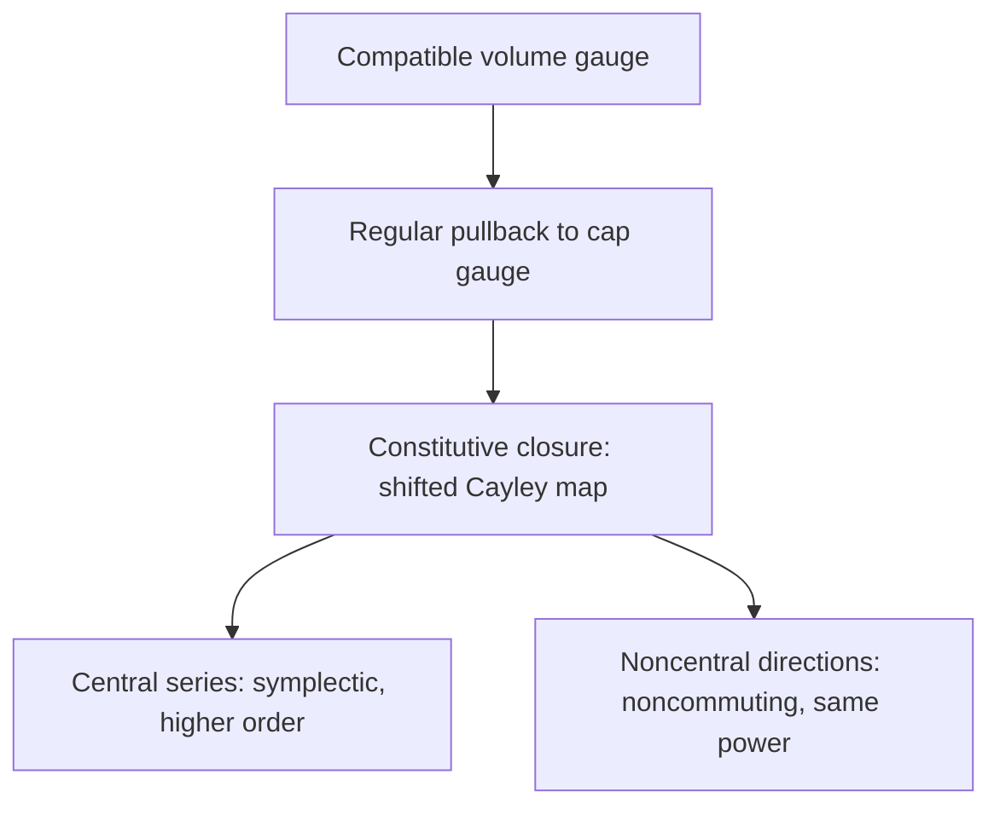
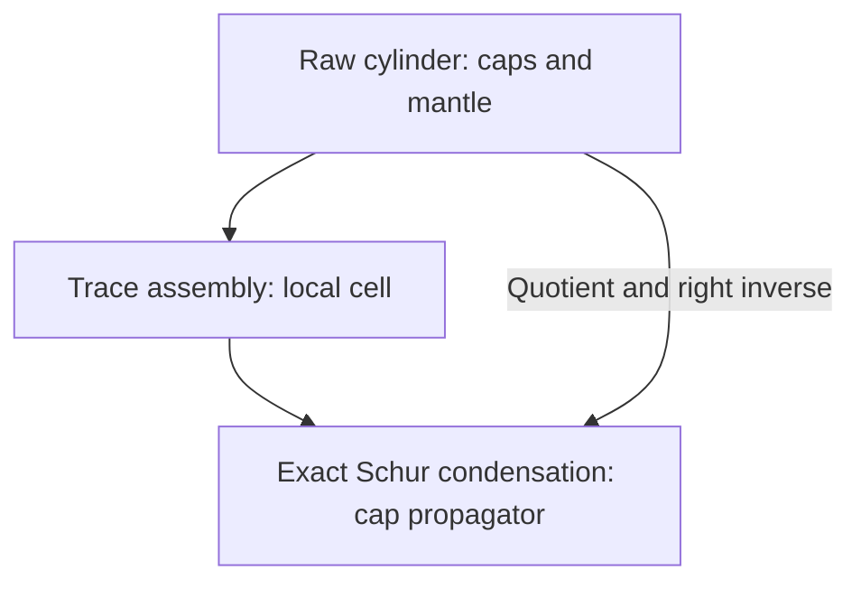

# Space–Time Stokes–Dirac Discretization

**Affine pairing gauges, active temporal stages and port-Hamiltonian simulation**  
Redha Moulla · AXIA, France · 2026

This single manuscript contains the complete version-12 geometric theory and its
extension to active temporal efforts, nonlinear Hamiltonians, physical dissipation
and boundary ports. Proofs, simulation protocols, results and references are
available directly on GitHub. Installation and reproduction commands are in the
[repository README](../README.md).

Sections 1–12 retain the original manuscript's numbering and hypotheses.
Sections 13–23 develop the active-stage extension; their statements and citations
use the prefix **T** to keep the two numbering systems unambiguous.
The [original LaTeX source](../archive/version-12/manuscript.tex) is retained for
provenance. The geometric construction begins with the spatial method of
[Moulla, Lefèvre and Maschke (2012)](https://doi.org/10.1016/j.jcp.2011.10.008).

**Reading routes:** start with [the original classification](#v12-section-2) for
the geometric theory, [the active-stage formulation](#extension-section-14) for
the nonlinear solver, or [the numerical evidence](#extension-section-22) for
reproducible simulations. Energy identities, temporal accuracy and simultaneous
space-time PDE convergence are distinguished throughout.


## Contents

**Geometric foundations and conservative cap construction**

1. [Introduction](#v12-section-1)
2. [The affine Stokes-pairing principle](#v12-section-2)
3. [Stokes' theorem on the space–time cylinder](#v12-section-3)
4. [Discrete cylinders and the full space–time gauge](#v12-section-4)
5. [The complete two-point temporal gauge](#v12-section-5)
6. [The exact symplectic gauge locus](#v12-section-6)
7. [Nonlinear Hamiltonians and the universal segment rule](#v12-section-7)
8. [Multiple stages: classification for invertible stage matrices](#v12-section-8)
9. [Space–time Stokes–Dirac closure and local rigidity](#v12-section-9)
10. [Consequences and discriminating computational validation](#v12-section-10)
11. [Discussion and limitations](#v12-section-11)
12. [Conclusion](#v12-section-12)

**Active-stage extension: nonlinear systems, dissipation and validation**

13. [Purpose and precise scope](#extension-section-13)
14. [Active time cell and constitutive effort](#extension-section-14)
15. [Closure, ports and exact energy balance](#extension-section-15)
16. [Exact recovery of the version-12 mixed cap family](#extension-section-16)
17. [The dissipative obstruction to one-effort compression](#extension-section-17)
18. [Elimination preserves passivity, including the ports](#extension-section-18)
19. [Order, reversal and coordinate covariance](#extension-section-19)
20. [The spatial reduction and a geometrically specified test gauge](#extension-section-20)
21. [Interconnection](#extension-section-21)
22. [Numerical evidence and reproduction](#extension-section-22)
23. [What remains open](#extension-section-23)

[References](#references) · [Reproducibility and provenance](#reproducibility-and-provenance)

---

## Abstract

We classify compatible pairings on a finite-dimensional discrete
space–time cylinder.  For a possibly nonsurjective differential
<i>D</i>:<i>E</i> → <i>F</i>, compatibility exists precisely when the boundary form
annihilates ker <i>D</i>, and the active freedom is
Λ<sup>2</sup>(<i>E</i>/ker <i>D</i>)<sup>∗</sup>.  On a temporal–spatial complex this separates
temporal, spatial, and intrinsic mixed gauges.  A regular interior solve
then yields an exact sequence for their visible and invisible cap
reductions.

For nonsingular quadratic Hamiltonian systems, cap gauges are shifted
Cayley coordinates on the no-+1 part of the energy-orthogonal group;
we determine their exact symplectic locus and defect.  An active polynomial
cell 𝒫<sub><i>s</i></sub> → 𝒫<sub><i>s</i>−1</sub> generates the Gauss–<i>s</i> cap
map by elimination.  On the 2012 polynomial transmission line, mixed
cylinder lifts preserve cap–mantle power, dissipation, and interface
cancellation.  Every alternating cap gauge also admits a minimal
auxiliary-mode Schur generation whose interior dimension equals its rank;
this algebraic realization is distinguished from selection by an
independently prescribed field cell.  For each fixed semidiscrete generator, a unique central
coefficient raises operator convergence from 2<i>s</i> to 2<i>s</i>+2; a
recursive rational hierarchy gives order at least 2<i>s</i>+2<i>r</i>, exact when
the next coefficient is nonzero, while
noncentral additions retain the attained order and leave the scalar
functional calculus.  Its reduced polynomial form separates removable
Cayley-chart resonances from true poles and shows unit amplification on
oscillatory modes but not general <i>A</i>-stability.  The exact coordinate is
a Stieltjes function in <i>z</i><sup>2</sup>, and <i>C</i><sub><i>s</i></sub> is its diagonal or
near-diagonal Padé approximant.  These Gauss coordinates have positive
Jacobi-chain realizations, whereas the corrected hierarchy need not: the
first nontrivial member already violates Stieltjes positivity.  Executable tests verify the reductions, power
laws, asymptotic coefficients, high-order branches, and a multiprecision
noncommutation law.

**Keywords.**
Port-Hamiltonian systems; Stokes–Dirac structures; space–time complexes;
discrete gradients; Gauss collocation; symplecticity; power balance;
geometric numerical integration.

**MSC 2020.**
37M15; 65P10; 65M60; 93C20.

<a name="v12-section-1"></a>

## 1. Introduction

Distributed port-Hamiltonian systems expose boundary power as part of the
geometry rather than as an afterthought
[[33]](#v12-ref-vanderschaft2002), [[17]](#v12-ref-kotyczka2018).  On a space–time cylinder, the
initial and final energies and the lateral power ports are different
components of one oriented boundary.  A discretization that starts from
this cylinder should therefore not be assembled by merely attaching a
time index to a spatial Stokes matrix.  It should possess a total discrete
differential, a global boundary form, and a compatible pairing before a
constitutive law is selected.

Existing structure-preserving spatial discretizations construct a
finite-dimensional Stokes identity whose boundary term becomes a power
port [[20]](#v12-ref-moulla2012), [[29]](#v12-ref-seslija2012), [[4]](#v12-ref-brugnoli2022).  In particular,
discrete-exterior-calculus constructions produce simplicial Dirac
structures on space while retaining continuous time; treating space and
time on equal footing is a distinct extension already identified in that
literature [[29]](#v12-ref-seslija2012).  Passivity-consistent time discretizations
and energy-consistent
Petrov–Galerkin formulations provide complementary temporal closures
[[5]](#v12-ref-celledoni2017), [[12]](#v12-ref-giesselmann2025).  Symplectic Runge–Kutta theory and
collocation identify Gauss–Legendre methods as the canonical collocation
schemes preserving quadratic invariants
[[8]](#v12-ref-cooper1987), [[28]](#v12-ref-sanzserna1988), [[27]](#v12-ref-reich2000), [[14]](#v12-ref-hairer2006).  Discrete-gradient
methods instead preserve a prescribed Hamiltonian exactly, including for
nonlinear Hamiltonians
[[21]](#v12-ref-mclachlan1999), [[13]](#v12-ref-gonzalez1996), [[26]](#v12-ref-quispel2008), [[10]](#v12-ref-eidnes2022).  High-order
segment and line-integral constructions connect this viewpoint to
collocation and Gaussian quadrature
[[15]](#v12-ref-hairer2010), [[3]](#v12-ref-brugnano2010), [[25]](#v12-ref-miyatake2016), [[16]](#v12-ref-kemmochi2023).  Locally exact
discrete-gradient modifications likewise use step- and
linearization-dependent skew operators to reproduce a target linearized
flow while preserving energy [[9]](#v12-ref-cieslinski2013).  The overlap is the
use of a constitutively adapted skew operator.  The present hierarchy is
not claimed as the first such modification: its additional content is the
affine Stokes classification before closure, the exact volume-to-cap
sequence, the central/noncentral split, and the realization of either
direction by a mixed cylinder two-form.

There are established genuinely space–time routes with different primary
structures.  Covariant variational integrators derive a discrete
multisymplectic form formula from a discrete action
[[23]](#v12-ref-marsden1998); space–time finite elements provide arbitrary-order
energy and momentum laws for multisymplectic PDEs
[[6]](#v12-ref-celledoni2021); and HDG/FEEC formulations characterize local
multisymplecticity on numerical traces
[[22]](#v12-ref-mclachlan2020), [[31]](#v12-ref-stern2026), [[32]](#v12-ref-sternzampa2026).  The present construction is
not a claim of priority over those field discretizations and does not
assume a discrete action.  Its different question is to classify all
pairings compatible with a prescribed discrete Stokes formula, transport
their affine freedom through a cell reduction, and identify which mixed
gauges generate boundary maps outside the scalar method-of-lines class.

The common algebraic fact is simple but consequential: a Stokes identity
or a discrete chain rule fixes only the symmetric part of a pairing.  The
remaining freedom is alternating on the quotient by directions invisible
to the differential.  The central question is whether this observation
can be made directly on the space–time cylinder, so that the spatial
freedom found in [[20]](#v12-ref-moulla2012), the temporal discrete-gradient gauge,
and mixed nonseparable pairings become sectors of one object.

This paper answers that question at eight levels.

1. For an arbitrary, possibly nonsurjective, differential
     <i>D</i>:<i>E</i> → <i>F</i>, the active compatible pairings form an affine space over
     Λ<sup>2</sup>(<i>E</i>/ker <i>D</i>)<sup>∗</sup>.  Applied to the genuine total complex through
     a degree-respecting symmetric double, this gives a bilinear gauge between
     complementary active quotients.  Applied instead to the stacked
     one-bidegree cylinder map, it gives temporal, spatial, and mixed sectors.

1. Once a Dirac relation, constitutive closure, boundary causality,
     and regular interior solve have fixed a reconstruction
     <i>L</i><sub><i>h</i></sub>:<i>Q</i><sub>∂</sub> → <i>Q</i><sub>st</sub>, the exact volume-to-cap reduction is
     <i>ω</i> ↦ <i>L</i><sub><i>h</i></sub><sup>∗</sup><i>ω</i>.  We classify its image and kernel and
     derive an intrinsic rank criterion for the visibility of mixed gauges.
     For trace-generated forms, a raw weak cell containing the same volume
     matrix is assembled and exactly realizes the prescribed cap gauge.  We
     state explicitly that this is a realization theorem, not a selection of
     the gauge by independent interior dynamics.

1. For a single time step and a quadratic Hamiltonian, the family
     Λ<sup>2</sup><i>V</i><sup>∗</sup> gives constitutively shifted Cayley coordinates on the
     no-+1 cell of <i>O</i>(<i>Q</i>).  Exact power holds on the whole chart; its symplectic
     intersection and factorized defect are computed explicitly, and the
     exact-flow gauge is obtained in closed form.

1. For an <i>s</i>-stage Runge–Kutta reconstruction with invertible
     stage matrix, all compatible bilinear stage pairings are classified.
     Local diagonal pairing reduces compatibility to the Cooper condition,
     and a short spanning argument proves directly that symplectic
     collocation is precisely Gauss collocation.  Conversely, starting from
     the polynomial temporal cell
     𝒫<sub><i>s</i></sub> → 𝒫<sub><i>s</i>−1</sub>, we retain the Gauss stages as
     active interior variables and prove that their elimination produces the
     diagonal Padé cap map and its induced two-point gauge.

1. For a space–time Stokes–Dirac discretization, Dirac maximality is
     kept separate from the constitutive chain rule.  This yields exact cap
     energy, lateral boundary power, passivity with dissipation, and exact
     cancellation on glued faces.  Under scalar locality, the stacked tensor
     equations force factorization, and maximal exactness then selects
     Gauss–Legendre on each axis.

1. A general rectangular Stokes theorem shows that an invertible
     effort-and-input reconstruction produces a square open representation
     with skew interconnection, dual input/output blocks, and skew
     feedthrough.  This turns the spatial reduction used in the 2012 line
     from a numerical observation into a direct algebraic consequence.

1. On that rectangular transmission-line reduction, a two-form on
     spatial derivatives of temporal increments gives an explicit mixed
     cylinder gauge.  For every <i>s</i>, its cap reduction gives a
     reversible, energy-preserving deformation of Gauss–<i>s</i>.  In the
     fixed one-term ansatz, one central coefficient and only one raises the
     order from 2<i>s</i> to exactly 2<i>s</i>+2; every other fixed coefficient has
     exactly order 2<i>s</i>.  Adding the next odd-power gauge term preserves
     that higher order while permitting noncommutation, and a recursive
     central hierarchy yields successive two-order lower bounds, exact under
     an explicit non-annulation condition.  A commutator
     criterion proves when the resulting method cannot belong to the scalar
     functional calculus of the semidiscrete line.  A dispersion experiment
     turns the gauge into a design variable.

1. Every finite-rank alternating cap gauge has a minimal auxiliary
     Schur generator with interior dimension equal to its rank.  For the
     central scalar coordinates, Stieltjes–Padé theory gives a stronger
     positive Jacobi-chain realization of every Gauss member.  The corrected
     (<i>s</i>,<i>r</i>)=(2,1) coordinate fails this positivity test, separating
     unrestricted algebraic generation from passive interior generation.

The last level exposes the following structural chain without identifying
its distinct notions of positivity:

<a name="v12-eq-gauss-stieltjes-jacobi-chain"></a>
**Equation (1).**

```math

 \boxed{\begin{gathered}
 \text{Gauss}
 \ \Longleftrightarrow\ 
 \text{Padé--Stieltjes}
 \ \Longleftrightarrow\ 
 \text{finite positive measure}\\
 \Longleftrightarrow\ 
 \text{positive Jacobi resolvent}
 \ \Longleftrightarrow\ 
 \text{Stieltjes continued fraction}.
 \end{gathered}}
```

**Scope and novelty.**

The affine Stokes principle, classical Gauss quadrature, symplectic
Runge–Kutta theory, discrete gradients, and the Dirac construction are
established ingredients.  The new contribution is their common
quotient-space formulation on a discrete cylinder: the nonsurjective
classification, the explicit distinction between the total and stacked
differentials, the exact visibility sequence for volume-to-cap reduction,
the intrinsic mixed reduction, the constitutively shifted Cayley
coordinates of cap gauges, the
rectangular reconstruction theorem, the active-stage derivation of the
Gauss cap gauge, the sharp auxiliary Schur existence-and-minimality
construction, the
positive Jacobi realization and its obstruction, the symplectic-locus and defect formulas, the exact
one-term order dichotomy, its multi-term correction hierarchy, tensor
rigidity derived from the global Stokes equations, and the mixed
Gauss–<i>s</i> family with its scalar-functional-calculus obstruction.  The
trace-generated theorem is deliberately described as exact realization;
only the higher-degree stage cell derives its cap gauge from an
independent interior solve.  We do not call an
arbitrary compatible bilinear form a multi-Dirac structure.  Multi-Dirac
field theory includes additional graded geometric and integrability
requirements [[34]](#v12-ref-vankerschaver2012).

<a name="v12-fig-paper-architecture"></a>



The volume gauge is <i>ω</i> ∈ Λ<sup>2</sup><i>Q</i><sub>st</sub><sup>∗</sup> and the cap pullback is <i>S</i><sub><i>h</i></sub>=<i>L</i><sub><i>h</i></sub><sup>∗</sup><i>ω</i>.

**Figure 1.** Architecture of the construction.  Compatibility is classified
in the volume, transported to the caps, and closed through a Cayley chart.
Only after the constitutive generator <i>A</i><sub><i>N</i></sub>=𝒥<sub><i>N</i></sub><i>Q</i><sub><i>N</i></sub> is fixed
does the cap space split operationally into a central accuracy hierarchy
and noncentral design directions; both retain the same contracted power
identity.

**Order convention.**

Every order statement below concerns matrix/operator convergence to
<i>e</i><sup><i>hA</i><sub><i>N</i></sub></sup> as <i>h</i> → 0 for a *fixed finite-dimensional linear
semidiscrete generator* <i>A</i><sub><i>N</i></sub>, with constants allowed to depend on
<i>N</i>.  It is neither a universal Runge–Kutta order statement for
nonlinear vector fields nor a simultaneous space–time convergence
theorem.  The nonlinear section establishes the chain rule and energy
identity, not the linear hierarchy's order.

**Definition 1.1. Local matrix defect and global operator order.**

<a name="v12-def-matrix-order"></a>

For fixed <i>A</i><sub><i>N</i></sub>, a one-step family <i>M</i><sub><i>h</i></sub> has *local matrix defect
of order <i>p</i>+1* if

<a name="v12-eq-local-matrix-order"></a>
**Equation (2).**

```math

 \left\lVert M_h-e^{hA_N}\right\rVert=O(h^{p+1})\qquad(h\to0)
```

in any matrix norm.  It has *global operator order <i>p</i>* on bounded
time intervals if, for each fixed <i>T</i>&gt;0 and <i>n</i>=<i>T</i>/<i>h</i> ∈ ℕ,

<a name="v12-eq-global-operator-order"></a>
**Equation (3).**

```math

 \left\lVert M_h^n-e^{TA_N}\right\rVert=O(h^p).
```

For a consistent finite-dimensional family satisfying
[Equation (2)](#v12-eq-local-matrix-order), the telescoping identity

```math
M_h^n-e^{TA_N}
 =\sum_{k=0}^{n-1}M_h^{n-1-k}
  (M_h-e^{hA_N})e^{khA_N}
```

gives [Equation (3)](#v12-eq-global-operator-order).  Thus the one-power shift used
below is an explicit fixed-<i>A</i><sub><i>N</i></sub> matrix estimate.

**Terminology for ``exact.”**

The adjective is always qualified by its object.  *Exact power* or
*exact energy* means an algebraic identity at the discrete level;
*exact elimination* means equality of two finite-dimensional Schur
reductions; *exact order* means that the displayed leading error
coefficient is nonzero; and *exact-flow gauge* refers specifically to
the Cayley coordinate of <i>e</i><sup><i>hA</i><sub><i>N</i></sub></sup>.  None of these phrases asserts a
simultaneous continuum limit unless such a limit is stated separately.

**Notation.**

All spaces are finite-dimensional and real. A vector space <i>V</i> and its
dual <i>V</i><sup>∗</sup> are distinguished until coordinates are chosen. In
coordinates, covectors are represented by columns and paired by transpose.
For an invertible skew matrix <i>J</i>, we write Ω=<i>J</i><sup>−1</sup>.
The state dimension is <i>n</i>; in symplectic statements <i>n</i>=2<i>m</i>.

<a name="v12-section-2"></a>

## 2. The affine Stokes-pairing principle

We first isolate the algebra that is shared by spatial integration by parts
and the temporal discrete chain rule.

**Definition 2.1. Discrete Stokes data.**

Let <i>E</i>,<i>F</i> be vector spaces, let <i>D</i>:<i>E</i> → <i>F</i> be linear, and let
<i>b</i>:<i>E</i> × <i>E</i> → ℝ be a symmetric bilinear boundary form. A bilinear
map <i>M</i>:<i>E</i> × <i>F</i> → ℝ is *Stokes compatible* if

<a name="v12-eq-stokes-compatibility"></a>
**Equation (4).**

```math

 M(z,Dw)+M(w,Dz)=b(z,w)
 \qquad (z,w\in E).
```

**Theorem 2.2. Active affine Stokes family.**

<a name="v12-thm-affine-stokes"></a>

Let <i>K</i>=ker <i>D</i>, <i>I</i>=im<i>D</i>, and
<i>r</i>=rank<i>D</i>. A compatible pairing exists if and only if

<a name="v12-eq-kernel-obstruction"></a>
**Equation (5).**

```math

 b(k,\ell)=0\qquad(k,\ell\in K).
```

On the active flow space <i>I</i>, if <i>M</i><sub>0</sub> is one compatible pairing,
all compatible restrictions are

<a name="v12-eq-abstract-gauge"></a>
**Equation (6).**

```math

 M_\omega(z,Dw)=M_0(z,Dw)+\omega([z],[w]),
 \qquad \omega\in\Lambda^2(E/K)^*.
```

Consequently the active solution set is an affine space of dimension

<a name="v12-eq-active-dimension"></a>
**Equation (7).**

```math

 \frac{r(r-1)}2.
```

If pairings are required on all of <i>E</i> × <i>F</i>, their values transverse
to <i>I</i> are unconstrained.  If ℋ denotes the full
homogeneous direction, it fits into the short exact sequence

<a name="v12-eq-full-affine-direction"></a>
**Equation (8).**

```math

 0\longrightarrow \mathop{\mathrm{Bil}}\nolimits(E,F/I;\mathbb{R})
 \longrightarrow\mathcal H
 \longrightarrow\Lambda^2(E/K)^*
 \longrightarrow0.
```

Every choice of a complement of <i>I</i> in <i>F</i> splits this sequence, but
the splitting is not canonical.  The full direction has dimension
<i>r</i>(<i>r</i>−1)/2+dim (<i>E</i>)(dim (<i>F</i>)−<i>r</i>).

*Proof.* Necessity follows from [Equation (4)](#v12-eq-stokes-compatibility) with <i>z</i>,<i>w</i> ∈ <i>K</i>.
Assume [Equation (5)](#v12-eq-kernel-obstruction). Choose a section
<i>R</i>:<i>I</i> → <i>E</i> of <i>D</i>:<i>E</i> → <i>I</i>, and write <i>z</i>=<i>k</i><sub><i>z</i></sub>+<i>RDz</i>. Define, for
<i>g</i> ∈ <i>I</i>,

```math
M_0(z,g)=\tfrac12 b(RDz,Rg)+b(k_z,Rg).
```

Substitution and [Equation (5)](#v12-eq-kernel-obstruction) verify compatibility on
<i>I</i>.  Choosing a complement of <i>I</i> in <i>F</i> and extending arbitrarily
produces a pairing on all of <i>E</i> × <i>F</i>.

If <i>M</i> and <i>M</i><sub>0</sub> are compatible, their difference <i>N</i>=<i>M</i>−<i>M</i><sub>0</sub> obeys

```math
N(z,Dw)+N(w,Dz)=0.
```

Taking <i>w</i> ∈ <i>K</i> gives <i>N</i>(<i>w</i>,<i>Dz</i>)=0 for every <i>z</i>, hence <i>N</i> factors
through <i>E</i>/<i>K</i> in its first argument.  The induced bijection
$`\bar D:E/K\to I`$ identifies the two active arguments, so the induced
bilinear form is alternating. Conversely,
every alternating form in [Equation (6)](#v12-eq-abstract-gauge) cancels from the
symmetric identity.  This proves the active classification.  Finally,
compatibility evaluates the second argument only on <i>I</i>.  Restriction to
<i>I</i> maps ℋ onto Λ<sup>2</sup>(<i>E</i>/<i>K</i>)<sup>∗</sup>, and its kernel
consists precisely of bilinear forms vanishing on <i>I</i>, equivalently
forms on <i>E</i> × (<i>F</i>/<i>I</i>).  This proves the exact sequence and the
dimension formula.

∎

**Remark 2.3.**

The Stokes-visible active gauge is intrinsically an alternating two-form on
the quotient <i>E</i>/ker <i>D</i>, not a skew matrix until a basis and an
identification with its dual are selected.  The kernel term in
[Equation (8)](#v12-eq-full-affine-direction) is invisible to Stokes compatibility and
should not be counted as an active gauge.  This distinction becomes
essential for a space–time differential, whose image is constrained by
integrability.

**Corollary 2.4. Recovery of the polynomial spatial freedom.**

<a name="v12-cor-2012-dimension"></a>

For <i>E</i>=𝒫<sub><i>N</i></sub>, <i>F</i>=𝒫<sub><i>N</i>−1</sub>, and
<i>D</i>= d/ d<i>z</i>, the derivative is onto, dim <i>F</i>=<i>N</i>, and the active
compatible family has dimension

```math
\frac{N(N-1)}2.
```

Thus the freedom in the polynomial Stokes construction of
[[20]](#v12-ref-moulla2012) is the spatial instance of
[Theorem 2.2](#v12-thm-affine-stokes), rather than only an analogy based on Gaussian
orthogonality.

<a name="v12-section-3"></a>

## 3. Stokes' theorem on the space–time cylinder

Let Ω be an oriented <i>d</i>-dimensional manifold with boundary
and let

```math
Z=[0,T]\times\Omega
```

carry the product orientation.  Its oriented boundary is

<a name="v12-eq-cylinder-boundary"></a>
**Equation (9).**

```math

 \partial Z=
 (\{T\}\times\Omega)-(\{0\}\times\Omega)
 \;\cup\;([0,T]\times\partial\Omega).
```

The first two components will be called the temporal caps and the last one
the lateral mantle.

**Proposition 3.1. One identity on the cylinder.**

<a name="v12-prop-continuous-cylinder"></a>

For <i>α</i> ∈ Ω<sup><i>k</i></sup>(<i>Z</i>) and
<i>β</i> ∈ Ω<sup><i>d</i>−<i>k</i></sup>(<i>Z</i>),

<a name="v12-eq-continuous-stokes-cylinder"></a>
**Equation (10).**

```math

 \int_Z \,\mathrm{d}\alpha\wedge\beta
 +(-1)^k\int_Z\alpha\wedge\,\mathrm{d}\beta
 =\int_{\partial Z}\mathop{\mathrm{tr}}\nolimits\alpha\wedge
                   \mathop{\mathrm{tr}}\nolimits\beta.
```

The right-hand side splits according to
[Equation (9)](#v12-eq-cylinder-boundary) into a final-minus-initial cap term and a
lateral boundary term.

*Proof.* The graded Leibniz rule gives
 d(<i>α</i> ∧ <i>β</i>)= d<i>α</i> ∧ <i>β</i>+(−1)<sup><i>k</i></sup><i>α</i> ∧  d<i>β</i>.
Apply Stokes' theorem and use the product orientation of
[Equation (9)](#v12-eq-cylinder-boundary).

∎

**Corollary 3.2. Port-Hamiltonian balance as a cylinder law.**

<a name="v12-cor-continuous-ph-cylinder"></a>

Suppose that a distributed port-Hamiltonian system satisfies

```math
\partial_t x=(\mathcal J-\mathcal R)e,
 \qquad e=\frac{\delta H}{\delta x},
 \qquad \mathcal R\succeq0,
```

and that the Green identity for 𝒥 is

```math
\left\langle e,\mathcal J e\right\rangle_{\Omega}
 =\left\langle y,u\right\rangle_{\partial\Omega}.
```

Then

<a name="v12-eq-continuous-power-cylinder"></a>
**Equation (11).**

```math

 H(x(T))-H(x(0))
 =\int_0^T\left\langle y,u\right\rangle_{\partial\Omega}\,\,\mathrm{d} t
  -\int_0^T\left\langle e,\mathcal R e\right\rangle_{\Omega}\,\,\mathrm{d} t.
```

Thus stored energy on the temporal caps and supplied power through the
lateral mantle are components of one oriented boundary balance.

*Proof.* The variational chain rule and the evolution equation give

```math
\frac{\,\mathrm{d}}{\,\mathrm{d} t}H(x(t))
 =\left\langle e,(\mathcal J-\mathcal R)e\right\rangle_{\Omega}
 =\left\langle e,\mathcal J e\right\rangle_{\Omega}
  -\left\langle e,\mathcal R e\right\rangle_{\Omega}.
```

Use the Green identity and integrate in time.  This is the
port-Hamiltonian specialization of the cap–mantle split in
[Proposition 3.1](#v12-prop-continuous-cylinder).

∎

<a name="v12-section-4"></a>

## 4. Discrete cylinders and the full space–time gauge

### 4.1. The temporal–spatial total complex

**Definition 4.1. Finite graded Stokes complex.**

<a name="v12-def-graded-stokes"></a>

A finite cochain complex (<i>C</i><sup>•</sup>,<i>d</i>) of formal dimension <i>m</i> is
equipped with a graded Stokes pairing if it has bilinear maps

```math
I_k:C^k\times C^{m-k}\to\mathbb{R}
```

and boundary maps <i>B</i><sub><i>k</i></sub> such that, for
<i>a</i> ∈ <i>C</i><sup><i>k</i></sup> and <i>b</i> ∈ <i>C</i><sup><i>m</i>−<i>k</i>−1</sup>,

<a name="v12-eq-graded-discrete-stokes"></a>
**Equation (12).**

```math

 I_{k+1}(da,b)+(-1)^kI_k(a,db)=B_k(a,b).
```

The boundary maps include the appropriate discrete traces.  This is the
cochain form of integration by parts; no metric or constitutive operator
is included in the definition.

Let (<i>C</i><sub><i>t</i></sub><sup>•</sup>,<i>d</i><sub><i>t</i></sub>) and (<i>C</i><sub><i>x</i></sub><sup>•</sup>,<i>d</i><sub><i>x</i></sub>) be finite cochain
complexes.  Their total complex is

<a name="v12-eq-total-complex"></a>
**Equation (13).**

```math

 C_\mathrm{st}^q=\bigoplus_{r+s=q}C_t^r\otimes C_x^s,
```

with, on a homogeneous temporal cochain <i>a</i> ∈ <i>C</i><sub><i>t</i></sub><sup><i>r</i></sup>,

<a name="v12-eq-total-differential"></a>
**Equation (14).**

```math

 d_\mathrm{st}(a\otimes b)
 =d_ta\otimes b+(-1)^r a\otimes d_xb.
```

In matrices this is

<a name="v12-eq-total-differential-matrix"></a>
**Equation (15).**

```math

 D_\mathrm{st}=D_t\otimes I+\Gamma_t\otimes D_x,
```

where Γ<sub><i>t</i></sub> acts by (−1)<sup><i>r</i></sup> on temporal degree <i>r</i>.

**Proposition 4.2. Complex property and signed product Stokes formula.**

<a name="v12-prop-total-complex"></a>

The total differential satisfies <i>d</i><sub>st</sub><sup>2</sup>=0.
Assume that the factor complexes have formal dimensions <i>m</i><sub><i>t</i></sub>,<i>m</i><sub><i>x</i></sub> and
carry the pairings of [Definition 4.1](#v12-def-graded-stokes).  For homogeneous simple
tensors of complementary bidegrees, define

<a name="v12-eq-signed-tensor-pairing"></a>
**Equation (16).**

```math

 I_\mathrm{st}(a_t\otimes a_x,c_t\otimes c_x)
 =(-1)^{|a_x||c_t|}
 I_t(a_t,c_t)I_x(a_x,c_x).
```

Let &#124;<i>a</i><sub><i>t</i></sub>&#124;=<i>r</i>, &#124;<i>a</i><sub><i>x</i></sub>&#124;=<i>s</i>.  A homogeneous element of total degree
<i>m</i><sub><i>t</i></sub>+<i>m</i><sub><i>x</i></sub>−<i>r</i>−<i>s</i>−1 has the two complementary components

```math
b^{(t)}=c_t\otimes c_x,\qquad
 (|c_t|,|c_x|)=(m_t-r-1,m_x-s),
```

and

```math
b^{(x)}=e_t\otimes e_x,\qquad
 (|e_t|,|e_x|)=(m_t-r,m_x-s-1).
```

Then the total boundary form is

<a name="v12-eq-signed-product-boundary"></a>
**Equation (17).**

```math
\begin{aligned}
B_\mathrm{st}(a,b)
 &=(-1)^{s(m_t-r-1)}
   B_t(a_t,c_t)I_x(a_x,c_x)\\
 &\quad+(-1)^{m_t+s(m_t-r)}
   I_t(a_t,e_t)B_x(a_x,e_x).

\end{aligned}
```

The first term is the temporal-cap contribution and the second is the
spatial-mantle contribution, including the product-orientation sign.

*Proof.* For a homogeneous simple tensor,

```math
\begin{aligned}
d_\mathrm{st}^2(a\otimes b)
 &=d_t^2a\otimes b
   +(-1)^{r+1}d_ta\otimes d_xb
   +(-1)^r d_ta\otimes d_xb
   +a\otimes d_x^2b=0.
\end{aligned}
```

For <i>b</i><sup>(<i>t</i>)</sup>, only the two temporal derivatives can pair factorwise.
Using [Equation (16)](#v12-eq-signed-tensor-pairing), their sum is

```math
(-1)^{s(m_t-r-1)}
 \bigl[I_t(d_ta_t,c_t)+(-1)^rI_t(a_t,d_tc_t)\bigr]
 I_x(a_x,c_x),
```

which is the first term of [Equation (17)](#v12-eq-signed-product-boundary).  For
<i>b</i><sup>(<i>x</i>)</sup>, the sign (−1)<sup><i>r</i></sup> in the spatial part of
[Equation (14)](#v12-eq-total-differential) combines with the interchange sign in
[Equation (16)](#v12-eq-signed-tensor-pairing).  The result is

```math
(-1)^{m_t+s(m_t-r)}I_t(a_t,e_t)
 \bigl[I_x(d_xa_x,e_x)+(-1)^sI_x(a_x,d_xe_x)\bigr],
```

which gives the mantle term.  Linearity handles sums of bidegrees.  This
also displays explicitly why the two boundary pieces add while the mixed
interior derivatives cancel.

∎

The affine freedom of the genuine total complex can now be stated without
replacing it by a directional gradient.  Let <i>m</i> be its formal dimension
and fix <i>q</i> ∈ {0,…,<i>m</i>−1}.  Set

<a name="v12-eq-graded-double-spaces"></a>
**Equation (18).**

```math

 \mathbb E_q=C_\mathrm{st}^q\oplus C_\mathrm{st}^{m-q-1},\qquad
 \mathbb F_q=C_\mathrm{st}^{q+1}\oplus C_\mathrm{st}^{m-q},
```

and define

<a name="v12-eq-graded-double-differential"></a>
**Equation (19).**

```math

 \mathbb D_q(a,b)=(d_\mathrm{st}a,d_\mathrm{st}b).
```

For <i>z</i>=(<i>a</i>,<i>b</i>) and $`\widehat z=(\widehat a,\widehat b)`$, introduce the
symmetric doubled boundary form

<a name="v12-eq-graded-double-boundary"></a>
**Equation (20).**

```math

 \mathbf b_q(z,\widehat z)
 =B_q(a,\widehat b)+B_q(\widehat a,b).
```

**Theorem 4.3. Affine classification for the genuine total complex.**

<a name="v12-thm-graded-affine"></a>

Put

```math
U_q=C_\mathrm{st}^q/\ker d_\mathrm{st}^q,
 \qquad
 V_q=C_\mathrm{st}^{m-q-1}/\ker d_\mathrm{st}^{m-q-1}.
```

The pairing

<a name="v12-eq-graded-double-pairing"></a>
**Equation (21).**

```math

 \mathbb M_q\bigl((a,b),(f,g)\bigr)
 =I_{q+1}(f,b)+(-1)^qI_q(a,g)
```

is compatible with 𝔻<sub><i>q</i></sub> and <b>b</b><sub><i>q</i></sub>.  Without a degree
restriction, the active compatible family is affine over

<a name="v12-eq-graded-unrestricted-gauge"></a>
**Equation (22).**

```math

 \Lambda^2(U_q\oplus V_q)^*.
```

If the pairing is required to preserve complementary degree—so that it
pairs <i>C</i><sub>st</sub><sup><i>q</i></sup> only with <i>dC</i><sub>st</sub><sup><i>m</i>−<i>q</i>−1</sup>, and
<i>C</i><sub>st</sub><sup><i>m</i>−<i>q</i>−1</sup> only with <i>dC</i><sub>st</sub><sup><i>q</i></sup>—its homogeneous
freedom is instead exactly

<a name="v12-eq-graded-active-gauge"></a>
**Equation (23).**

```math

 \boxed{\quad \mathop{\mathrm{Bil}}\nolimits(U_q,V_q;\mathbb R)
       \simeq U_q^*\otimes V_q^*.\quad}
```

Thus cancellations between different bidegrees are incorporated through
the actual kernels of the total differential.

*Proof.* For <i>z</i>=(<i>a</i>,<i>b</i>) and $`\widehat z=(\widehat a,\widehat b)`$, the left-hand
side of the symmetric compatibility identity is

```math
\begin{aligned}
&\mathbb M_q(z,\mathbb D_q\widehat z)
  +\mathbb M_q(\widehat z,\mathbb D_qz)\\
 &=I_{q+1}(d\widehat a,b)+(-1)^qI_q(\widehat a,db)
  +I_{q+1}(da,\widehat b)+(-1)^qI_q(a,d\widehat b)\\
 &=B_q(\widehat a,b)+B_q(a,\widehat b),
\end{aligned}
```

which is [Equation (20)](#v12-eq-graded-double-boundary).  Since
ker 𝔻<sub><i>q</i></sub>=ker <i>d</i><sub>st</sub><sup><i>q</i></sup> ⊕ ker <i>d</i><sub>st</sub><sup><i>m</i>−<i>q</i>−1</sup>, [Theorem 2.2](#v12-thm-affine-stokes) gives
[Equation (22)](#v12-eq-graded-unrestricted-gauge).

For the degree-preserving subfamily, let a homogeneous correction have
off-diagonal components $`N_1(a,d\widehat b)`$ and
$`N_2(b,d\widehat a)`$.  After quotienting the two kernels, compatibility
with zero boundary requires

```math
N_1(u,\widehat v)+N_2(v,\widehat u)
 +N_1(\widehat u,v)+N_2(\widehat v,u)=0.
```

Taking $`\widehat u=0`$ and <i>v</i>=0 gives
$`N_2(\widehat v,u)=-N_1(u,\widehat v)`$.  Hence one arbitrary bilinear
form <i>η</i> ∈ Bil(<i>U</i><sub><i>q</i></sub>,<i>V</i><sub><i>q</i></sub>;ℝ) determines both
components through

<a name="v12-eq-graded-homogeneous-correction"></a>
**Equation (24).**

```math

 N_\eta\bigl((a,b),\mathbb D_q(\widehat a,\widehat b)\bigr)
 =\eta([a],[\widehat b])-\eta([\widehat a],[b]),
```

and every degree-preserving correction is obtained in this way.

∎

**Remark 4.4. The total and stacked kernels are different.**

<a name="v12-rem-total-versus-stacked"></a>

Take two copies of the complex
$`0\to\mathbb R\xrightarrow{1}\mathbb R\to0`$.  At total degree one,
the total differential is, up to orientation,
<i>d</i><sub>st</sub>(<i>a</i>,<i>b</i>)=<i>b</i>−<i>a</i>; its kernel is the diagonal even though both
factor differentials have zero kernel.  Therefore the formula
ker <i>D</i><sub>st</sub>=<i>K</i><sub><i>t</i></sub> ⊗ <i>K</i><sub><i>x</i></sub> below is not a formula for an arbitrary
total-complex differential.  It belongs to the stacked one-bidegree map,
where the two directional derivatives are retained as separate output
components.

The preceding theorem treats the genuine graded total complex.  The
finite tensor cells used later employ a related but distinct stacked map.
Let
(<i>E</i><sub><i>a</i></sub>,<i>F</i><sub><i>a</i></sub>,<i>D</i><sub><i>a</i></sub>,<i>b</i><sub><i>a</i></sub>,<i>M</i><sub><i>a</i></sub>), <i>a</i> ∈ {<i>t</i>,<i>x</i>}, be compatible Stokes data,
and let <i>G</i><sub><i>a</i></sub>:<i>E</i><sub><i>a</i></sub> × <i>E</i><sub><i>a</i></sub> → ℝ be symmetric interior pairings.  Put

<a name="v12-eq-est"></a>

<a name="v12-eq-fst"></a>

<a name="v12-eq-dst-gradient"></a>
**Equations (25)–(27).**

```math
\begin{aligned}
E_\mathrm{st}&=E_t\otimes E_x,\\
 F_\mathrm{st}&=(F_t\otimes E_x)\oplus(E_t\otimes F_x),\\
 D_\mathrm{st}z&=((D_t\otimes I)z,(I\otimes D_x)z),
\end{aligned}
```

where the sign Γ<sub><i>t</i></sub> is inserted in the second component when the
chosen bidegree requires it.  Unlike [Equation (14)](#v12-eq-total-differential), the two
directional images in [Equation (27)](#v12-eq-dst-gradient) are not added.

**Theorem 4.5. Product representative and cylinder boundary.**

<a name="v12-thm-product-representative"></a>

There is a compatible product representative <i>M</i><sub>st</sub><sup>0</sup> defined on
simple tensors by

<a name="v12-eq-product-representative"></a>
**Equation (28).**

```math
\begin{aligned}
&M_\mathrm{st}^0
 \bigl(z_t\otimes z_x,
       (f_t\otimes e_x,e_t\otimes f_x)\bigr)\\
 &\qquad=
 M_t(z_t,f_t)G_x(z_x,e_x)
 +G_t(z_t,e_t)M_x(z_x,f_x),

\end{aligned}
```

and extended bilinearly.  Its boundary form is

<a name="v12-eq-product-boundary"></a>
**Equation (29).**

```math

 b_\mathrm{st}=b_t\otimes G_x+G_t\otimes b_x.
```

The first summand is supported on the temporal caps and the second on the
spatial mantle.

*Proof.* It suffices to test pure tensors <i>z</i>=<i>z</i><sub><i>t</i></sub> ⊗ <i>z</i><sub><i>x</i></sub> and
<i>w</i>=<i>w</i><sub><i>t</i></sub> ⊗ <i>w</i><sub><i>x</i></sub>.  Substitution of [Equation (27)](#v12-eq-dst-gradient) into
[Equation (28)](#v12-eq-product-representative) gives

```math
\begin{aligned}
&\bigl[M_t(z_t,D_tw_t)+M_t(w_t,D_tz_t)\bigr]
   G_x(z_x,w_x)\\
 &\quad+G_t(z_t,w_t)
   \bigl[M_x(z_x,D_xw_x)+M_x(w_x,D_xz_x)\bigr].
\end{aligned}
```

Factor compatibility turns this expression into
<i>b</i><sub><i>t</i></sub>(<i>z</i><sub><i>t</i></sub>,<i>w</i><sub><i>t</i></sub>)<i>G</i><sub><i>x</i></sub>(<i>z</i><sub><i>x</i></sub>,<i>w</i><sub><i>x</i></sub>)+<i>G</i><sub><i>t</i></sub>(<i>z</i><sub><i>t</i></sub>,<i>w</i><sub><i>t</i></sub>)<i>b</i><sub><i>x</i></sub>(<i>z</i><sub><i>x</i></sub>,<i>w</i><sub><i>x</i></sub>).
Pure tensors span <i>E</i><sub>st</sub>, proving the result.  In the graded
version the Koszul sign in [Equation (14)](#v12-eq-total-differential) produces the
oriented sign in the mantle term.

∎

### 4.2. Classification and sector decomposition

Write <i>K</i><sub><i>a</i></sub>=ker <i>D</i><sub><i>a</i></sub>, <i>n</i><sub><i>a</i></sub>=dim <i>E</i><sub><i>a</i></sub>, and
<i>k</i><sub><i>a</i></sub>=dim <i>K</i><sub><i>a</i></sub> for <i>a</i> ∈ {<i>t</i>,<i>x</i>}.

**Theorem 4.6. Full active gauge of the stacked cylinder cell.**

<a name="v12-thm-space-time-gauge"></a>

For [Equation (27)](#v12-eq-dst-gradient),

<a name="v12-eq-space-time-kernel"></a>
**Equation (30).**

```math

 K_\mathrm{st}:=\ker D_\mathrm{st}=K_t\otimes K_x.
```

Consequently

<a name="v12-eq-space-time-rank"></a>
**Equation (31).**

```math

 r_\mathrm{st}:=\mathop{\mathrm{rank}}\nolimitsD_\mathrm{st}
 =n_tn_x-k_tk_x.
```

Every active compatible space–time pairing is

<a name="v12-eq-space-time-affine-family"></a>
**Equation (32).**

```math

 M_\mathrm{st}^{\omega}(z,D_\mathrm{st}w)
 =M_\mathrm{st}^0(z,D_\mathrm{st}w)+\omega([z],[w]),
 \qquad
 \omega\in\mathcal G_\mathrm{st},
```

where

<a name="v12-eq-intrinsic-space-time-gauge"></a>
**Equation (33).**

```math

 \boxed{\quad
 \mathcal G_\mathrm{st}
 =\Lambda^2(E_\mathrm{st}/K_\mathrm{st})^*.
 \quad}
```

Its dimension is

<a name="v12-eq-space-time-gauge-dimension"></a>
**Equation (34).**

```math

 \dim\mathcal G_\mathrm{st}
 =\frac{r_\mathrm{st}(r_\mathrm{st}-1)}2.
```

*Proof.* The kernel of <i>D</i><sub><i>t</i></sub> ⊗ <i>I</i> is <i>K</i><sub><i>t</i></sub> ⊗ <i>E</i><sub><i>x</i></sub>, while the kernel
of <i>I</i> ⊗ <i>D</i><sub><i>x</i></sub> is <i>E</i><sub><i>t</i></sub> ⊗ <i>K</i><sub><i>x</i></sub>.  Their intersection is
<i>K</i><sub><i>t</i></sub> ⊗ <i>K</i><sub><i>x</i></sub>, proving [Equation (30)](#v12-eq-space-time-kernel); rank–nullity
gives [Equation (31)](#v12-eq-space-time-rank).  The product representative in
[Theorem 4.5](#v12-thm-product-representative) proves existence, and
[Theorem 2.2](#v12-thm-affine-stokes) applied to <i>D</i><sub>st</sub> gives
[Equation (32)](#v12-eq-space-time-affine-family)–[Equation (34)](#v12-eq-space-time-gauge-dimension).

∎

**Proposition 4.7. Canonical pure–mixed filtration.**

<a name="v12-prop-canonical-sector-sequence"></a>

Let

```math
Q_\mathrm{st}=(E_t\otimes E_x)/(K_t\otimes K_x),\qquad
 \overline E_t=E_t/K_t,\quad \overline E_x=E_x/K_x.
```

There is a canonical short exact sequence

<a name="v12-eq-canonical-sector-sequence"></a>
**Equation (35).**

```math

 0\longrightarrow
 (\overline E_t\otimes K_x)\oplus(K_t\otimes\overline E_x)
 \xrightarrow{\;\jmath\;}Q_\mathrm{st}
 \xrightarrow{\;\pi_{tx}\;}
 \overline E_t\otimes\overline E_x
 \longrightarrow0.
```

The subspace on the left contains the pure temporal and pure spatial
directions.  The quotient on the right is the canonical mixed sector.
A choice of complements of <i>K</i><sub><i>t</i></sub> and <i>K</i><sub><i>x</i></sub> supplies a natural
factorized splitting of this filtration.  General linear sections of
<i>π</i><sub><i>tx</i></sub> need not arise from such a pair of complements.

*Proof.* The tensor product of the quotient maps
$`E_t\to\overline E_t`$ and $`E_x\to\overline E_x`$ vanishes on
<i>K</i><sub><i>t</i></sub> ⊗ <i>K</i><sub><i>x</i></sub>, hence induces <i>π</i><sub><i>tx</i></sub>.  Its kernel is the image
of <i>E</i><sub><i>t</i></sub> ⊗ <i>K</i><sub><i>x</i></sub>+<i>K</i><sub><i>t</i></sub> ⊗ <i>E</i><sub><i>x</i></sub> modulo
<i>K</i><sub><i>t</i></sub> ⊗ <i>K</i><sub><i>x</i></sub>.  Quotienting the intersection
(<i>E</i><sub><i>t</i></sub> ⊗ <i>K</i><sub><i>x</i></sub>) ∩ (<i>K</i><sub><i>t</i></sub> ⊗ <i>E</i><sub><i>x</i></sub>)=<i>K</i><sub><i>t</i></sub> ⊗ <i>K</i><sub><i>x</i></sub>
identifies this kernel with the direct sum on the left of
[Equation (35)](#v12-eq-canonical-sector-sequence).  Surjectivity follows from that of
the two factor quotient maps.

∎

**Corollary 4.8. Temporal, spatial, and mixed sectors.**

<a name="v12-cor-gauge-sectors"></a>

Choose complements <i>E</i><sub><i>t</i></sub>=<i>K</i><sub><i>t</i></sub> ⊕ <i>U</i><sub><i>t</i></sub> and
<i>E</i><sub><i>x</i></sub>=<i>K</i><sub><i>x</i></sub> ⊕ <i>U</i><sub><i>x</i></sub>.  Then

<a name="v12-eq-quotient-sector-split"></a>
**Equation (36).**

```math

 E_\mathrm{st}/K_\mathrm{st}
 \simeq Q_t\oplus Q_x\oplus Q_{tx},
```

where

```math
Q_t=U_t\otimes K_x,
 \qquad Q_x=K_t\otimes U_x,
 \qquad Q_{tx}=U_t\otimes U_x
 \simeq\overline E_t\otimes\overline E_x.
```

Accordingly,

<a name="v12-eq-wedge-sector-split"></a>
**Equation (37).**

```math

 \mathcal G_\mathrm{st}
 \simeq
 \bigoplus_{a\in\{t,x,tx\}}\Lambda^2Q_a^*
 \;\oplus\!
 \bigoplus_{a\lt b}Q_a^*\otimes Q_b^*.
```

The summands contain pure temporal, pure spatial, mixed, and cross-sector
gauges.  The total space 𝒢<sub>st</sub>, the pure subspace, and
the mixed quotient in [Equation (35)](#v12-eq-canonical-sector-sequence) are intrinsic;
only the displayed direct-sum splitting depends on the chosen complements.

*Proof.* Expanding
(<i>K</i><sub><i>t</i></sub> ⊕ <i>U</i><sub><i>t</i></sub>) ⊗ (<i>K</i><sub><i>x</i></sub> ⊕ <i>U</i><sub><i>x</i></sub>) and quotienting by
<i>K</i><sub><i>t</i></sub> ⊗ <i>K</i><sub><i>x</i></sub> gives [Equation (36)](#v12-eq-quotient-sector-split).  For a direct
sum <i>Q</i>=<i>Q</i><sub>1</sub> ⊕ <i>Q</i><sub>2</sub> ⊕ <i>Q</i><sub>3</sub>, the standard exterior-square identity
is
$`\Lambda^2Q^*=\bigoplus_i\Lambda^2Q_i^* \oplus\bigoplus_{i<j}Q_i^*\otimes Q_j^*`$, which proves [Equation (37)](#v12-eq-wedge-sector-split).

∎

**Proposition 4.9. Pure-axis embeddings and boundary reduction.**

<a name="v12-prop-boundary-reductions"></a>

For nonzero <i>k</i><sub><i>t</i></sub> ∈ <i>K</i><sub><i>t</i></sub> and <i>k</i><sub><i>x</i></sub> ∈ <i>K</i><sub><i>x</i></sub>, the maps

```math
\begin{aligned}
\iota_t:E_t/K_t&\longrightarrow E_\mathrm{st}/K_\mathrm{st},
 &[z_t]&\longmapsto[z_t\otimes k_x],\\
 \iota_x:E_x/K_x&\longrightarrow E_\mathrm{st}/K_\mathrm{st},
 &[z_x]&\longmapsto[k_t\otimes z_x]
\end{aligned}
```

are injective.  Pullback by <i>ι</i><sub><i>t</i></sub> and <i>ι</i><sub><i>x</i></sub> sends a
space–time gauge to its pure temporal and pure spatial restrictions.  In
particular, the time-constant pullback contains the polynomial spatial
gauges of [[20]](#v12-ref-moulla2012).  A cap-to-cap temporal method on the full
spatial state space is obtained only after eliminating the interior
spatial flows; it generally receives contributions from
<i>Q</i><sub><i>t</i></sub> ⊕ <i>Q</i><sub><i>tx</i></sub>.  The next sections classify that reduced boundary
gauge.  A gauge supported entirely on <i>Q</i><sub><i>tx</i></sub> can be nonzero while both
pure-axis restrictions vanish.

*Proof.* If <i>z</i><sub><i>t</i></sub> ⊗ <i>k</i><sub><i>x</i></sub> ∈ <i>K</i><sub><i>t</i></sub> ⊗ <i>K</i><sub><i>x</i></sub> and <i>k</i><sub><i>x</i></sub> ≠ 0, then
<i>z</i><sub><i>t</i></sub> ∈ <i>K</i><sub><i>t</i></sub>; hence <i>ι</i><sub><i>t</i></sub> is injective.  The spatial statement is
identical.  Alternating forms pull back functorially.  Finally a form
supported on <i>Q</i><sub><i>tx</i></sub> vanishes on the images of both pure embeddings.

∎

### 4.3. Regular volume-to-cap reduction

The pullbacks in [Proposition 4.9](#v12-prop-boundary-reductions) restrict a gauge along
pure axes.  A numerical time step requires a different operation: the
interior equations must first be solved and the resulting active volume
field restricted to its cap data.  This operation depends on the Dirac
relation, the constitutive closure, the boundary causality, and the step
size; it is not determined by the Stokes pairing alone.

Let

```math
Q_\mathrm{st}=E_\mathrm{st}/K_\mathrm{st}
```

be the active volume space and let <i>Q</i><sub>∂</sub> be the chosen active cap
space.  After fixing the four ingredients above, call the reduction
*regular* if the interior equations determine a linear reconstruction

<a name="v12-eq-regular-lifting"></a>
**Equation (38).**

```math

 L_h:Q_\partial\longrightarrow Q_\mathrm{st}.
```

The notation permits <i>L</i><sub><i>h</i></sub> to depend on the selected constitutive law
and on <i>h</i>, but it is held fixed while the following affine gauge
reduction is classified.

**Theorem 4.10. Exact visibility sequence for volume-to-cap gauges.**

<a name="v12-thm-volume-cap-reduction"></a>

For a regular reconstruction <i>L</i><sub><i>h</i></sub>, the homogeneous volume-to-cap reduction is
the pullback map

<a name="v12-eq-volume-cap-pullback"></a>
**Equation (39).**

```math

 \mathcal R_{L_h}:\Lambda^2Q_\mathrm{st}^*
 \longrightarrow\Lambda^2Q_\partial^*,
 \qquad
 \mathcal R_{L_h}(\omega)=L_h^*\omega,
```

where

```math
(L_h^*\omega)(\xi,\zeta)
 =\omega(L_h\xi,L_h\zeta).
```

Put

```math
W_h=\mathop{\mathrm{im}}\nolimitsL_h,\qquad
 K_{\partial,h}=\ker L_h,\qquad r_h=\mathop{\mathrm{rank}}\nolimitsL_h.
```

Then

<a name="v12-eq-volume-cap-image"></a>
**Equation (40).**

```math

 \mathop{\mathrm{im}}\nolimits\mathcal R_{L_h}
 =
 \left\{\eta\in\Lambda^2Q_\partial^*:
 \iota_k\eta=0\ \text{for every }k\in K_{\partial,h}\right\}
 \simeq\Lambda^2(Q_\partial/K_{\partial,h})^*,
```

and

<a name="v12-eq-volume-cap-kernel"></a>
**Equation (41).**

```math

 \ker\mathcal R_{L_h}
 =
 \left\{\omega\in\Lambda^2Q_\mathrm{st}^*:
 \omega|_{W_h\times W_h}=0\right\}.
```

Equivalently, restriction to <i>W</i><sub><i>h</i></sub> gives the short exact sequence

<a name="v12-eq-volume-cap-exact-sequence"></a>
**Equation (42).**

```math

 0\longrightarrow\ker\mathcal R_{L_h}
 \longrightarrow\Lambda^2Q_\mathrm{st}^*
 \xrightarrow{\;\mathcal R_{L_h}\;}
 \Lambda^2(Q_\partial/K_{\partial,h})^*
 \longrightarrow0.
```

Consequently,

<a name="v12-eq-volume-cap-image-dimension"></a>

<a name="v12-eq-volume-cap-kernel-dimension"></a>
**Equations (43)–(44).**

```math
\begin{aligned}
\dim\mathop{\mathrm{im}}\nolimits\mathcal R_{L_h}
 &=\frac{r_h(r_h-1)}2,\\
 \dim\ker\mathcal R_{L_h}
 &=\binom{\dim Q_\mathrm{st}}2-\binom{r_h}2.

\end{aligned}
```

If <i>L</i><sub><i>h</i></sub> is injective, every cap gauge has a volume extension.  If
<i>L</i><sub><i>h</i></sub> is surjective, no nonzero volume gauge is invisible on all cap
data.  In particular, an isomorphism <i>L</i><sub><i>h</i></sub> induces an isomorphism of
gauge spaces.

*Proof.* If <i>k</i> ∈ <i>K</i><sub>∂,<i>h</i></sub>, then
(<i>L</i><sub><i>h</i></sub><sup>∗</sup><i>ω</i>)(<i>k</i>,<i>ξ</i>)=<i>ω</i>(0,<i>L</i><sub><i>h</i></sub><i>ξ</i>)=0, proving the inclusion from
left to right in [Equation (40)](#v12-eq-volume-cap-image).  Conversely, every
<i>η</i> satisfying the annihilation condition descends uniquely to an
alternating form on <i>Q</i><sub>∂</sub>/<i>K</i><sub>∂,<i>h</i></sub>.  The induced map

```math
\overline L_h:Q_\partial/K_{\partial,h}\longrightarrow W_h
```

is an isomorphism.  Transport <i>η</i> to <i>W</i><sub><i>h</i></sub> by this isomorphism and
extend the resulting alternating form from <i>W</i><sub><i>h</i></sub> to <i>Q</i><sub>st</sub>
using any linear complement of <i>W</i><sub><i>h</i></sub>.  Its pullback is <i>η</i>, so
[Equation (40)](#v12-eq-volume-cap-image) and surjectivity in
[Equation (42)](#v12-eq-volume-cap-exact-sequence) follow.

The pullback vanishes exactly when <i>ω</i> vanishes on every pair of
vectors in <i>W</i><sub><i>h</i></sub>, which is [Equation (41)](#v12-eq-volume-cap-kernel).  Since
dim <i>W</i><sub><i>h</i></sub>=<i>r</i><sub><i>h</i></sub>, the two dimension formulas follow.  Injectivity of
<i>L</i><sub><i>h</i></sub> means <i>K</i><sub>∂,<i>h</i></sub>=0, while surjectivity means
<i>W</i><sub><i>h</i></sub>=<i>Q</i><sub>st</sub>; the final claims are immediate.

∎

**Corollary 4.11. Affine reduction and gauge-invariant power.**

<a name="v12-cor-affine-volume-cap"></a>

Assume that a reference compatible volume pairing reduces, under the same
fixed reconstruction, to a cap pairing <i>m</i><sub>∂,0</sub>.  Then the full reduced
family is

<a name="v12-eq-reduced-affine-family"></a>
**Equation (45).**

```math

 m_{\partial,\omega}
 =m_{\partial,0}+L_h^*\omega.
```

For every cap increment <i>ξ</i>,

```math
(L_h^*\omega)(\xi,\xi)=0.
```

Thus the visible gauge changes the cap method but not its contracted power
identity.

**Corollary 4.12. Intrinsic reduction of the mixed quotient.**

<a name="v12-cor-mixed-visibility"></a>

Let
$`Q_{tx}=\overline E_t\otimes\overline E_x`$ and let
<i>π</i><sub><i>tx</i></sub>:<i>Q</i><sub>st</sub> → <i>Q</i><sub><i>tx</i></sub> be the canonical quotient map in
[Equation (35)](#v12-eq-canonical-sector-sequence).  Pullback embeds the canonical mixed
gauges as <i>π</i><sub><i>tx</i></sub><sup>∗</sup>Λ<sup>2</sup><i>Q</i><sub><i>tx</i></sub><sup>∗</sup> ⊂ Λ<sup>2</sup><i>Q</i><sub>st</sub><sup>∗</sup>, and

<a name="v12-eq-intrinsic-mixed-pullback"></a>
**Equation (46).**

```math

 \boxed{\quad
 \mathcal R_{L_h}\circ\pi_{tx}^*
 =(\pi_{tx}L_h)^*.
 \quad}
```

If <i>r</i><sub><i>tx</i>,<i>h</i></sub>=rank(<i>π</i><sub><i>tx</i></sub><i>L</i><sub><i>h</i></sub>), then the visible
canonical mixed family has dimension

<a name="v12-eq-mixed-visibility-dimension"></a>
**Equation (47).**

```math

 \dim\mathop{\mathrm{im}}\nolimits(\mathcal R_{L_h}\circ\pi_{tx}^*)
 =\binom{r_{tx,h}}2.
```

Its kernel consists exactly of the forms on <i>Q</i><sub><i>tx</i></sub> that vanish on
im(<i>π</i><sub><i>tx</i></sub><i>L</i><sub><i>h</i></sub>) × im(<i>π</i><sub><i>tx</i></sub><i>L</i><sub><i>h</i></sub>), and has dimension

```math
\binom{\dim Q_{tx}}2-\binom{r_{tx,h}}2.
```

In particular, there exists a nonzero canonical mixed gauge whose cap
pullback is nonzero if and only if

<a name="v12-eq-mixed-visibility-rank"></a>
**Equation (48).**

```math

 \mathop{\mathrm{rank}}\nolimits(\pi_{tx}L_h)\ge2.
```

A prescribed nonzero mixed form may nevertheless belong to the kernel.

*Proof.* Functoriality gives
<i>L</i><sub><i>h</i></sub><sup>∗</sup><i>π</i><sub><i>tx</i></sub><sup>∗</sup>=(<i>π</i><sub><i>tx</i></sub><i>L</i><sub><i>h</i></sub>)<sup>∗</sup>.  Apply
[Theorem 4.10](#v12-thm-volume-cap-reduction) to the single map <i>π</i><sub><i>tx</i></sub><i>L</i><sub><i>h</i></sub>.  The
image, kernel, and dimension statements follow verbatim and require no
choice of tensor complements.

∎

**Proposition 4.13. Schur realization of the reconstruction.**

<a name="v12-prop-schur-lifting"></a>

Suppose a linear Dirac–constitutive cell has been partitioned into
interior variables <i>z</i><sub><i>i</i></sub> and cap variables <i>ξ</i>, and its interior
equations are

<a name="v12-eq-interior-block-system"></a>
**Equation (49).**

```math

 K_{ii}(h)z_i+K_{i\partial}(h)\xi=0.
```

If <i>K</i><sub><i>ii</i></sub>(<i>h</i>) is invertible, the regular reconstruction is

<a name="v12-eq-schur-lifting"></a>
**Equation (50).**

```math

 L_h\xi=
 \begin{bmatrix}
  -K_{ii}(h)^{-1}K_{i\partial}(h)\xi\\[1mm]\xi
 \end{bmatrix}.
```

In coordinates, a volume gauge matrix Ω<sub>st</sub><sup>⊤</sup>=−Ω<sub>st</sub> reduces to

<a name="v12-eq-schur-gauge"></a>
**Equation (51).**

```math

 \Omega_\partial=L_h^\top\Omega_\mathrm{st}L_h.
```

*Proof.* [Equation (50)](#v12-eq-schur-lifting) is the unique solution of
[Equation (49)](#v12-eq-interior-block-system); [Equation (51)](#v12-eq-schur-gauge) is the coordinate
form of [Equation (39)](#v12-eq-volume-cap-pullback).

∎

**Theorem 4.14. Trace-generated cell and exact raw realization.**

<a name="v12-thm-trace-generated-condensation"></a>

Let <i>X</i> be the active cap state space and <i>Z</i><sub><i>h</i></sub> a raw cell space.  Let
<i>T</i><sub><i>h</i></sub>:<i>Z</i><sub><i>h</i></sub> → <i>X</i> be onto, let <i>Q</i>:<i>X</i> → <i>X</i><sup>∗</sup> be symmetric, and let
<i>J</i>:<i>X</i><sup>∗</sup> → <i>X</i> be skew.  For an alternating cap map
<i>S</i><sub><i>h</i></sub>:<i>X</i> → <i>X</i><sup>∗</sup>, put

<a name="v12-eq-trace-generated-volume-form"></a>
**Equation (52).**

```math

 \Omega_h=T_h^*S_hT_h:Z_h\longrightarrow Z_h^*.
```

It descends to $`\overline\Omega_h`$ on
$`\overline Z_h=Z_h/\ker T_h`$.  Given <i>x</i><sub>0</sub>, consider the weak cell
equations for $`([z],e,x_1)\in\overline Z_h\times X^*\times X`$:

<a name="v12-eq-raw-cell-trace"></a>

<a name="v12-eq-raw-cell-dirac"></a>

<a name="v12-eq-raw-cell-constitutive"></a>
**Equations (53)–(55).**

```math
\begin{aligned}
\overline T_h[z]&=x_1-x_0,\\
 x_1-x_0&=hJe,\\
 \overline T_h^*\bigl(e-Q\overline x\bigr)
 +\overline\Omega_h[z]&=0,
 \qquad \overline x=\tfrac12(x_0+x_1).

\end{aligned}
```

Then the cap closure encoded by Ω<sub><i>h</i></sub> is recovered exactly by
elimination:

<a name="v12-eq-condensed-cap-closure"></a>
**Equation (56).**

```math

 e=Q\overline x-S_h(x_1-x_0)
```

and its exact Schur complement is

<a name="v12-eq-trace-generated-cap-map"></a>
**Equation (57).**

```math

 \boxed{\quad
 \bigl(I+hJS_h-\tfrac h2JQ\bigr)x_1
 =\bigl(I+hJS_h+\tfrac h2JQ\bigr)x_0.
 \quad}
```

[Equation (57)](#v12-eq-trace-generated-cap-map) is always a linear relation.
If

<a name="v12-eq-trace-generated-invertibility"></a>
**Equation (58).**

```math

 I+hJS_h-\tfrac h2JQ
 \quad\text{is invertible},
```

it defines a unique map from <i>x</i><sub>0</sub> to <i>x</i><sub>1</sub>.  The physical variables
(<i>e</i>,<i>x</i><sub>1</sub>) are independent of the representative
of &#91;<i>z</i>&#93; and of the right inverse used to coordinatize the quotient.

In Euclidean coordinates, let the columns of <i>N</i><sub><i>h</i></sub> form an orthonormal
basis of ker <i>T</i><sub><i>h</i></sub>.  A square raw assembly, with a multiplier fixing
the null component, is

<a name="v12-eq-raw-cell-block-system"></a>
**Equation (59).**

```math

 \begin{bmatrix}
 T_h&0&-I&0\\
 0&-hJ&I&0\\
 \Omega_h&T_h^*&-\tfrac12T_h^*Q&N_h\\
 N_h^*&0&0&0
 \end{bmatrix}
 \begin{bmatrix}z\\e\\x_1\\\lambda\end{bmatrix}
 =
 \begin{bmatrix}-I\\I\\\tfrac12T_h^*Q\\0\end{bmatrix}x_0.
```

Under [Equation (58)](#v12-eq-trace-generated-invertibility), this square system is
invertible and its Schur map from <i>x</i><sub>0</sub> to <i>x</i><sub>1</sub> is exactly
[Equation (57)](#v12-eq-trace-generated-cap-map).  Thus the prescribed cap gauge is not
attached as an additional reduced equation: it is encoded by the
trace-generated volume form and recovered exactly from the raw cell.

*Proof.* Because <i>T</i><sub><i>h</i></sub> is onto, the induced map
$`\overline T_h:\overline Z_h\to X`$ is an isomorphism and
$`\overline T_h^*`$ is injective.  Using
[Equation (52)](#v12-eq-trace-generated-volume-form), [Equation (53)](#v12-eq-raw-cell-trace), the third cell
equation becomes

```math
\overline T_h^*
 \bigl(e-Q\overline x+S_h(x_1-x_0)\bigr)=0.
```

Injectivity gives [Equation (56)](#v12-eq-condensed-cap-closure).  Substitution into
[Equation (54)](#v12-eq-raw-cell-dirac) gives

```math
x_1-x_0=hJ\bigl(Q\overline x-S_h(x_1-x_0)\bigr),
```

which rearranges to [Equation (57)](#v12-eq-trace-generated-cap-map).  If
<i>R</i><sub><i>h</i></sub>:<i>X</i> → <i>Z</i><sub><i>h</i></sub> is any right inverse, then

```math
R_h^*\Omega_hR_h
 =(T_hR_h)^*S_h(T_hR_h)=S_h.
```

Two right inverses differ by a map into ker <i>T</i><sub><i>h</i></sub>, on which
Ω<sub><i>h</i></sub> vanishes.  Finally, the last row of
[Equation (59)](#v12-eq-raw-cell-block-system) selects the orthogonal representative;
the third row is the unquotiented weak equation.  Eliminating
(<i>z</i>,<i>e</i>,<i>λ</i>) reproduces the preceding calculation.  Under
[Equation (58)](#v12-eq-trace-generated-invertibility), a homogeneous right-hand side
first gives <i>x</i><sub>1</sub>=<i>e</i>=0 from the condensed equations, then <i>z</i>=0 from
<i>T</i><sub><i>h</i></sub><i>z</i>=0 and <i>N</i><sub><i>h</i></sub><sup>∗</sup><i>z</i>=0, and finally <i>λ</i>=0.  The square raw
system is therefore invertible.

∎

<a name="v12-fig-dynamic-condensation"></a>



The raw cylinder <i>Z</i><sub><i>h</i></sub> is considered modulo ker <i>T</i><sub><i>h</i></sub>. Trace assembly <i>T</i><sub><i>h</i></sub> defines the local cell (<i>z</i>,<i>e</i>,<i>x</i><sub>1</sub>,<i>λ</i>) with Ω<sub><i>h</i></sub>=<i>T</i><sub><i>h</i></sub><sup>∗</sup><i>S</i><sub><i>h</i></sub><i>T</i><sub><i>h</i></sub>, whose condensed cap propagator is <i>M</i><sub><i>S</i>,<i>h</i></sub>. The lower route expresses <i>R</i><sub><i>h</i></sub><sup>∗</sup>Ω<sub><i>h</i></sub><i>R</i><sub><i>h</i></sub>=<i>S</i><sub><i>h</i></sub>.

**Figure 2.** Exact raw-cell realization of a prescribed cap gauge.  The lower
identity is independent of the chosen section; the upper path shows that
the gauge encoded in Ω<sub><i>h</i></sub>=<i>T</i><sub><i>h</i></sub><sup>∗</sup><i>S</i><sub><i>h</i></sub><i>T</i><sub><i>h</i></sub> is recovered exactly by
elimination.  No claim of selecting <i>S</i><sub><i>h</i></sub> from independent interior
dynamics is made here.

**Remark 4.15. Singular interior problems.**

If <i>K</i><sub><i>ii</i></sub>(<i>h</i>) is singular, the interior solution may be nonunique or
subject to compatibility constraints.  The reduction is then a linear
relation rather than a map <i>L</i><sub><i>h</i></sub>, and composition of Dirac relations or
presymplectic reduction is required.  Likewise, if changing the volume
gauge changes the interior solve, one obtains <i>L</i><sub><i>h</i></sub><sup><i>ω</i></sup> and the
global map <i>ω</i> ↦ (<i>L</i><sub><i>h</i></sub><sup><i>ω</i></sup>)<sup>∗</sup><i>ω</i> need not be affine.
[Theorem 4.10](#v12-thm-volume-cap-reduction) classifies the exact gauge freedom within
each fixed regular reduction chart; it does not hide these hypotheses.

**Proposition 4.16. Tangent reduction when the reconstruction depends on the gauge.**

<a name="v12-prop-gauge-dependent-tangent"></a>

Suppose <i>ω</i> ↦ <i>L</i><sub><i>h</i></sub><sup><i>ω</i></sup> is differentiable and define

```math
\mathcal F_h(\omega)=(L_h^\omega)^*\omega.
```

For <i>ξ</i>,<i>ζ</i> ∈ <i>Q</i><sub>∂</sub>,

<a name="v12-eq-gauge-dependent-differential"></a>
**Equation (60).**

```math
\begin{aligned}
D\mathcal F_h(\omega)[\delta\omega](\xi,\zeta)
 &=\delta\omega(L_h^\omega\xi,L_h^\omega\zeta)\\
 &\quad+\omega(DL_h^\omega[\delta\omega]\xi,L_h^\omega\zeta)\\
 &\quad+\omega(L_h^\omega\xi,DL_h^\omega[\delta\omega]\zeta).

\end{aligned}
```

At the zero gauge,

<a name="v12-eq-tangent-pullback"></a>
**Equation (61).**

```math

 D\mathcal F_h(0)[\delta\omega]=L_h^{0*}\delta\omega.
```

Thus the fixed-reconstruction pullback theorem is also the exact tangent
model of a gauge-dependent nonlinear reduction.  For the trace-generated
family in [Theorem 4.14](#v12-thm-trace-generated-condensation), the stronger finite
identity holds because the quotient trace itself is gauge independent.

*Proof.* Differentiate
<i>ω</i>(<i>L</i><sub><i>h</i></sub><sup><i>ω</i></sup><i>ξ</i>,<i>L</i><sub><i>h</i></sub><sup><i>ω</i></sup><i>ζ</i>) by the product rule.  At
<i>ω</i>=0, the two terms containing the undifferentiated form vanish.

∎

<a name="v12-section-5"></a>

## 5. The complete two-point temporal gauge

We now pass to the cap-to-cap problem obtained after eliminating interior
spatial flows, while keeping the spatial state space arbitrary.  In the
language of [Theorem 4.10](#v12-thm-volume-cap-reduction), its gauge belongs to the image
of ℛ<sub><i>L</i><sub><i>h</i></sub></sub> and can therefore contain the trace of mixed
space–time sectors precisely under [Equation (48)](#v12-eq-mixed-visibility-rank).  This
is also the smallest setting in which the distinction between
gauge-invariant power and gauge-dependent symplecticity is visible.

### 5.1. Temporal Stokes data

Let <i>V</i>=ℝ<sup><i>n</i></sup>, let <i>Q</i>=<i>Q</i><sup>⊤</sup>, and define

```math
H(x)=\tfrac12x^\top Qx,\qquad
 z=(x_0,x_1)\in E_t=V\oplus V,\qquad
 D_tz=x_1-x_0=:\Delta x.
```

The polarized temporal boundary form is

<a name="v12-eq-temporal-boundary"></a>
**Equation (62).**

```math

 b_Q(z,w)=x_1^\top Qy_1-x_0^\top Qy_0,
 \qquad w=(y_0,y_1).
```

Its restriction to <i>K</i><sub><i>t</i></sub>=ker <i>D</i><sub><i>t</i></sub>={(<i>x</i>,<i>x</i>):<i>x</i> ∈ <i>V</i>} vanishes. Hence
[Theorem 2.2](#v12-thm-affine-stokes) applies.

A linear two-point effort is a linear map
$`\bar e:E_t\to V^*`$. It defines

```math
M_{\bar e}(z,v)=\bar e(z)[v].
```

Taking <i>w</i>=<i>z</i> in [Equation (4)](#v12-eq-stokes-compatibility) shows that compatibility is
exactly the polarized form of

<a name="v12-eq-discrete-chain-rule"></a>
**Equation (63).**

```math

 \bar e(x_0,x_1)[\Delta x]=H(x_1)-H(x_0).
```

**Theorem 5.1. Complete linear temporal gauge.**

<a name="v12-thm-two-point-gauge"></a>

The linear efforts satisfying [Equation (63)](#v12-eq-discrete-chain-rule) for all
<i>x</i><sub>0</sub>,<i>x</i><sub>1</sub> are precisely

<a name="v12-eq-effort-intrinsic"></a>
**Equation (64).**

```math

 \bar e_{\mathsf S}(x_0,x_1)
 =Q\bar x+\iota_{\Delta x}\mathsf S,
 \qquad
 \bar x=\tfrac12(x_0+x_1),\quad
 \mathsf S\in\Lambda^2V^*.
```

In coordinates, if <i>S</i><sup>⊤</sup>=−<i>S</i> represents 𝖲, then

<a name="v12-eq-effort-matrix"></a>
**Equation (65).**

```math

 \boxed{\ \bar e_S=Q\bar x-S\Delta x\ }.
```

The affine family has dimension <i>n</i>(<i>n</i>−1)/2.

*Proof.* The midpoint effort $`Q\bar x`$ is compatible because

```math
(Q\bar x)^\top\Delta x
 =\tfrac12(x_1+x_0)^\top Q(x_1-x_0)
 =H(x_1)-H(x_0).
```

Moreover, <i>E</i><sub><i>t</i></sub>/<i>K</i><sub><i>t</i></sub> ≃ <i>V</i> through <i>D</i><sub><i>t</i></sub>. Applying
[Theorem 2.2](#v12-thm-affine-stokes), the difference from the midpoint pairing is an
arbitrary 𝖲 ∈ Λ<sup>2</sup><i>V</i><sup>∗</sup> evaluated on
(Δ<i>x</i>,<i>v</i>). Since
𝖲(Δ<i>x</i>,<i>v</i>)=(−<i>S</i>Δ<i>x</i>)<sup>⊤</sup><i>v</i>, this is
[Equation (65)](#v12-eq-effort-matrix). Alternation makes its contraction with
Δ<i>x</i> vanish.

∎

### 5.2. Gauge-invariant power balance

Consider the port-Hamiltonian step

<a name="v12-eq-ph-step"></a>
**Equation (66).**

```math

 \frac{\Delta x}{h}
 =\bigl(J-R\bigr)\bar e_S+G\bar u,
 \qquad
 \bar y=G^\top\bar e_S,
```

where <i>J</i><sup>⊤</sup>=−<i>J</i> and <i>R</i><sup>⊤</sup>=<i>R</i> ⪰ 0.

**Corollary 5.2. Exact gauge-invariant power law.**

<a name="v12-cor-power"></a>

Every <i>S</i><sup>⊤</sup>=−<i>S</i> gives the exact identity

<a name="v12-eq-power-law"></a>
**Equation (67).**

```math

 H(x_1)-H(x_0)
 =h\,\bar y^\top\bar u-h\,\bar e_S^\top R\bar e_S.
```

For <i>R</i>=0, the discrete boundary supply is exact. For <i>R</i> ⪰ 0, the
step is passive.

*Proof.* Pair [Equation (66)](#v12-eq-ph-step) with $`\bar e_S`$, use
[Equation (63)](#v12-eq-discrete-chain-rule), skewness of <i>J</i>, and the definition of
$`\bar y`$.

∎

### 5.3. Constitutively shifted Cayley coordinates

The classical Cayley transform gives rational coordinates between a Lie
algebra and an open cell of its matrix group
[[19]](#v12-ref-kostant2001), [[24]](#v12-ref-maslovskaya2024).  The point here is not to rename that
transform, but to identify the *constitutively shifted* variable
<i>I</i>+<i>hJS</i> selected by the discrete chain rule.  At fixed <i>h</i>, the cap
gauges thereby parametrize the energy-orthogonal maps having no
eigenvalue +1.  This convention differs from the common Cayley cell
that excludes −1: the group identity is not in the present cell, and
the zero gauge represents the midpoint map rather than the identity.

**Theorem 5.3. Gauge coordinate on the no-+1 Cayley cell of <i>O</i>(<i>Q</i>).**

<a name="v12-thm-gauge-cayley-chart"></a>

Assume that <i>J</i><sup>⊤</sup>=−<i>J</i> and <i>Q</i>=<i>Q</i><sup>⊤</sup> are nonsingular, put
<i>A</i>=<i>JQ</i>, Ω=<i>J</i><sup>−1</sup>, and fix <i>h</i> ≠ 0.  For an alternating
matrix <i>S</i>, define

<a name="v12-eq-cap-cayley-blocks"></a>
**Equation (68).**

```math

 B_\pm(S)=I+hJS\mathbin{\pm}\frac h2A,
 \qquad M_S=B_-(S)^{-1}B_+(S),
```

whenever <i>B</i><sub>−</sub>(<i>S</i>) is invertible.  Then

<a name="v12-eq-gauge-cayley-bijection"></a>
**Equation (69).**

```math

 \left\{S:S^\top=-S,\ B_-(S)\text{ invertible}\right\}
 \xrightarrow[\hspace{12mm}]{\ S\mapsto M_S\ }
 \left\{M:M^\top QM=Q,\ M-I\text{ invertible}\right\}
```

is a bijection, denoted by Φ<sub><i>h</i></sub>.  Its inverse is

<a name="v12-eq-energy-cayley-ratio"></a>

<a name="v12-eq-inverse-gauge-cayley"></a>
**Equations (70)–(71).**

```math
\begin{aligned}
R_M&=(M+I)(M-I)^{-1},\\
 C_M&=\frac h2A R_M,\qquad
 S_M=\frac1h\Omega(C_M-I).
\end{aligned}
```

*Proof.* The step equations are
$`\Delta x=hJ(Q\bar x-S\Delta x)`$, so the discrete chain rule gives
<i>x</i><sub>1</sub><sup>⊤</sup><i>Qx</i><sub>1</sub>=<i>x</i><sub>0</sub><sup>⊤</sup><i>Qx</i><sub>0</sub>.  Hence every well-defined <i>M</i><sub><i>S</i></sub> is
<i>Q</i>-orthogonal.  Moreover,

```math
M_S-I=B_-(S)^{-1}hA,
```

which is invertible because <i>A</i> is.

Conversely, let <i>M</i><sup>⊤</sup><i>QM</i>=<i>Q</i> and suppose <i>M</i>−<i>I</i> is invertible.
The Cayley ratio in [Equation (70)](#v12-eq-energy-cayley-ratio) is <i>Q</i>-skew:

<a name="v12-eq-q-skew-cayley-ratio"></a>
**Equation (72).**

```math

 R_M^\top Q+QR_M=0.
```

Indeed, multiplying the left-hand side by (<i>M</i>−<i>I</i>)<sup>⊤</sup> and <i>M</i>−<i>I</i>
reduces it to 2(<i>M</i><sup>⊤</sup><i>QM</i>−<i>Q</i>).  Since
<i>A</i><sup>⊤</sup>Ω=−<i>Q</i> and Ω<i>A</i>=<i>Q</i>,

```math
C_M^\top\Omega=-\frac h2R_M^\top Q
 =\frac h2QR_M=\Omega C_M.
```

It follows that
<i>S</i><sub><i>M</i></sub><sup>⊤</sup>=−<i>S</i><sub><i>M</i></sub>.  Finally,

```math
C_M-\frac h2A=hA(M-I)^{-1},\qquad
 C_M+\frac h2A=hAM(M-I)^{-1},
```

so <i>B</i><sub>−</sub>(<i>S</i><sub><i>M</i></sub>) is invertible and
<i>B</i><sub>−</sub>(<i>S</i><sub><i>M</i></sub>)<sup>−1</sup><i>B</i><sub>+</sub>(<i>S</i><sub><i>M</i></sub>)=<i>M</i>.  Solving
<i>B</i><sub>−</sub>(<i>S</i>)<i>M</i><sub><i>S</i></sub>=<i>B</i><sub>+</sub>(<i>S</i>) for <i>I</i>+<i>hJS</i> gives
<i>C</i><sub><i>M</i><sub><i>S</i></sub></sub>, proving that the two constructions are inverse.

∎

**Corollary 5.4. The exact-flow gauge.**

<a name="v12-cor-exact-flow-gauge"></a>

Where <i>e</i><sup><i>hA</i></sup>−<i>I</i> is invertible, the exact Hamiltonian flow is represented
by

<a name="v12-eq-exact-flow-gauge"></a>
**Equation (73).**

```math

 S_h^\mathrm{exact}
 =\frac1h\Omega
 \left[
  \frac{hA}{2}\coth\!\left(\frac{hA}{2}\right)-I
 \right].
```

The matrix function in brackets is regular at the origin and

<a name="v12-eq-exact-flow-gauge-series"></a>
**Equation (74).**

```math

 S_h^\mathrm{exact}
 =\frac h{12}\Omega A^2
  -\frac{h^3}{720}\Omega A^4+O(h^5).
```

*Proof.* For <i>M</i>=<i>e</i><sup><i>hA</i></sup>, functional calculus gives
(<i>M</i>+<i>I</i>)(<i>M</i>−<i>I</i>)<sup>−1</sup>=coth (<i>hA</i>/2).  Apply
[Equation (71)](#v12-eq-inverse-gauge-cayley); the series follows from the Bernoulli
expansion of (<i>z</i>/2)coth (<i>z</i>/2).

∎

**Remark 5.5. Stable evaluation and chart conditioning.**

<a name="v12-rem-cayley-conditioning"></a>

The inverse formula [Equation (70)](#v12-eq-energy-cayley-ratio) is an exact algebraic
identity, but evaluating it from a rounded matrix <i>M</i> is ill-conditioned
as <i>M</i> → <i>I</i>: both the subtraction <i>M</i>−<i>I</i> and its inverse amplify
perturbations.  This is intrinsic to recovering a finite gauge from the
chosen group coordinate near the excluded identity.  It is not necessary
when the map is known analytically.  For the exact flow one evaluates
(<i>z</i>/2)coth (<i>z</i>/2)−1 by its Bernoulli series or a cancellation-free
matrix-function algorithm.  For Gauss–<i>s</i>, one evaluates
[Equation (99)](#v12-eq-stage-induced-gauss-gauge) directly from the even and odd Padé
polynomials, without forming either <i>R</i><sub><i>s</i></sub>−<i>I</i> or the inverse Cayley ratio.
For the exact flow, the chart has a genuine resonance whenever
<i>e</i><sup><i>hA</i></sup> has eigenvalue +1, equivalently when some spectral value
satisfies <i>hλ</i> ∈ 2<i>πi</i>ℤ.  The local Bernoulli series has
radius 2<i>π</i>, set by the nearest nonzero poles of
(<i>z</i>/2)coth (<i>z</i>/2); away from the local disk one should use a
Schur–Parlett or rational matrix-function evaluation and test the
distance to these resonances.  Since <i>S</i><sub><i>h</i></sub><sup>exact</sup>=<i>O</i>(<i>h</i>), a rounded
evaluation of <i>M</i>−<i>I</i> generically gives a *relative* inverse-chart
error of size <i>O</i>(<i>ϵ</i><sub>mach</sub>/<i>h</i><sup>3</sup>).  The scaled values in
[Table 8](#v12-tab-cayley-conditioning) confirm this law.
The numerical tests in [Table 8](#v12-tab-cayley-conditioning) separate this
stable forward evaluation from the condition-sensitive inverse chart.

### 5.4. Canonical selectors

**Proposition 5.6. Symmetry, localization, and order.**

<a name="v12-prop-selectors"></a>

Within [Equation (65)](#v12-eq-effort-matrix):

1. endpoint symmetry
     $`\bar e(x_1,x_0)=\bar e(x_0,x_1)`$ holds if and only if <i>S</i>=0;

1. dependence on the midpoint alone holds if and only if <i>S</i>=0;

1. if <i>Q</i> is nonsingular, localization as
     $`\bar e=Q((1-\theta)x_0+\theta x_1)`$, with a fixed
     <i>θ</i>, holds if and only if $`\theta=\tfrac12`$ and <i>S</i>=0;

1. for the closed equation $`\dot x=JQx`$, if both <i>J</i> and <i>Q</i>
     are nonsingular, the associated one-step map is second order if and only
     if <i>S</i>=0. Every nonzero fixed <i>S</i> is first order.

*Proof.* Interchanging the endpoints changes Δ<i>x</i> to −Δ<i>x</i>, proving
the first two claims. Point localization would require
$`-S=(\theta-\tfrac12)Q`$. Its left-hand side is skew and its right-hand
side symmetric, so both vanish.

For the order statement put <i>A</i>=<i>JQ</i>. The closed method can be written

```math
\Delta x=hF_S\bar x,\qquad
 F_S=(I+hJS)^{-1}A.
```

Its map is the Cayley transform in
[Equation (68)](#v12-eq-cap-cayley-blocks), equivalently
<i>M</i><sub><i>S</i></sub>=(<i>I</i>−<i>hF</i><sub><i>S</i></sub>/2)<sup>−1</sup>(<i>I</i>+<i>hF</i><sub><i>S</i></sub>/2).
Expansion gives

<a name="v12-eq-order-expansion"></a>
**Equation (75).**

```math

 M_S=I+hA+h^2\left(\tfrac12A^2-JSA\right)+O(h^3).
```

The exact flow has coefficient <i>A</i><sup>2</sup>/2. Under the stated
invertibility assumptions, <i>JSA</i>=0 implies <i>S</i>=0.

∎

**Remark 5.7. Necessary hypotheses.**

If <i>Q</i> is singular, a nonzero <i>S</i> may satisfy <i>SA</i>=0, so the
unqualified claim that every nonzero gauge is first order is false.
The hypotheses in [Proposition 5.6](#v12-prop-selectors) are therefore substantive.

<a name="v12-section-6"></a>

## 6. The exact symplectic gauge locus

Assume in this section that <i>J</i> is invertible, put
Ω=<i>J</i><sup>−1</sup>, and keep <i>Q</i>=<i>Q</i><sup>⊤</sup>. The continuous matrix
<i>A</i>=<i>JQ</i> is Hamiltonian:

```math
A^\top\Omega+\Omega A=0.
```

**Theorem 6.1. Symplectic-locus criterion.**

<a name="v12-thm-symplectic-locus"></a>

Assume that <i>I</i>+<i>hJS</i> and <i>B</i><sub>−</sub>(<i>S</i>) are invertible.  Then the map <i>M</i><sub><i>S</i></sub>
is Ω-symplectic if and only if

<a name="v12-eq-locus"></a>
**Equation (76).**

```math

 \boxed{\ SJQ=QJS\ }
 \qquad\Longleftrightarrow\qquad
 A^\top S+SA=0.
```

Thus the symplectic gauges form the linear space

```math
\mathcal{L}=\{S\in\Lambda^2V^*:A^\top S+SA=0\}
```

of alternating two-forms invariant under the continuous flow.

*Proof.* A Cayley transform of <i>F</i><sub><i>S</i></sub> is Ω-symplectic exactly when
<i>F</i><sub><i>S</i></sub><sup>⊤</sup>Ω+Ω<i>F</i><sub><i>S</i></sub>=0. Since

```math
\Omega F_S=(I+hSJ)^{-1}Q,
```

this condition is the symmetry of (<i>I</i>+<i>hSJ</i>)<sup>−1</sup><i>Q</i>. Equivalently,

```math
(I+hSJ)^{-1}Q=Q(I+hJS)^{-1}.
```

Multiplication on the left and right yields <i>SJQ</i>=<i>QJS</i>. Finally,
<i>A</i><sup>⊤</sup>=−<i>QJ</i>, so this is equivalent to <i>A</i><sup>⊤</sup><i>S</i>+<i>SA</i>=0.

∎

**Corollary 6.2. The symplectic intersection of the Cayley chart.**

<a name="v12-cor-cayley-symplectic-intersection"></a>

Under the hypotheses of [Theorem 5.3](#v12-thm-gauge-cayley-chart), the bijection
[Equation (69)](#v12-eq-gauge-cayley-bijection) restricts to

```math
\mathcal{L}\cap\mathop{\mathrm{dom}}\nolimits\Phi_h
 \longleftrightarrow
 \left\{M\in O(Q)\cap Sp(\Omega):M-I\text{ invertible}\right\}.
```

Thus the centralizer equation <i>A</i><sup>⊤</sup><i>S</i>+<i>SA</i>=0 is precisely the
gauge-coordinate description of the intersection between energy
orthogonality and symplecticity.

**Theorem 6.3. Exact symplectic defect.**

<a name="v12-thm-defect"></a>

Assume <i>I</i>+<i>hJS</i> is invertible, put
<i>F</i><sub><i>S</i></sub>=(<i>I</i>+<i>hJS</i>)<sup>−1</sup><i>A</i>, and let $`D_S=I-\tfrac h2F_S`$. Then

<a name="v12-eq-defect-cayley"></a>

<a name="v12-eq-defect-commutator"></a>
**Equations (77)–(78).**

```math
\begin{aligned}
D_S^\top(M_S^\top\Omega M_S-\Omega)D_S
 &=h(F_S^\top\Omega+\Omega F_S),\\
 F_S^\top\Omega+\Omega F_S
 &=-h(I+hSJ)^{-1}(SJQ-QJS)(I+hJS)^{-1}.

\end{aligned}
```

Hence an off-locus gauge has a one-step symplectic defect of order
<i>h</i><sup>2</sup>, with leading coefficient controlled by <i>SJQ</i>−<i>QJS</i>.

*Proof.* Writing $`N_S=I+\tfrac h2F_S`$, commutativity of <i>N</i><sub><i>S</i></sub> and <i>D</i><sub><i>S</i></sub>
gives <i>M</i><sub><i>S</i></sub><i>D</i><sub><i>S</i></sub>=<i>N</i><sub><i>S</i></sub>. Therefore

```math
D_S^\top(M_S^\top\Omega M_S-\Omega)D_S
 =N_S^\top\Omega N_S-D_S^\top\Omega D_S,
```

which expands to [Equation (77)](#v12-eq-defect-cayley). Direct calculation gives

```math
F_S^\top\Omega+\Omega F_S
 =(I+hSJ)^{-1}Q-Q(I+hJS)^{-1}.
```

Multiplying the middle difference by its two denominators proves
[Equation (78)](#v12-eq-defect-commutator).

∎

**Theorem 6.4. Centralizer representation and generic dimension.**

<a name="v12-thm-generic-dimension"></a>

Let <i>n</i>=2<i>m</i>, <i>C</i>=<i>JS</i>, and define the Ω-adjoint by
<i>C</i><sup>†</sup>=Ω<sup>−1</sup><i>C</i><sup>⊤</sup>Ω. Then

<a name="v12-eq-centralizer"></a>
**Equation (79).**

```math

 S\in\mathcal{L}
 \quad\Longleftrightarrow\quad
 [C,A]=0,\qquad C^\dagger=C,\qquad S=\Omega C.
```

If <i>A</i> is nonderogatory, i.e. its minimal polynomial has degree 2<i>m</i>,
then

<a name="v12-eq-generic-basis"></a>
**Equation (80).**

```math

 \mathcal{L}=\mathop{\mathrm{span}}\nolimits\{\Omega,\Omega A^2,\ldots,\Omega A^{2m-2}\},
 \qquad \dim\mathcal{L}=m.
```

*Proof.* Substituting <i>S</i>=Ω<i>C</i> in [Equation (76)](#v12-eq-locus), and using
<i>Q</i>=Ω<i>A</i> and <i>J</i>Ω=<i>I</i>, gives <i>CA</i>=<i>AC</i>. Moreover,
(Ω<i>C</i>)<sup>⊤</sup>=−Ω<i>C</i> is equivalent to
<i>C</i><sup>⊤</sup>Ω=Ω<i>C</i>, namely <i>C</i><sup>†</sup>=<i>C</i>.

If <i>A</i> is nonderogatory, its centralizer consists of
<i>p</i>(<i>A</i>), deg <i>p</i>&lt;2<i>m</i>. Since <i>A</i><sup>†</sup>=−<i>A</i>,

```math
p(A)^\dagger=p(-A).
```

The self-adjoint condition implies <i>p</i>(−<i>A</i>)=<i>p</i>(<i>A</i>). The polynomial
<i>p</i>(−<i>z</i>)−<i>p</i>(<i>z</i>) has degree below the minimal-polynomial degree and
annihilates <i>A</i>, hence it is zero. Thus <i>p</i> is even. The <i>m</i> even
powers in [Equation (80)](#v12-eq-generic-basis) are independent by the same
minimal-polynomial argument.

∎

**Corollary 6.5. Two dimensions and time reparametrization.**

<a name="v12-cor-two-dimensional"></a>

The form Ω always belongs to ℒ. If <i>S</i>=<i>σ</i>Ω,
then the method is the midpoint rule with effective step

```math
h_{\mathrm{eff}}=\frac{h}{1+h\sigma}.
```

For <i>n</i>=2, every skew <i>S</i> is a multiple of Ω; consequently
the full gauge family is symplectic, although only <i>S</i>=0 is second order
for a fixed nondegenerate system.

*Proof.* For <i>S</i>=<i>σ</i>Ω, <i>JS</i>=<i>σI</i>, and the step equation becomes
$`(1+h\sigma)\Delta x=hA\bar x`$. In two dimensions
Λ<sup>2</sup><i>V</i><sup>∗</sup> is one-dimensional.

∎

**Example 6.6. Two uncoupled modes.**

<a name="v12-ex-two-modes"></a>

Let <i>J</i>=diag(<i>J</i><sub>2</sub>,<i>J</i><sub>2</sub>),
$`J_2=\left[\begin{smallmatrix}0&1\\-1&0\end{smallmatrix}\right]`$, and
<i>Q</i>=diag(<i>ω</i><sub>1</sub><i>I</i><sub>2</sub>,<i>ω</i><sub>2</sub><i>I</i><sub>2</sub>), with
<i>ω</i><sub>1</sub> ≠ <i>ω</i><sub>2</sub>&gt;0. Then

```math
\mathcal{L}=\left\{\mathop{\mathrm{diag}}\nolimits(\sigma_1J_2,\sigma_2J_2):
 \sigma_1,\sigma_2\in\mathbb{R}\right\}.
```

Every cross-mode skew block lies outside ℒ unless it satisfies a
frequency-dependent degeneracy. This four-dimensional example is the
smallest setting in which exact energy and symplecticity are genuinely
separated by the gauge.

**Corollary 6.7. Semidiscrete wave equation.**

<a name="v12-cor-wave-locus"></a>

Let a wave semidiscretization with <i>N</i> configuration degrees of freedom
have

```math
J=\begin{bmatrix}0&I_N\\-I_N&0\end{bmatrix},
 \qquad
 Q=\begin{bmatrix}K&0\\0&I_N\end{bmatrix},
 \qquad K=K^\top\succ0.
```

If <i>K</i> has <i>N</i> distinct eigenvalues, then the state dimension is
2<i>N</i> and

```math
\dim\mathcal{L}=N,\qquad
 \mathcal{L}=\mathop{\mathrm{span}}\nolimits\{\Omega,\Omega A^2,\ldots,\Omega A^{2N-2}\}.
```

If eigenvalues are repeated, the locus can be larger and its dimension is
not determined by <i>N</i> alone.

*Proof.* The Hamiltonian matrix
$`A=\left[\begin{smallmatrix}0&I_N\\-K&0\end{smallmatrix}\right]`$
has eigenvalues $`\pm i\sqrt{\lambda_j(K)}`$. Under the simple-spectrum
hypothesis they are all distinct, so <i>A</i> is nonderogatory.
[Theorem 6.4](#v12-thm-generic-dimension) applies with <i>m</i>=<i>N</i>. Repeated eigenvalues
enlarge the centralizer in general.

∎

<a name="v12-section-7"></a>

## 7. Nonlinear Hamiltonians and the universal segment rule

Let <i>H</i> ∈ <i>C</i><sup>1</sup>(<i>V</i>,ℝ). A two-point map
$`\bar\nabla H:V\times V\to V^*`$ is a discrete gradient if

<a name="v12-eq-dg"></a>
**Equation (81).**

```math

 \bar\nabla H(x_0,x_1)[x_1-x_0]=H(x_1)-H(x_0),
```

with the consistency condition
$`\bar\nabla H(x,x)=\,\mathrm{d} H(x)`$.

**Proposition 7.1. Pointwise nonlinear gauge.**

<a name="v12-prop-nonlinear-gauge"></a>

For a fixed pair <i>x</i><sub>0</sub> ≠ <i>x</i><sub>1</sub>, if <i>g</i><sub>0</sub> is one compatible covector,
then every compatible covector is

```math
g_0+r,\qquad r\in\mathop{\mathrm{Ann}}\nolimits(\Delta x)
 =\{r\in V^*:r[\Delta x]=0\}.
```

The affine direction has dimension <i>n</i>−1. Moreover every such <i>r</i>
can be written <i>r</i>=<i>ι</i><sub>Δ<i>x</i></sub>𝖲 for some
𝖲 ∈ Λ<sup>2</sup><i>V</i><sup>∗</sup>, although this representation is nonunique
for <i>n</i>&gt;2.

*Proof.* The first assertion is immediate from subtracting two copies of
[Equation (81)](#v12-eq-dg). Choose <i>α</i> ∈ <i>V</i><sup>∗</sup> with
<i>α</i>&#91;Δ<i>x</i>&#93;=1. Since <i>r</i>&#91;Δ<i>x</i>&#93;=0,

```math
\iota_{\Delta x}(\alpha\wedge r)=r.
```

∎

The average vector field (AVF) discrete gradient is

<a name="v12-eq-avf"></a>
**Equation (82).**

```math

 \bar\nabla_{\mathop{\mathrm{AVF}}\nolimits}H(x_0,x_1)
 =\int_0^1\,\mathrm{d} H(x_0+\tau\Delta x)\,\,\mathrm{d}\tau.
```

**Theorem 7.2. Uniqueness of the universal segment measure.**

<a name="v12-thm-avf-unique"></a>

Let <i>μ</i> be a finite signed Borel measure on &#91;0,1&#93;, independent of
<i>H</i>,<i>x</i><sub>0</sub>,<i>x</i><sub>1</sub>, and set

```math
\bar\nabla_\mu H(x_0,x_1)
 =\int_0^1\,\mathrm{d} H(x_0+\tau\Delta x)\,\,\mathrm{d}\mu(\tau).
```

This formula satisfies the discrete chain rule for every <i>C</i><sup>1</sup>
Hamiltonian and every segment if and only if <i>μ</i> is Lebesgue measure.
Thus AVF is the unique universal discrete gradient in this
segment-measure class.

*Proof.* Sufficiency is the fundamental theorem of calculus. For necessity,
restrict to a one-dimensional affine line and write
<i>g</i>(<i>τ</i>)=<i>H</i>(<i>x</i><sub>0</sub>+<i>τ</i>Δ<i>x</i>). Compatibility says

```math
\int_0^1 g'(\tau)\,\,\mathrm{d}\mu(\tau)=g(1)-g(0)
 =\int_0^1g'(\tau)\,\,\mathrm{d}\tau
```

for every <i>g</i> ∈ <i>C</i><sup>1</sup>&#91;0,1&#93;. Every continuous function is the derivative
of such a <i>g</i>; hence the two measures have equal integrals against all
continuous functions. The uniqueness part of the Riesz representation
theorem gives <i>μ</i>= d<i>τ</i>.

∎

**Corollary 7.3.**

For quadratic <i>H</i>, AVF equals $`Q\bar x`$, the zero-gauge effort of
[Theorem 5.1](#v12-thm-two-point-gauge).

**Remark 7.4. What is and is not selected.**

Symmetry alone does not select AVF: the Gonzalez discrete gradient is also
symmetric [[13]](#v12-ref-gonzalez1996). AVF is affine-covariant because it
integrates a covector field along an affine segment; the standard Gonzalez
formula uses a chosen inner product through
‖Δ<i>x</i>‖<sup>−2</sup>. The uniqueness in
[Theorem 7.2](#v12-thm-avf-unique) is therefore precise but deliberately restricted to
universal segment-measure formulas. It is consistent with the established
order theory and structural characterization of AVF
[[26]](#v12-ref-quispel2008), [[10]](#v12-ref-eidnes2022).

**Remark 7.5. Symplecticity versus nonlinear energy preservation.**

No universal claim that the nonlinear symplectic gauge locus is empty is
made here. Classical no-go results require hypotheses concerning
symplecticity, exact energy preservation, consistency, and the absence of
additional first integrals. They imply, roughly, that a method satisfying
both properties for a generic nonintegrable Hamiltonian must coincide with
an exact-flow reparametrization [[11]](#v12-ref-ge1988), [[14]](#v12-ref-hairer2006). This is a
restriction on method classes, not a proof that every particular nonlinear
problem has an empty locus.

<a name="v12-section-8"></a>

## 8. Multiple stages: classification for invertible stage matrices

### 8.1. Bilinear chain-rule pairings

Let 𝒜 ∈ ℝ<sup><i>s</i> × <i>s</i></sup> be a Runge–Kutta matrix,
let <i>b</i> ∈ ℝ<sup><i>s</i></sup>, and let

```math
X=\boldsymbol{1}\otimes x_0+h(\mathcal A\otimes I)F,
 \qquad
 x_1=x_0+h(b^\top\otimes I)F.
```

For a quadratic Hamiltonian, let <i>E</i>=(<i>I</i><sub><i>s</i></sub> ⊗ <i>Q</i>)<i>X</i>. A matrix
<i>P</i> ∈ ℝ<sup><i>s</i> × <i>s</i></sup> defines the stage pairing

```math
\langle\!\langle E,F\rangle\!\rangle_P
 =\sum_{i,j=1}^sP_{ij}e_i^\top f_j.
```

**Proposition 8.1. Stage chain-rule conditions.**

<a name="v12-prop-p-conditions"></a>

The identity

```math
H(x_1)-H(x_0)
 =h\langle\!\langle E,F\rangle\!\rangle_P
```

holds for all <i>x</i><sub>0</sub>,<i>F</i> and all symmetric <i>Q</i> if and only if

<a name="v12-eq-p-conditions"></a>
**Equation (83).**

```math

 \boxed{\ \boldsymbol{1}^\top P=b^\top,\qquad
 \mathcal A^\top P+P^\top\mathcal A=bb^\top.\ }
```

*Proof.* Substitution gives

```math
h\langle\!\langle E,F\rangle\!\rangle_P
 =h\,x_0^\top Q(\boldsymbol{1}^\top P\otimes I)F
 +h^2F^\top(\mathcal A^\top P\otimes Q)F.
```

Only the symmetric part of 𝒜<sup>⊤</sup><i>P</i> contributes. Comparing
this expression with

```math
\tfrac12(x_0+h(b^\top\otimes I)F)^\top Q
 (x_0+h(b^\top\otimes I)F)-\tfrac12x_0^\top Qx_0
```

for arbitrary data yields [Equation (83)](#v12-eq-p-conditions).

∎

**Theorem 8.2. All compatible stage pairings for invertible 𝒜.**

<a name="v12-thm-p-family"></a>

Assume that 𝒜 is invertible.  Let

```math
v=\mathcal A^{-1}\boldsymbol{1},\qquad \beta=b^\top v.
```

A compatible <i>P</i> exists if and only if

<a name="v12-eq-beta"></a>
**Equation (84).**

```math

 \beta\in\{0,2\}.
```

When it exists, every solution is

<a name="v12-eq-p-general"></a>
**Equation (85).**

```math

 P=\mathcal A^{-\top}\left(\tfrac12bb^\top+K\right),
 \qquad K^\top=-K,
```

where

<a name="v12-eq-k-constraint"></a>
**Equation (86).**

```math

 v^\top K=(1-\tfrac12\beta)b^\top.
```

The solution set is affine of dimension

<a name="v12-eq-p-dimension"></a>
**Equation (87).**

```math

 \frac{(s-1)(s-2)}2.
```

Equivalently, if <i>R</i>(<i>z</i>)=1+<i>z</i> <i>b</i><sup>⊤</sup>(<i>I</i>−<i>z</i>𝒜)<sup>−1</sup><b>1</b> is the
stability function, existence holds exactly when
&#124;<i>R</i>(∞)&#124;=1.

*Proof.* Put <i>X</i>=𝒜<sup>⊤</sup><i>P</i>. The second equation in
[Equation (83)](#v12-eq-p-conditions) says

```math
X=\tfrac12bb^\top+K,\qquad K^\top=-K,
```

which gives [Equation (85)](#v12-eq-p-general). The first equation becomes
[Equation (86)](#v12-eq-k-constraint). For every skew <i>K</i>,
<i>v</i><sup>⊤</sup><i>Kv</i>=0. Thus a necessary condition is

```math
(1-\tfrac12\beta)b^\top v
 =(1-\tfrac12\beta)\beta=0,
```

which is [Equation (84)](#v12-eq-beta). It is sufficient: every row <i>w</i><sup>⊤</sup> with
<i>w</i><sup>⊤</sup><i>v</i>=0 can be represented as <i>v</i><sup>⊤</sup><i>K</i>=<i>w</i><sup>⊤</sup>, for example

```math
K=\frac{vw^\top-wv^\top}{v^\top v}.
```

The linear map <i>K</i> ↦ <i>v</i><sup>⊤</sup><i>K</i> from skew matrices has image
<i>v</i><sup>⊥</sup>, hence rank <i>s</i>−1. Its kernel, and therefore the affine
solution family, has dimension

```math
\frac{s(s-1)}2-(s-1)=\frac{(s-1)(s-2)}2.
```

Finally <i>R</i>(∞)=1−<i>b</i><sup>⊤</sup>𝒜<sup>−1</sup><b>1</b>=1−<i>β</i>.

∎

**Remark 8.3. Singular stage matrices.**

<a name="v12-rem-singular-stage"></a>

[Proposition 8.1](#v12-prop-p-conditions) remains the complete solvability system when
𝒜 is singular, but [Theorem 8.2](#v12-thm-p-family) does not classify that
case.  It is nonempty: for the trapezoidal rule

```math
\mathcal A=
 \begin{bmatrix}0&0\\[1mm]\tfrac12&\tfrac12\end{bmatrix},
 \qquad b=\begin{bmatrix}\tfrac12\\[1mm]\tfrac12\end{bmatrix},
 \qquad
 P=\frac14\begin{bmatrix}1&1\\1&1\end{bmatrix}
```

satisfies [Equation (83)](#v12-eq-p-conditions).  A full singular classification is the
finite-dimensional range problem for

```math
\Phi(P)=\bigl(P^\top\boldsymbol{1},\,
 \mathcal A^\top P+P^\top\mathcal A\bigr);
```

it is deliberately not claimed here.

**Remark 8.4. Nondegeneracy and power skewness.**

Existence of <i>P</i> does not imply det <i>P</i> ≠ 0. Nor does the chain rule
alone make the pointwise stage operator <i>I</i><sub><i>s</i></sub> ⊗ <i>J</i> skew for the
<i>P</i>-pairing. For pointwise Hamiltonian stages <i>f</i><sub><i>i</i></sub>=<i>Je</i><sub><i>i</i></sub>, the
contraction vanishes automatically when <i>P</i>=<i>P</i><sup>⊤</sup>. These are separate
requirements. The local Gauss pairing below has
<i>P</i>=diag(<i>b</i>) ≻ 0, so both issues disappear.

### 8.2. Locality, the Cooper condition, and Gauss rigidity

Take distinct real collocation nodes <i>c</i><sub>1</sub>,…,<i>c</i><sub><i>s</i></sub>, with Lagrange
polynomials ℓ<sub><i>j</i></sub>, and set

<a name="v12-eq-collocation"></a>
**Equation (88).**

```math

 a_{ij}=\int_0^{c_i}\ell_j(\tau)\,\,\mathrm{d}\tau,\qquad
 b_j=\int_0^1\ell_j(\tau)\,\,\mathrm{d}\tau,\qquad
 B=\mathop{\mathrm{diag}}\nolimits(b).
```

Local diagonal stage pairing is <i>P</i>=<i>B</i>. The compatibility equations then
reduce to

<a name="v12-eq-cooper"></a>
**Equation (89).**

```math

 B\mathcal A+\mathcal A^\top B=bb^\top,
```

the Cooper condition.

**Theorem 8.5. Symplectic collocation is exactly Gauss collocation.**

<a name="v12-thm-gauss-rigidity"></a>

For a collocation method with <i>s</i> distinct real nodes, the following
are equivalent:

1. the local diagonal pairing <i>P</i>=<i>B</i> satisfies the chain rule;

1. the Cooper condition [Equation (89)](#v12-eq-cooper) holds;

1. the interpolatory quadrature is exact on 𝒫<sub>2<i>s</i>−1</sub>;

1. the nodal polynomial
     $`\pi(\tau)=\prod_{i=1}^s(\tau-c_i)`$ is orthogonal to
     𝒫<sub><i>s</i>−1</sub> in <i>L</i><sup>2</sup>(0,1);

1. the nodes and weights are the shifted Gauss–Legendre rule.

*Proof.* The first two statements are the specialization of
[Proposition 8.1](#v12-prop-p-conditions). Put

```math
L_j(t)=\int_0^t\ell_j(\tau)\,\,\mathrm{d}\tau.
```

The quadrature functional $`\mathcal Q(p)=\sum_kb_kp(c_k)`$ satisfies

```math
\mathcal Q\bigl((L_iL_j)'\bigr)
 =b_i a_{ij}+b_j a_{ji}.
```

Under the Cooper condition this equals
$`b_ib_j=L_i(1)L_j(1)=\int_0^1(L_iL_j)'`$.
The <i>L</i><sub><i>i</i></sub> span

```math
\{p\in\mathcal{P}_s:p(0)=0\}=t\mathcal{P}_{s-1}.
```

Their pairwise products span <i>t</i><sup>2</sup>𝒫<sub>2<i>s</i>−2</sub>, and their derivatives
span <i>t</i>𝒫<sub>2<i>s</i>−2</sub>, i.e. all monomials
<i>t</i>,<i>t</i><sup>2</sup>,…,<i>t</i><sup>2<i>s</i>−1</sup>. Constants are already integrated exactly.
Thus Cooper implies exactness on 𝒫<sub>2<i>s</i>−1</sub>. The converse follows by
applying exactness to each (<i>L</i><sub><i>i</i></sub><i>L</i><sub><i>j</i></sub>)′.

An <i>s</i>-node interpolatory rule is exact on 𝒫<sub>2<i>s</i>−1</sub> exactly when,
for every <i>q</i> ∈ 𝒫<sub><i>s</i>−1</sub>,

```math
\int_0^1\pi(\tau)q(\tau)\,\,\mathrm{d}\tau=0.
```

The unique monic degree-<i>s</i> polynomial with this orthogonality property is
the shifted Legendre polynomial. Its roots are automatically distinct and
interior to (0,1); they are the Gauss nodes, and the
interpolatory weights are then the Gauss weights.

∎

**Corollary 8.6. Polynomial energy proof.**

<a name="v12-cor-polynomial-energy"></a>

Let <i>u</i> ∈ 𝒫<sub><i>s</i></sub>(&#91;0,1&#93;;<i>V</i>) be a collocation polynomial for
<i>u</i>′=<i>hJQu</i>. Then Gauss nodes imply exact conservation of
$`\tfrac12u^\top Qu`$.

*Proof.* The polynomial <i>p</i>(<i>τ</i>)=(<i>Qu</i>(<i>τ</i>))<sup>⊤</sup><i>u</i>′(<i>τ</i>) has degree at most
2<i>s</i>−1 and vanishes at every collocation node. Hence
<i>p</i>=<i>πq</i>, with <i>q</i> ∈ 𝒫<sub><i>s</i>−1</sub>. Orthogonality in
[Theorem 8.5](#v12-thm-gauss-rigidity) gives

```math
H(u(1))-H(u(0))=\int_0^1p(\tau)\,\,\mathrm{d}\tau=0.
```

∎

**Proposition 8.7. From the local Stokes pairing to active stages.**

<a name="v12-prop-local-stokes-to-stages"></a>

Let the nodes <i>c</i><sub><i>i</i></sub> be distinct and real, let
<i>Q</i>=<i>Q</i><sup>⊤</sup> ≠ 0, and let
<i>x</i><sub><i>h</i></sub> ∈ 𝒫<sub><i>s</i></sub>(&#91;0,1&#93;;<i>X</i>).  Write its scaled flow as

<a name="v12-eq-polynomial-flow-interpolation"></a>
**Equation (90).**

```math

 h^{-1}x_h'(\tau)=k_h(\tau)
 =\sum_{j=1}^s\ell_j(\tau)k_j,
 \qquad X_i=x_h(c_i).
```

Then polynomial integration gives, without invoking a Runge–Kutta
ansatz,

<a name="v12-eq-stokes-generated-stages"></a>
**Equation (91).**

```math

 X_i=x_0+h\sum_{j=1}^sa_{ij}k_j,\qquad
 x_1=x_0+h\sum_{j=1}^sb_jk_j.
```

For the quadratic effort <i>e</i><sub><i>h</i></sub>=<i>Qx</i><sub><i>h</i></sub>, the local diagonal pairing

<a name="v12-eq-local-gauss-stokes-pairing"></a>
**Equation (92).**

```math

 h\sum_{i=1}^sb_i(QX_i)^\top k_i
```

is the exact cap difference
<i>H</i>(<i>x</i><sub>1</sub>)−<i>H</i>(<i>x</i><sub>0</sub>) for every <i>x</i><sub><i>h</i></sub> ∈ 𝒫<sub><i>s</i></sub> if and only if the
Cooper condition holds, equivalently if and only if the nodes and weights
are the shifted Gauss rule.  If additionally <i>J</i><sup>⊤</sup>=−<i>J</i>, closing the
active variables by <i>k</i><sub><i>i</i></sub>=<i>JQX</i><sub><i>i</i></sub> annihilates
[Equation (92)](#v12-eq-local-gauss-stokes-pairing) and turns
[Equation (91)](#v12-eq-stokes-generated-stages) into the Gauss stage equations.

*Proof.* Integrating [Equation (90)](#v12-eq-polynomial-flow-interpolation) from 0 to
<i>c</i><sub><i>i</i></sub> and to 1 gives [Equation (91)](#v12-eq-stokes-generated-stages).  Moreover,

```math
H(x_1)-H(x_0)
 =h\int_0^1(Qx_h)^\top k_h\,\,\mathrm{d}\tau .
```

The integrand has degree at most 2<i>s</i>−1, so Gauss exactness proves
sufficiency.  Conversely, suppose the pairing is exact for every
<i>x</i><sub><i>h</i></sub>.  Since <i>Q</i> is real symmetric and nonzero, some <i>v</i> ∈ <i>X</i>
satisfies <i>v</i><sup>⊤</sup><i>Qv</i> ≠ 0.  Taking <i>x</i><sub><i>h</i></sub>(<i>τ</i>)=<i>p</i>(<i>τ</i>)<i>v</i> proves
quadrature exactness for $`pp'=\tfrac12(p^2)'`$, for every
<i>p</i> ∈ 𝒫<sub><i>s</i></sub>.  Polarization with <i>p</i>+<i>q</i> then proves exactness
for

```math
(pq)'=p'q+pq'\qquad(p,q\in\mathcal P_s).
```

The products <i>pq</i> span 𝒫<sub>2<i>s</i></sub>, hence their derivatives
span 𝒫<sub>2<i>s</i>−1</sub>.  Thus the quadrature is exact on the whole
space 𝒫<sub>2<i>s</i>−1</sub>, and [Theorem 8.5](#v12-thm-gauss-rigidity) gives the
Cooper condition and the shifted Gauss rule.  Under the constitutive law
each summand is
(<i>QX</i><sub><i>i</i></sub>)<sup>⊤</sup><i>J</i>(<i>QX</i><sub><i>i</i></sub>)=0.  Thus the active stage equations follow from
the local polynomial Stokes pairing plus constitutive closure, and their
later Schur reduction is not an arbitrary rewriting of a preselected
Runge–Kutta method.

∎

**Theorem 8.8. Active Gauss cell and induced cap gauge.**

<a name="v12-thm-active-gauss-cell"></a>

Let <i>X</i>=ℝ<sup><i>n</i></sup>, let <i>A</i>=<i>JQ</i>, and take the shifted <i>s</i>-point
Gauss–Legendre nodes, Lagrange polynomials, matrix 𝒜<sub><i>s</i></sub>, and
weights <i>b</i> from [Equation (88)](#v12-eq-collocation).  The polynomial temporal cell

```math
\mathcal P_s([0,1];X)
 \xrightarrow{\ \partial_\tau\ }
 \mathcal P_{s-1}([0,1];X)
```

is represented by active stage states <i>X</i><sub><i>i</i></sub> and stage flows <i>k</i><sub><i>i</i></sub>:

<a name="v12-eq-active-gauss-stages"></a>

<a name="v12-eq-active-gauss-output"></a>
**Equations (93)–(94).**

```math
\begin{aligned}
X_i&=x_0+h\sum_{j=1}^s a_{ij}k_j,
 &k_i&=AX_i,\\
 x_1&=x_0+h\sum_{j=1}^s b_jk_j.

\end{aligned}
```

Put

<a name="v12-eq-active-stage-block"></a>
**Equation (95).**

```math

 \mathcal K_s(h,A)=I_s\otimes I-h\mathcal A_s\otimes A.
```

Whenever this block is invertible, elimination of the <i>sn</i> stage
variables gives

<a name="v12-eq-active-stage-schur-map"></a>
**Equation (96).**

```math

 M_s^\mathrm{cell}(hA)
 =I+h(b^\top\otimes A)\mathcal K_s(h,A)^{-1}(\boldsymbol{1}\otimes I)
 =R_s(hA),
```

where

<a name="v12-eq-pade-polynomial"></a>

<a name="v12-eq-diagonal-pade-map"></a>
**Equations (97)–(98).**

```math
\begin{aligned}
P_s(z)&=\sum_{k=0}^s
 \frac{(2s-k)!\,s!}{(2s)!\,k!\,(s-k)!}\,z^k,
 \\
 R_s(z)&=P_s(-z)^{-1}P_s(z).

\end{aligned}
```

Assume in addition that <i>J</i>,<i>Q</i>, <i>R</i><sub><i>s</i></sub>(<i>hA</i>)−<i>I</i>, and the displayed
matrix functions below are invertible.  Write

```math
E_s(z)=\tfrac12\bigl(P_s(z)+P_s(-z)\bigr),\qquad
 O_s(z)=\tfrac12\bigl(P_s(z)-P_s(-z)\bigr)
       =z\widehat O_s(z).
```

The cap gauge induced by this interior Schur reduction is

<a name="v12-eq-stage-induced-gauss-gauge"></a>
**Equation (99).**

```math

 \boxed{\quad
 S_{s,h}^\mathrm{cell}
 =\frac1h\Omega
 \left[
  \frac12E_s(hA)\widehat O_s(hA)^{-1}-I
 \right],
 \qquad \Omega=J^{-1}.
 \quad}
```

It is alternating, and its two-point map is exactly the <i>s</i>-stage
Gauss method.

*Proof.* The polynomial reconstruction and the two stage relations follow from
[Proposition 8.7](#v12-prop-local-stokes-to-stages); conversely they reconstruct a unique
<i>x</i><sub><i>h</i></sub> ∈ 𝒫<sub><i>s</i></sub>.  Stacking the
stage equations gives

```math
\mathcal K_s(h,A)X=(\boldsymbol{1}\otimes I)x_0,
```

and substitution into the endpoint equation proves the first equality in
[Equation (96)](#v12-eq-active-stage-schur-map).

The scalar stability function of Gauss collocation has numerator and
denominator of degree at most <i>s</i> and agrees with <i>e</i><sup><i>z</i></sup> through degree
2<i>s</i>; it is therefore the diagonal Padé approximant
<i>P</i><sub><i>s</i></sub>(−<i>z</i>)<sup>−1</sup><i>P</i><sub><i>s</i></sub>(<i>z</i>).  The same rational identity holds for matrices on
the common resolvent set, proving the second equality.

It remains to identify the cap two-form generated by the stages.  Since
all polynomials in <i>A</i> commute,

```math
(R_s+I)(R_s-I)^{-1}
 =E_s(hA)O_s(hA)^{-1}
 =(hA)^{-1}E_s(hA)\widehat O_s(hA)^{-1}.
```

Substitution into the inverse Cayley formula
[Equation (71)](#v12-eq-inverse-gauge-cayley) gives
[Equation (99)](#v12-eq-stage-induced-gauss-gauge).  Alternation follows either from
[Theorem 5.3](#v12-thm-gauge-cayley-chart) and <i>R</i><sub><i>s</i></sub><sup>⊤</sup><i>QR</i><sub><i>s</i></sub>=<i>Q</i>, or directly from
<i>A</i><sup>⊤</sup>Ω+Ω<i>A</i>=0.

∎

**Remark 8.9. Representation versus interior generation.**

<a name="v12-rem-representation-generation"></a>

The trace-generated theorem [Theorem 4.14](#v12-thm-trace-generated-condensation)
starts from <i>S</i><sub><i>h</i></sub> and realizes it in a redundant raw cell.  By contrast,
[Theorem 8.8](#v12-thm-active-gauss-cell) starts from the standard local Gauss pairing
on 𝒫<sub><i>s</i></sub> → 𝒫<sub><i>s</i>−1</sub> and the constitutive stage law
<i>k</i><sub><i>i</i></sub>=<i>AX</i><sub><i>i</i></sub>; the cap gauge is computed only after the active stage block
has been eliminated.  This is a genuine interior generation result.

**Remark 8.10.**

The same monic-polynomial orthogonality is the scalar core of the spatial
𝒫<sub><i>N</i></sub>/𝒫<sub><i>N</i>−1</sub> Stokes-pairing construction
[[20]](#v12-ref-moulla2012). The common mechanism is not merely that both methods
use Gauss nodes: in both variables, scalar locality turns compatibility
into maximal-degree quadrature exactness, and maximal-degree exactness is
equivalent to orthogonality of the nodal polynomial.

<a name="v12-section-9"></a>

## 9. Space–time Stokes–Dirac closure and local rigidity

### 9.1. Maximality, constitutive closure, and glued faces

Let active state flows and efforts lie in dual spaces of dimension <i>d</i>,
and let a boundary port have dimension <i>r</i>.  Coordinates may be chosen
after restricting to the active quotient in
[Equation (33)](#v12-eq-intrinsic-space-time-gauge).  Consider

<a name="v12-eq-open-dirac"></a>
**Equation (100).**

```math

 \mathcal{D}_h=\left\{(f,u;e,y):
 f=-\mathcal J_he-Bu,\quad y=B^\top e+Nu\right\},
 \qquad \mathcal J_h^\top=-\mathcal J_h,\quad N^\top=-N.
```

The symmetric split-power pairing is

<a name="v12-eq-plus-pairing"></a>
**Equation (101).**

```math

 \left\langle\!\left\langle
 (f,u;e,y),(f',u';e',y')
 \right\rangle\!\right\rangle_+
 =e^\top f'+e'^\top f+y^\top u'+y'^\top u.
```

**Proposition 9.1. Finite-dimensional open Dirac structure with feedthrough.**

<a name="v12-prop-dirac-maximal"></a>

The subspace 𝒟<sub><i>h</i></sub> in [Equation (100)](#v12-eq-open-dirac) is maximally isotropic for
[Equation (101)](#v12-eq-plus-pairing).

*Proof.* For any element of 𝒟<sub><i>h</i></sub>,

```math
e^\top f+y^\top u
 =-e^\top\mathcal J_he-e^\top Bu+e^\top Bu+u^\top Nu=0.
```

Polarization proves isotropy. The free variables (<i>e</i>,<i>u</i>) give
dim 𝒟<sub><i>h</i></sub>=<i>d</i>+<i>r</i>, half the dimension of the ambient split space.
Therefore the isotropic subspace is maximal.

∎

**Theorem 9.2. Rectangular Stokes-to-Dirac reduction.**

<a name="v12-thm-rectangular-stokes-dirac"></a>

Let <i>E</i> be a raw effort space, <i>X</i> an active state space, and <i>U</i>
a port-input space.  Consider linear maps

```math
P:E\to X^*,\qquad K:E\to X,\qquad
 \Gamma:E\to U,\qquad Y:E\to U^*.
```

Assume the rectangular Stokes identity

<a name="v12-eq-abstract-rectangular-stokes"></a>
**Equation (102).**

```math

 \left\langle Pe,Ke\right\rangle=\left\langle Ye,\Gamma e\right\rangle
 \qquad(e\in E)
```

and suppose that

<a name="v12-eq-effort-input-reconstruction"></a>
**Equation (103).**

```math

 \mathcal R=\begin{bmatrix}P\\\Gamma\end{bmatrix}:
 E\longrightarrow X^*\oplus U
```

is an isomorphism.  Define the square blocks by

<a name="v12-eq-rectangular-square-blocks"></a>
**Equation (104).**

```math

 \begin{bmatrix}\mathcal J&B\end{bmatrix}=K\mathcal R^{-1},
 \qquad
 \begin{bmatrix}C&N\end{bmatrix}=Y\mathcal R^{-1}.
```

Then

<a name="v12-eq-rectangular-dirac-identities"></a>
**Equation (105).**

```math

 \mathcal J^*=-\mathcal J,\qquad C=B^*,\qquad N^*=-N.
```

Consequently the raw equations reduce exactly to

<a name="v12-eq-rectangular-open-reduction"></a>
**Equation (106).**

```math

 f=\mathcal J\epsilon+Bu,\qquad
 y=B^*\epsilon+Nu,\qquad
 \epsilon=Pe,\quad u=\Gamma e,\quad f=Ke,\quad y=Ye,
```

and the oriented tuple (−<i>f</i>,<i>u</i>;<i>ϵ</i>,<i>y</i>) belongs to the maximally
isotropic relation [Equation (100)](#v12-eq-open-dirac) with
𝒥<sub><i>h</i></sub>=𝒥.

*Proof.* For arbitrary (<i>ϵ</i>,<i>u</i>), write
<i>e</i>=ℛ<sup>−1</sup>(<i>ϵ</i>,<i>u</i>).  Then
[Equation (102)](#v12-eq-abstract-rectangular-stokes) becomes

```math
\left\langle \epsilon,\mathcal J\epsilon+Bu\right\rangle
 =\left\langle C\epsilon+Nu,u\right\rangle.
```

The pure quadratic terms imply 𝒥<sup>∗</sup>=−𝒥 and
<i>N</i><sup>∗</sup>=−<i>N</i>; polarization of the mixed term gives <i>C</i>=<i>B</i><sup>∗</sup>.
[Equation (106)](#v12-eq-rectangular-open-reduction) follows from the definitions,
and [Proposition 9.1](#v12-prop-dirac-maximal) gives maximal isotropy.

∎

**Theorem 9.3. Cap-to-mantle power balance.**

<a name="v12-thm-space-time-step"></a>

Let <i>H</i><sub><i>h</i></sub> be a discrete Hamiltonian on a temporal cap and let
$`\bar e(x_0,x_1)`$ be any compatible temporal boundary reduction of a
space–time pairing, so that

```math
\bar e^\top\Delta x=H_h(x_1)-H_h(x_0).
```

Impose

<a name="v12-eq-dirac-step"></a>
**Equation (107).**

```math

 \left(-\frac{\Delta x}{h},\bar u;\bar e,\bar y\right)\in\mathcal{D}_h.
```

Then

<a name="v12-eq-dirac-power"></a>
**Equation (108).**

```math

 H_h(x_1)-H_h(x_0)=h\,\bar y^\top\bar u.
```

The result holds for every active space–time gauge whose pullback gives
the chosen temporal effort.  The relation 𝒟<sub><i>h</i></sub> supplies maximal
isotropy, whereas the compatible pairing supplies constitutive closure;
neither statement implies the other.

*Proof.* Self-isotropy of [Equation (107)](#v12-eq-dirac-step) gives
$`-\bar e^\top\Delta x/h+\bar y^\top\bar u=0`$.
The chain rule converts the cap term into the Hamiltonian increment.
Gauge independence follows because an alternating two-form vanishes when
evaluated twice on the same active increment.

∎

**Corollary 9.4. Dissipation and gluing.**

<a name="v12-cor-composition"></a>

If a resistive relation adds <i>R</i><sub><i>h</i></sub>=<i>R</i><sub><i>h</i></sub><sup>⊤</sup> ⪰ 0, then

<a name="v12-eq-dissipative-power"></a>
**Equation (109).**

```math

 H_h(x_1)-H_h(x_0)
 =h\,\bar y^\top\bar u-h\,\bar e^\top R_h\bar e.
```

If two space–time cells share a face and are interconnected with opposite
orientations,
$`\bar u_1=-\bar y_2`$ and $`\bar u_2=\bar y_1`$, their internal supplies
cancel.  Summing [Equation (109)](#v12-eq-dissipative-power) over a mesh leaves only the
external mantle and the resistive volume terms, exactly as internal faces
cancel in a cellular boundary.

### 9.2. Local diagonal rigidity derived from the total equations

Let <i>c</i><sub><i>i</i></sub><sup><i>t</i></sup>, 1 ≤ <i>i</i> ≤ <i>N</i><sub><i>t</i></sub>, and
<i>c</i><sub><i>j</i></sub><sup><i>x</i></sup>, 1 ≤ <i>j</i> ≤ <i>N</i><sub><i>x</i></sub>, be distinct nodes with Lagrange bases
ℓ<sub><i>i</i></sub><sup><i>t</i></sup> and ℓ<sub><i>j</i></sub><sup><i>x</i></sup>.  A pointwise diagonal pairing on the tensor
grid is determined by a weight array <i>W</i>=(<i>W</i><sub><i>ji</i></sub>) through

<a name="v12-eq-local-tensor-pairing"></a>
**Equation (110).**

```math

 \left\langle p,q\right\rangle_W
 =\sum_{i=1}^{N_t}\sum_{j=1}^{N_x}
 W_{ji}\,p(c_i^t,c_j^x)q(c_i^t,c_j^x).
```

Suppose the one-dimensional local compatible weight spaces are the lines
span{<i>w</i><sup><i>t</i></sup>} and span{<i>w</i><sup><i>x</i></sup>}.  This conclusion follows from
[Theorem 8.5](#v12-thm-gauss-rigidity) for maximal polynomial collocation and from its
spatial Stokes analogue.

**Theorem 9.5. Tensor rigidity from global Stokes compatibility.**

<a name="v12-thm-tensor-rigidity"></a>

Assume that the full tensor trial space contains all products
ℓ<sub><i>i</i></sub><sup><i>t</i></sup><i>p</i><sub><i>x</i></sub> and <i>p</i><sub><i>t</i></sub>ℓ<sub><i>j</i></sub><sup><i>x</i></sup>, and that the diagonal pairing
[Equation (110)](#v12-eq-local-tensor-pairing) satisfies the two components of the global
Stokes identity associated with <i>D</i><sub>st</sub>.  Then

<a name="v12-eq-tensor-weight-scaled"></a>
**Equation (111).**

```math

 W=\alpha\,w^x(w^t)^\top
```

for a scalar <i>α</i>.  If the one-dimensional weights and <i>W</i> are
normalized, <i>α</i>=1.  If the factor rules are polynomial rules of
maximal degree, the unique normalized local pairing is

<a name="v12-eq-tensor-weight"></a>
**Equation (112).**

```math

 \boxed{\quad W=w^x(w^t)^\top
 =\mathrm{GL}_x\otimes\mathrm{GL}_t.\quad}
```

*Proof.* Fix a temporal node <i>c</i><sub><i>i</i></sub><sup><i>t</i></sup> and test the spatial component of the global
identity with functions ℓ<sub><i>i</i></sub><sup><i>t</i></sup><i>p</i><sub><i>x</i></sub> and ℓ<sub><i>i</i></sub><sup><i>t</i></sup><i>q</i><sub><i>x</i></sub>.  Since
ℓ<sub><i>i</i></sub><sup><i>t</i></sup>(<i>c</i><sub><i>k</i></sub><sup><i>t</i></sup>)=<i>δ</i><sub><i>ik</i></sub>, every temporal slice except <i>i</i>
vanishes in [Equation (110)](#v12-eq-local-tensor-pairing).  The column <i>W</i><sub>:<i>i</i></sub> must
therefore be a one-dimensional spatial compatible weight vector.  Hence

```math
W_{:i}=\lambda_iw^x,
 \qquad W=w^x\lambda^\top.
```

Now fix a spatial node and use <i>p</i><sub><i>t</i></sub>ℓ<sub><i>j</i></sub><sup><i>x</i></sup>, <i>q</i><sub><i>t</i></sub>ℓ<sub><i>j</i></sub><sup><i>x</i></sup> in the
temporal component.  Every row of <i>W</i> belongs to
span{(<i>w</i><sup><i>t</i></sup>)<sup>⊤</sup>}.  Choosing <i>j</i> with <i>w</i><sub><i>j</i></sub><sup><i>x</i></sup> ≠ 0 gives
<i>λ</i>=<i>αw</i><sup><i>t</i></sup>, proving
[Equation (111)](#v12-eq-tensor-weight-scaled).  Normalization fixes <i>α</i>=1, and
maximal polynomial exactness selects the Gauss factors by
the nodal-polynomial argument in [Theorem 8.5](#v12-thm-gauss-rigidity), applied on
each axis.

∎

**Remark 9.6. What locality removes.**

The conclusion is not a uniqueness statement in the full affine family
[Equation (32)](#v12-eq-space-time-affine-family).  The local diagonal ansatz removes the
nonlocal sectors in [Equation (37)](#v12-eq-wedge-sector-split); the global Stokes
equations then force separability.  A nonzero mixed gauge is therefore a
precise algebraic obstruction to representing the pairing by pointwise
product weights, not a violation of Stokes compatibility.

### 9.3. A wave system with boundary ports

Consider the first-order wave system on a spatial nodal grid.  Let
<i>W</i><sub><i>x</i></sub>=<i>W</i><sub><i>x</i></sub><sup>⊤</sup> ≻ 0 and <i>D</i><sub><i>x</i></sub> satisfy the summation-by-parts identity

<a name="v12-eq-sbp-wave"></a>
**Equation (113).**

```math

 W_xD_x+D_x^\top W_x=B_x,
 \qquad B_x=\mathop{\mathrm{diag}}\nolimits(-1,0,\ldots,0,1).
```

For <i>x</i>=(<i>q</i>,<i>p</i>), set

<a name="v12-eq-wave-qj"></a>
**Equation (114).**

```math

 Q_h=\mathop{\mathrm{diag}}\nolimits(W_x,W_x),\qquad
 \mathcal J_h=
 \begin{bmatrix}
 0&D_xW_x^{-1}\\ D_xW_x^{-1}&0
 \end{bmatrix},
 \qquad
 \mathcal R_h=\rho Q_h^{-1},\quad\rho\ge0.
```

Here 𝒥<sub><i>h</i></sub> is the unclosed Stokes operator, not a skew matrix:
its symmetric defect is exactly the boundary term encoded by
[Equation (113)](#v12-eq-sbp-wave).  Introducing the two endpoint ports converts this
defect into an open Dirac relation of the form [Equation (100)](#v12-eq-open-dirac).
For any skew gauge <i>S</i>, define

<a name="v12-eq-wave-gauge-effort"></a>
**Equation (115).**

```math

 g=Q_h\bar x-S\Delta x,
 \qquad v=Q_h^{-1}g=(v_q,v_p),
```

and close the cell by

<a name="v12-eq-wave-step"></a>
**Equation (116).**

```math

 \frac{\Delta x}{h}=(\mathcal J_h-\mathcal R_h)g.
```

**Proposition 9.7. Gauge-independent wave power.**

<a name="v12-prop-wave-power"></a>

Every well-defined solution of [Equation (116)](#v12-eq-wave-step) satisfies

<a name="v12-eq-wave-power"></a>
**Equation (117).**

```math
\begin{aligned}
H_h(x_1)-H_h(x_0)
 &=h\bigl(v_{q,N}v_{p,N}-v_{q,0}v_{p,0}\bigr)\\
 &\quad-h\rho
 \bigl(v_q^\top W_xv_q+v_p^\top W_xv_p\bigr),

\end{aligned}
```

where $`H_h(x)=\tfrac12x^\top Q_hx`$.  The first line is the right-face
power minus the left-face power.  On two adjacent cells, continuity of
the two boundary efforts makes the shared-face contributions cancel with
opposite orientations.

*Proof.* Skewness of <i>S</i> gives

```math
H_h(x_1)-H_h(x_0)=g^\top\Delta x.
```

Moreover, [Equation (113)](#v12-eq-sbp-wave) yields

```math
g^\top\mathcal J_hg
 =v_q^\top W_xD_xv_p+v_p^\top W_xD_xv_q
 =v_q^\top B_xv_p,
```

which is the oriented boundary term in [Equation (117)](#v12-eq-wave-power); and
<i>g</i><sup>⊤</sup>ℛ<sub><i>h</i></sub><i>g</i>=<i>ρ</i>(<i>v</i><sub><i>q</i></sub><sup>⊤</sup><i>W</i><sub><i>x</i></sub><i>v</i><sub><i>q</i></sub>+<i>v</i><sub><i>p</i></sub><sup>⊤</sup><i>W</i><sub><i>x</i></sub><i>v</i><sub><i>p</i></sub>).
Substitute [Equation (116)](#v12-eq-wave-step).  Shared faces occur twice with opposite
entries of <i>B</i><sub><i>x</i></sub>, proving cancellation.

∎

### 9.4. A direct rectangular transmission-line cylinder

We now apply the cylinder gauge to the polynomial reduction of the ideal
transmission line in [[20]](#v12-ref-moulla2012), rather than first selecting a
spatial state-space model and then applying an unrelated time integrator.
Let

```math
E_N=\mathcal{P}_N([0,\ell]),\qquad F_N=\mathcal{P}_{N-1}([0,\ell]),
 \qquad D_N=\partial_z:E_N\longrightarrow F_N,
```

and let the full-rank rectangular pairing <i>M</i><sub><i>N</i></sub>:<i>E</i><sub><i>N</i></sub> × <i>F</i><sub><i>N</i></sub> → ℝ
satisfy

<a name="v12-eq-rectangular-stokes-line"></a>
**Equation (118).**

```math

 M_ND_N+D_N^\top M_N^\top
 =r_\ell r_\ell^\top-r_0r_0^\top,
```

where <i>r</i><sub>0</sub>,<i>r</i><sub>ℓ</sub> ∈ <i>E</i><sub><i>N</i></sub><sup>∗</sup> are endpoint evaluation.  This is the
coordinate form of the exact polynomial Stokes identity used in the 2012
construction.  No square same-grid differentiation matrix is assumed.
The temporal factor is the minimal exact complex
$`\mathcal{P}_1([0,h])\xrightarrow{\partial_t}\mathcal{P}_0([0,h])`$: its traces are the
two caps and its single flow coordinate is the cap difference divided by
<i>h</i>.  Consequently the following equations are the simultaneous
closure of one tensor cylinder cell, even though they may subsequently be
eliminated to a cap map.

On a temporal slab, take cap states <i>x</i><sub><i>a</i></sub>=(<i>q</i><sub><i>a</i></sub>,<i>p</i><sub><i>a</i></sub>) ∈ <i>F</i><sub><i>N</i></sub> ⊕ <i>F</i><sub><i>N</i></sub>,
<i>a</i> ∈ {0,1}, and spatial effort polynomials
<i>e</i><sub><i>q</i></sub>,<i>e</i><sub><i>p</i></sub> ∈ <i>E</i><sub><i>N</i></sub>.  Put

<a name="v12-eq-active-line-efforts"></a>
**Equation (119).**

```math

 \epsilon=
 \begin{bmatrix}M_N^\top e_q\\M_N^\top e_p\end{bmatrix},
 \qquad
 H_N(x)=\tfrac12x^\top Q_Nx,
 \qquad Q_N=Q_N^\top\succ0.
```

For a skew cap gauge <i>S</i><sub><i>h</i></sub><sup>⊤</sup>=−<i>S</i><sub><i>h</i></sub>, impose simultaneously

<a name="v12-eq-rectangular-line-flow"></a>

<a name="v12-eq-rectangular-line-closure"></a>
**Equations (120)–(121).**

```math
\begin{aligned}
\frac{q_1-q_0}{h}&=-D_Ne_p,
 &\frac{p_1-p_0}{h}&=-D_Ne_q,
 \\
 \epsilon&=Q_N\frac{x_0+x_1}{2}-S_h(x_1-x_0).

\end{aligned}
```

Choose the boundary causality

<a name="v12-eq-line-port-causality"></a>
**Equation (122).**

```math

 u=\begin{bmatrix}e_q(0)\\e_p(\ell)\end{bmatrix},
 \qquad
 y=\begin{bmatrix}e_p(0)\\-e_q(\ell)\end{bmatrix}.
```

We denote these oriented components by
<i>u</i>=(<i>u</i><sub><i>L</i></sub>,<i>u</i><sub><i>R</i></sub>)<sup>⊤</sup> and <i>y</i>=(<i>y</i><sub><i>L</i></sub>,<i>y</i><sub><i>R</i></sub>)<sup>⊤</sup>, so that the left supply is
<i>y</i><sub><i>L</i></sub><i>u</i><sub><i>L</i></sub> and the right supply is <i>y</i><sub><i>R</i></sub><i>u</i><sub><i>R</i></sub>.  This convention is used
unchanged when neighboring cells are interconnected.
The homogeneous conditions <i>u</i>=0 are the complementary endpoint
conditions used for the closed ideal line in [[20]](#v12-ref-moulla2012).

**Proposition 9.8. Direct cap–mantle balance for the rectangular line.**

<a name="v12-prop-rectangular-line-power"></a>

Every well-defined solution of
[Equation (120)](#v12-eq-rectangular-line-flow), [Equation (121)](#v12-eq-rectangular-line-closure) satisfies

<a name="v12-eq-rectangular-line-power"></a>
**Equation (123).**

```math

 H_N(x_1)-H_N(x_0)=h\,y^\top u.
```

If two such cells are glued by
<i>u</i><sub>1,<i>R</i></sub>=<i>y</i><sub>2,<i>L</i></sub> and <i>u</i><sub>2,<i>L</i></sub>=−<i>y</i><sub>1,<i>R</i></sub>, their interface
supplies cancel.  Adding a symmetric positive semidefinite active
resistance <i>R</i><sub><i>N</i></sub> to the flow relation changes the right-hand side to

```math
h\,y^\top u-h\,\epsilon^\top R_N\epsilon.
```

*Proof.* Skewness of <i>S</i><sub><i>h</i></sub> and [Equation (121)](#v12-eq-rectangular-line-closure) give

```math
\begin{aligned}
H_N(x_1)-H_N(x_0)
 &=\epsilon_q^\top(q_1-q_0)+\epsilon_p^\top(p_1-p_0)\\
 &=-h\bigl(e_q^\top M_ND_Ne_p
            +e_p^\top M_ND_Ne_q\bigr)\\
 &=-h\,e_q^\top
   \bigl(M_ND_N+D_N^\top M_N^\top\bigr)e_p.
\end{aligned}
```

Using [Equation (118)](#v12-eq-rectangular-stokes-line), the last expression is

```math
h\bigl(e_q(0)e_p(0)-e_q(\ell)e_p(\ell)\bigr)=h\,y^\top u.
```

The interconnection contribution is
<i>y</i><sub>1,<i>R</i></sub><i>y</i><sub>2,<i>L</i></sub>−<i>y</i><sub>2,<i>L</i></sub><i>y</i><sub>1,<i>R</i></sub>=0.  The resistive statement follows
by contracting the additional flow −<i>R</i><sub><i>N</i></sub><i>ϵ</i> with <i>ϵ</i>.

∎

The cap gauge in [Equation (121)](#v12-eq-rectangular-line-closure) can now be placed
inside the exact visibility sequence of
[Theorem 4.10](#v12-thm-volume-cap-reduction).  Write
𝒟<sub><i>x</i></sub>=<i>I</i><sub>2</sub> ⊗ <i>D</i><sub><i>N</i></sub> and define the cap trace

<a name="v12-eq-line-cap-trace"></a>
**Equation (124).**

```math

 \mathcal T_N(z_0,z_1)=\mathcal D_x(z_1-z_0),
 \qquad
 \mathcal T_N:(E_N\oplus E_N)^2\to F_N\oplus F_N.
```

For an alternating form
Θ ∈ Λ<sup>2</sup>(<i>F</i><sub><i>N</i></sub> ⊕ <i>F</i><sub><i>N</i></sub>)<sup>∗</sup>, define

<a name="v12-eq-mixed-cylinder-lift"></a>
**Equation (125).**

```math

 \omega_{tx}^{\Theta}
 =\mathcal T_N^*\Theta,\qquad
 \omega_{tx}^{\Theta}(z,w)
 =\Theta(\mathcal T_Nz,\mathcal T_Nw).
```

**Proposition 9.9. Surjective mixed realization of all cap gauges.**

<a name="v12-prop-mixed-cylinder-lift"></a>

The form <i>ω</i><sub><i>tx</i></sub><sup>Θ</sup> is well defined on the active
space–time quotient.  It vanishes on time-constant fields and on fields
whose spatial part lies in ker 𝒟<sub><i>x</i></sub>; hence it is supported on
the mixed sector <i>Q</i><sub><i>tx</i></sub> of [Equation (36)](#v12-eq-quotient-sector-split).
Equivalently, after passage to the active quotient, there is a unique onto
map $`\widetilde{\mathcal T}_N`$ such that

<a name="v12-eq-line-trace-mixed-factorization"></a>
**Equation (126).**

```math

 \boxed{\quad
 \mathcal T_N=\widetilde{\mathcal T}_N\pi_{tx}.
 \quad}
```

Moreover, 𝒯<sub><i>N</i></sub> is onto.  If
<i>σ</i><sub><i>x</i></sub>:<i>F</i><sub><i>N</i></sub> ⊕ <i>F</i><sub><i>N</i></sub> → <i>E</i><sub><i>N</i></sub> ⊕ <i>E</i><sub><i>N</i></sub> is any right inverse of
𝒟<sub><i>x</i></sub>, then

<a name="v12-eq-line-geometric-lifting"></a>
**Equation (127).**

```math

 \mathcal L_N\xi=(0,\sigma_x\xi)
```

is an explicit geometric right inverse with
𝒯<sub><i>N</i></sub>ℒ<sub><i>N</i></sub>=<i>I</i>.  More generally, every regular interior
reconstruction <i>L</i><sub><i>h</i></sub> consistent with the cap trace satisfies
𝒯<sub><i>N</i></sub><i>L</i><sub><i>h</i></sub>=<i>I</i>, and

<a name="v12-eq-mixed-cap-reduction"></a>
**Equation (128).**

```math

 \boxed{\quad
 \mathcal R_{L_h}(\omega_{tx}^{\Theta})
 =L_h^*\mathcal T_N^*\Theta=\Theta.
 \quad}
```

Consequently every alternating cap gauge on the active line state has an
explicit purely mixed cylinder realization.

*Proof.* Changing either cap potential by an element of
ker 𝒟<sub><i>x</i></sub> leaves [Equation (125)](#v12-eq-mixed-cylinder-lift) unchanged.
If <i>z</i><sub>1</sub>=<i>z</i><sub>0</sub>, the temporal increment vanishes; if both spatial
increments lie in the spatial kernel, their images under
𝒟<sub><i>x</i></sub> vanish.  Alternation follows from
Θ<sup>⊤</sup>=−Θ.  These are precisely the quotient and support
properties defining the <i>Q</i><sub><i>tx</i></sub> sector.  The universal property of the
quotient gives [Equation (126)](#v12-eq-line-trace-mixed-factorization).  Since
<i>D</i><sub><i>N</i></sub>:𝒫<sub><i>N</i></sub> → 𝒫<sub><i>N</i>−1</sub> is onto,
𝒟<sub><i>x</i></sub> and 𝒯<sub><i>N</i></sub> are onto and a right inverse
<i>σ</i><sub><i>x</i></sub> exists.  Finally,

```math
L_h^*\mathcal T_N^*\Theta
 =(\mathcal T_NL_h)^*\Theta=\Theta.
```

This is the injective-reconstruction case of
[Theorem 4.10](#v12-thm-volume-cap-reduction).

∎

### 9.5. Interior Schur generation versus encoded realization

The pullback in [Proposition 9.9](#v12-prop-mixed-cylinder-lift) places a prescribed
two-form in the cylinder.  A different question is whether eliminating
genuine auxiliary variables can produce the same cap form.  The following
finite-dimensional result gives a sharp algebraic answer.

**Theorem 9.10. Minimal auxiliary Schur generation.**

<a name="v12-thm-minimal-schur-gauge-generation"></a>

Let <i>V</i> be an <i>n</i>-dimensional cap space and let
Θ<sub>0</sub>,Θ<sub>1</sub> ∈ Λ<sup>2</sup><i>V</i><sup>∗</sup>.  Put
Δ=Θ<sub>1</sub>−Θ<sub>0</sub> and
rankΔ=2<i>q</i>.  Then there exist an interior space
<i>W</i> of dimension 2<i>q</i>, a nondegenerate alternating matrix
<i>K</i>:<i>W</i> → <i>W</i><sup>∗</sup>, and a coupling <i>B</i>:<i>W</i> → <i>V</i><sup>∗</sup> such that

<a name="v12-eq-skew-interior-generator"></a>
**Equation (129).**

```math

 \mathbb G=
 \begin{bmatrix}
  \Theta_0&B\\-B^\top&K
 \end{bmatrix},
 \qquad \mathbb G^\top=-\mathbb G,
```

and elimination of the interior variable from

<a name="v12-eq-skew-interior-elimination"></a>
**Equation (130).**

```math

 p=\Theta_0x+B\eta,
 \qquad 0=-B^\top x+K\eta
```

gives exactly

<a name="v12-eq-schur-generated-cap-gauge"></a>
**Equation (131).**

```math

 p=\Theta_1x.
```

Moreover, 2<i>q</i> is the smallest possible interior dimension among all
representations of the form [Equation (129)](#v12-eq-skew-interior-generator) with
invertible <i>K</i>.

*Proof.* The real congruence normal form for an alternating matrix gives a full
column-rank matrix <i>U</i> ∈ ℝ<sup><i>n</i> × 2<i>q</i></sup> such that

```math
\Delta=U\mathbb J_qU^\top,
 \qquad
 \mathbb J_q=\mathop{\mathrm{diag}}\nolimits\!\left(
 \begin{bmatrix}0&1\\-1&0\end{bmatrix},\ldots,
 \begin{bmatrix}0&1\\-1&0\end{bmatrix}\right).
```

Take <i>B</i>=<i>U</i> and <i>K</i>=−𝕁<sub><i>q</i></sub>, so that
<i>K</i><sup>−1</sup>=𝕁<sub><i>q</i></sub>.  The second equation in
[Equation (130)](#v12-eq-skew-interior-elimination) gives
<i>η</i>=<i>K</i><sup>−1</sup><i>B</i><sup>⊤</sup><i>x</i>, and substitution in the first gives

```math
p=(\Theta_0+BK^{-1}B^\top)x
   =(\Theta_0+\Delta)x=\Theta_1x.
```

The displayed block matrix is alternating by construction.  Conversely,
every such elimination satisfies

```math
\Delta=BK^{-1}B^\top,
 \qquad
 \mathop{\mathrm{rank}}\nolimits\Delta\le\dim W.
```

Thus no smaller interior space can generate a rank-2<i>q</i> change.

∎

**Remark 9.11. What the theorem does not select.**

<a name="v12-rem-auxiliary-generation-not-selection"></a>

[Theorem 9.10](#v12-thm-minimal-schur-gauge-generation) is stronger than a volume
pullback: the target gauge appears only after an interior variable is
eliminated, and the number of auxiliary modes is minimal.  It is still an
*encoded auxiliary generation*, because <i>B</i> and <i>K</i> are built
from the desired Δ.  It does not prove that a spatial–temporal
field complex, specified independently of Θ<sub>1</sub>, selects that gauge.
That field-selection problem remains the genuinely mixed open step.
The theorem's role is therefore to close the unrestricted algebraic
existence question and identify its sharp dimension.  Its block
factorization is an application of the standard real normal form for an
alternating matrix, not a claim of a new general realization theory.

The rectangular maps entering [Theorem 9.2](#v12-thm-rectangular-stokes-dirac) are

<a name="v12-eq-line-rectangular-maps"></a>
**Equation (132).**

```math

 \mathcal M_N^*=\mathop{\mathrm{diag}}\nolimits(M_N^\top,M_N^\top),\qquad
 \mathcal K_N=
 \begin{bmatrix}0&-D_N\\-D_N&0\end{bmatrix},
```

while 𝒞<sub><i>N</i></sub><i>e</i>=<i>u</i> and 𝒴<sub><i>N</i></sub><i>e</i>=<i>y</i> are the input and
output traces in [Equation (122)](#v12-eq-line-port-causality).

**Lemma 9.12. Polynomial endpoint reconstruction.**

<a name="v12-lem-polynomial-endpoint-reconstruction"></a>

For either <i>a</i>=0 or <i>a</i>=ℓ, the single-field map

<a name="v12-eq-single-field-endpoint-reconstruction"></a>
**Equation (133).**

```math

 \begin{bmatrix}M_N^\top\\ r_a^\top\end{bmatrix}:
 E_N\longrightarrow F_N^*\oplus\mathbb R
```

is an isomorphism.  Consequently, with the complementary causality in
[Equation (122)](#v12-eq-line-port-causality), the two-field effort/input reconstruction
ℛ<sub><i>N</i></sub> below is an isomorphism.

*Proof.* Suppose first that <i>M</i><sub><i>N</i></sub><sup>⊤</sup><i>e</i>=0 and <i>r</i><sub>0</sub><sup>⊤</sup><i>e</i>=0.  Contracting
[Equation (118)](#v12-eq-rectangular-stokes-line) on both sides with <i>e</i> gives
(<i>r</i><sub>ℓ</sub><sup>⊤</sup><i>e</i>)<sup>2</sup>−(<i>r</i><sub>0</sub><sup>⊤</sup><i>e</i>)<sup>2</sup>=0, hence
<i>r</i><sub>ℓ</sub><sup>⊤</sup><i>e</i>=0.  Left multiplication of the same identity by
<i>e</i><sup>⊤</sup> now gives

```math
(D_Ne)^\top M_N^\top=0,
```

because both trace terms and <i>e</i><sup>⊤</sup><i>M</i><sub><i>N</i></sub> vanish.  Thus
<i>M</i><sub><i>N</i></sub><i>D</i><sub><i>N</i></sub><i>e</i>=0.  The pairing matrix <i>M</i><sub><i>N</i></sub> has full column rank, so
<i>D</i><sub><i>N</i></sub><i>e</i>=0.  Therefore <i>e</i> is constant, and its zero endpoint trace
forces <i>e</i>=0.  The proof with <i>r</i><sub>ℓ</sub><sup>⊤</sup><i>e</i>=0 is identical, with
the endpoints exchanged.  Each map in
[Equation (133)](#v12-eq-single-field-endpoint-reconstruction) is injective between
spaces of the same dimension <i>N</i>+1, hence bijective.  Taking the block
sum of the <i>r</i><sub>0</sub> reconstruction for <i>e</i><sub><i>q</i></sub> and the <i>r</i><sub>ℓ</sub>
reconstruction for <i>e</i><sub><i>p</i></sub> proves the last claim.

∎

The map

<a name="v12-eq-line-effort-input-reconstruction"></a>
**Equation (134).**

```math

 \mathcal R_N=
 \begin{bmatrix}\mathcal M_N^*\\\mathcal C_N\end{bmatrix}
```

is therefore invertible: each full effort polynomial is determined by
its <i>N</i> active power coordinates and its prescribed complementary
endpoint trace.  The rectangular identity [Equation (118)](#v12-eq-rectangular-stokes-line) is
exactly [Equation (102)](#v12-eq-abstract-rectangular-stokes).  Therefore
[Theorem 9.2](#v12-thm-rectangular-stokes-dirac) proves, rather than assumes, the
finite-dimensional representation

<a name="v12-eq-reduced-open-line"></a>
**Equation (135).**

```math

 f=\mathcal J_N\epsilon+B_Nu,
 \qquad
 y=C_N\epsilon+N_Nu,
 \qquad
 C_N=B_N^\top,\quad
 \mathcal J_N^\top=-\mathcal J_N,\quad N_N^\top=-N_N.
```

The blocks are explicitly

<a name="v12-eq-line-square-block-recovery"></a>
**Equation (136).**

```math

 \begin{bmatrix}\mathcal J_N&B_N\end{bmatrix}
 =\mathcal K_N\mathcal R_N^{-1},\qquad
 \begin{bmatrix}B_N^\top&N_N\end{bmatrix}
 =\mathcal Y_N\mathcal R_N^{-1}.
```

This square representation is a consequence of the rectangular Stokes
identity; it is not the starting point.  For the closed line put
<i>A</i><sub><i>N</i></sub>=𝒥<sub><i>N</i></sub><i>Q</i><sub><i>N</i></sub>.  If <i>f</i><sub>phys</sub>=Δ<i>x</i>/<i>h</i>, the correct
oriented Dirac statement is

<a name="v12-eq-line-oriented-dirac-identification"></a>
**Equation (137).**

```math

 (-f_\mathrm{phys},u;\epsilon,y)\in\mathcal D_h,
 \qquad \mathcal J_h=\mathcal J_N,\quad B=B_N,\quad N=N_N,
```

in agreement with [Equation (107)](#v12-eq-dirac-step).

**Theorem 9.13. Mixed deformations of the stage-induced Gauss hierarchy.**

<a name="v12-thm-mixed-gauss-deformation"></a>

Assume that <i>Q</i><sub><i>N</i></sub> and 𝒥<sub><i>N</i></sub> are nonsingular.  Let
Θ<sup>⊤</sup>=−Θ be the cap reduction of
[Equation (125)](#v12-eq-mixed-cylinder-lift).  For <i>s</i> ≥ 1, let
$`P_s,E_s,\widehat O_s`$, and <i>R</i><sub><i>s</i></sub> be those of
[Theorem 8.8](#v12-thm-active-gauss-cell).  Where the displayed inverses exist, define
the stage-induced Gauss–<i>s</i> cap gauge by

<a name="v12-eq-gauss-s-cap-gauge"></a>
**Equation (138).**

```math

 S^\mathrm{G}_{s,h}
 =\frac1h\Omega_N
 \left[
  \frac12E_s(hA_N)\widehat O_s(hA_N)^{-1}-I
 \right],
 \qquad \Omega_N=\mathcal J_N^{-1}.
```

Define its mixed deformation by

<a name="v12-eq-mixed-gauss-gauge"></a>
**Equation (139).**

```math

 \boxed{\quad
 S_{s,h}^{\Theta}=S^\mathrm{G}_{s,h}+h^{2s-1}\Theta.
 \quad}
```

For <i>u</i>=0, the step

<a name="v12-eq-mixed-gauss-step"></a>
**Equation (140).**

```math

 \Delta x
 =h\mathcal J_N
 \left(Q_N\bar x-S_{s,h}^{\Theta}\Delta x\right)
```

has the following properties whenever its matrices are invertible.

**(1)** At Θ=0, <i>S</i><sup>G</sup><sub><i>s</i>,<i>h</i></sub> is generated by elimination
 of the <i>s</i> active polynomial stages in
 [Theorem 8.8](#v12-thm-active-gauss-cell).  The added mixed perturbation has the
 volume representative
 𝒯<sub><i>N</i></sub><sup>∗</sup>(<i>h</i><sup>2<i>s</i>−1</sup>Θ)𝒯<sub><i>N</i></sub>, and exact raw-cell
 elimination recovers the sum <i>S</i><sub><i>s</i>,<i>h</i></sub><sup>Θ</sup>.

**(2)** It preserves <i>H</i><sub><i>N</i></sub> exactly, is self-adjoint, and has global order
 at least 2<i>s</i>.  At Θ=0, its
 propagator is the diagonal Padé map <i>R</i><sub><i>s</i></sub>(<i>hA</i><sub><i>N</i></sub>), equivalently the
 <i>s</i>-stage Gauss method.

**(3)** It is symplectic if and only if


<a name="v12-eq-mixed-gauss-symplectic"></a>
**Equation (141).**

```math

  [\mathcal J_N\Theta,A_N]=0.
```

**(4)** If &#91;𝒥<sub><i>N</i></sub>Θ,<i>A</i><sub><i>N</i></sub>&#93; ≠ 0, then for all sufficiently
 small nonzero <i>h</i> its propagator does not commute with <i>A</i><sub><i>N</i></sub>.  It
 therefore lies outside the scalar functional calculus of <i>A</i><sub><i>N</i></sub>.  In
 particular, it cannot be the result of applying any Runge–Kutta or
 collocation method with scalar coefficients to $`\dot x=A_Nx`$.

*Proof.* [Theorem 8.8](#v12-thm-active-gauss-cell), applied with
<i>A</i>=<i>A</i><sub><i>N</i></sub> and Ω=Ω<sub><i>N</i></sub>, proves that
<i>S</i><sup>G</sup><sub><i>s</i>,<i>h</i></sub> is alternating and generated by the interior Gauss
cell, with cap map <i>R</i><sub><i>s</i></sub>(<i>hA</i><sub><i>N</i></sub>).  The mixed lift follows from
[Proposition 9.9](#v12-prop-mixed-cylinder-lift); its exact raw realization is
[Theorem 4.14](#v12-thm-trace-generated-condensation).

Put

```math
B_{s,\pm}=I+h\mathcal J_NS^\mathrm{G}_{s,h}
             \mathbin{\pm}\frac h2A_N,
 \qquad E_{s,h}=h^{2s}\mathcal J_N\Theta.
```

Eliminating the effort from [Equation (140)](#v12-eq-mixed-gauss-step) gives

<a name="v12-eq-mixed-gauss-map-general"></a>
**Equation (142).**

```math

 M_{s,\Theta,h}
 =(B_{s,-}+E_{s,h})^{-1}(B_{s,+}+E_{s,h}),
 \qquad B_{s,-}^{-1}B_{s,+}=R_s(hA_N).
```

The discrete chain rule proves exact energy preservation.  Both
<i>S</i><sup>G</sup><sub><i>s</i>,<i>h</i></sub> and <i>h</i><sup>2<i>s</i>−1</sup>Θ are odd in <i>h</i>, so reversing
<i>h</i> and exchanging the caps inverts the map; hence the method is
self-adjoint.

The exact resolvent identity

```math
M_{s,\Theta,h}-R_s
 =(B_{s,-}+E_{s,h})^{-1}E_{s,h}(I-R_s)
```

is <i>O</i>(<i>h</i><sup>2<i>s</i>+1</sup>).  Since diagonal Padé has local error
<i>O</i>(<i>h</i><sup>2<i>s</i>+1</sup>), the deformation has local error
<i>O</i>(<i>h</i><sup>2<i>s</i>+1</sup>) and therefore global order at least 2<i>s</i>.  The leading
coefficient and the unique exceptional value of Θ are computed
exactly in [Theorem 9.14](#v12-thm-unique-order-raising-gauge) below.

The symplectic criterion [Equation (76)](#v12-eq-locus), applied at each fixed <i>h</i>,
is automatic for <i>S</i><sup>G</sup><sub><i>s</i>,<i>h</i></sub>, because its map is Gauss and
𝒥<sub><i>N</i></sub><i>S</i><sup>G</sup><sub><i>s</i>,<i>h</i></sub> is a rational function of <i>A</i><sub><i>N</i></sub>.
The remaining condition is
Θ<i>A</i><sub><i>N</i></sub>=<i>Q</i><sub><i>N</i></sub>𝒥<sub><i>N</i></sub>Θ; multiplication by
𝒥<sub><i>N</i></sub> gives [Equation (141)](#v12-eq-mixed-gauss-symplectic).  Finally,
<i>E</i><sub><i>s</i>,<i>h</i></sub>=<i>h</i><sup>2<i>s</i></sup>𝒥<sub><i>N</i></sub>Θ and
<i>I</i>−<i>R</i><sub><i>s</i></sub>=−<i>hA</i><sub><i>N</i></sub>+<i>O</i>(<i>h</i><sup>2</sup>) yield

<a name="v12-eq-mixed-map-commutator"></a>
**Equation (143).**

```math

 [M_{s,\Theta,h},A_N]
 =-h^{2s+1}[\mathcal J_N\Theta,A_N]A_N
  +O(h^{2s+2}).
```

Nonsingularity of <i>A</i><sub><i>N</i></sub> proves the noncommutation claim.  Every scalar
rational, polynomial, or analytic function of <i>A</i><sub><i>N</i></sub> commutes with it.

∎

**Theorem 9.14. Exact one-term order dichotomy.**

<a name="v12-thm-unique-order-raising-gauge"></a>

Under the assumptions of [Theorem 9.13](#v12-thm-mixed-gauss-deformation), set

<a name="v12-eq-pade-leading-coefficient"></a>
**Equation (144).**

```math

 c_s=(-1)^{s+1}\frac{(s!)^2}{(2s)!(2s+1)!}.
```

Within the one-term ansatz [Equation (139)](#v12-eq-mixed-gauss-gauge), let Θ
be alternating, independent of <i>h</i>, and fixed as <i>h</i> → 0.  Then

<a name="v12-eq-mixed-gauss-leading-error"></a>
**Equation (145).**

```math

 M_{s,\Theta,h}-e^{hA_N}
 =h^{2s+1}\bigl(c_sA_N^{2s}-\mathcal J_N\Theta\bigr)A_N
  +O(h^{2s+2}).
```

Consequently the unique <i>h</i>-independent leading coefficient in this
ansatz that cancels the leading error is

<a name="v12-eq-unique-order-raising-gauge"></a>
**Equation (146).**

```math

 \boxed{\quad
 \Theta_s^\star=c_s\Omega_NA_N^{2s}.
 \quad}
```

It is alternating.  If Θ ≠ Θ<sub><i>s</i></sub><sup>⋆</sup>, the method has
exact global order 2<i>s</i>; for Θ=Θ<sub><i>s</i></sub><sup>⋆</sup>, it has global
order exactly 2<i>s</i>+2.  More precisely,

<a name="v12-eq-raised-branch-leading-error"></a>
**Equation (147).**

```math

 M_{s,\Theta_s^\star,h}-e^{hA_N}
 =d_sh^{2s+3}A_N^{2s+3}+O(h^{2s+4}),
```

where

<a name="v12-eq-second-cayley-coefficient"></a>
**Equation (148).**

```math

 d_1=-\frac1{720},\qquad
 d_s=-c_s\frac{(s+1)(2s-3)}{6(2s-1)(2s+3)}\quad(s\ge2).
```

In particular, every noncommuting coefficient in the one-term ansatz has
exactly order 2<i>s</i>.  The cap coefficient
Θ<sub><i>s</i></sub><sup>⋆</sup> depends on the constitutive generator, but by
[Proposition 9.9](#v12-prop-mixed-cylinder-lift) it possesses a pure-mixed cylinder
realization.  For <i>s</i>=1, the order-raised method is identically the
two-stage Gauss method, not merely a fourth-order approximation to it.

*Proof.* Write $`P_s(z)=\sum_{k=0}^sa_kz^k`$, with <i>a</i><sub><i>k</i></sub> given in
[Equation (97)](#v12-eq-pade-polynomial).  For <i>r</i> ≥ 0, coefficient extraction and
the beta integral give

<a name="v12-eq-pade-residual-coefficients"></a>
**Equation (149).**

```math
\begin{aligned}
g_{s,r}
 &:=[z^{2s+1+r}]\bigl(P_s(-z)e^z-P_s(z)\bigr)\\
 &=\frac{s!}{(2s)!r!}
   \int_0^1(1-t)^r
   \sum_{k=0}^s\frac{(-1)^kt^{2s-k}}{k!(s-k)!}\,\,\mathrm{d} t\\
 &=(-1)^s\frac{s!(s+r)!}
 {(2s)!r!(2s+r+1)!}.

\end{aligned}
```

Indeed,

```math
\sum_{k=0}^s\frac{(-1)^kt^{2s-k}}{k!(s-k)!}
 =\frac{(-1)^s}{s!}t^s(1-t)^s,
```

which proves [Equation (149)](#v12-eq-pade-residual-coefficients).  Since

```math
a_1=\frac12,\qquad
 a_2=\frac{s-1}{4(2s-1)},
```

division by
<i>P</i><sub><i>s</i></sub>(−<i>z</i>)=1−<i>a</i><sub>1</sub><i>z</i>+<i>a</i><sub>2</sub><i>z</i><sup>2</sup>+<i>O</i>(<i>z</i><sup>3</sup>), using <i>r</i>=0,1,2, yields

<a name="v12-eq-pade-three-term-error"></a>
**Equation (150).**

```math

 R_s(z)-e^z
 =c_sz^{2s+1}\bigl(1+z+\rho_sz^2+O(z^3)\bigr),
 \qquad
 \rho_s=\frac{8s^2+10s-5}{4(2s-1)(2s+3)}.
```

In particular, its first term is

<a name="v12-eq-pade-leading-error"></a>
**Equation (151).**

```math

 R_s(z)-e^z=c_sz^{2s+1}+O(z^{2s+2}).
```

For the mixed perturbation, the exact resolvent identity in the proof of
[Theorem 9.13](#v12-thm-mixed-gauss-deformation), together with
<i>E</i><sub><i>s</i>,<i>h</i></sub>=<i>h</i><sup>2<i>s</i></sup>𝒥<sub><i>N</i></sub>Θ, gives

```math
M_{s,\Theta,h}-R_s(hA_N)
 =-h^{2s+1}\mathcal J_N\Theta A_N+O(h^{2s+2}).
```

Adding [Equation (151)](#v12-eq-pade-leading-error) proves
[Equation (145)](#v12-eq-mixed-gauss-leading-error).  Since <i>A</i><sub><i>N</i></sub> and
𝒥<sub><i>N</i></sub> are invertible, its coefficient vanishes if and only if
Θ=<i>c</i><sub><i>s</i></sub>Ω<sub><i>N</i></sub><i>A</i><sub><i>N</i></sub><sup>2<i>s</i></sup>.  Moreover,

```math
(\Omega_NA_N^{2s})^\top=-\Omega_NA_N^{2s},
```

so this unique coefficient is an admissible two-form.  Every other choice
has nonzero local error at degree 2<i>s</i>+1, hence exact global order
2<i>s</i>.  Cancellation gives global order at least 2<i>s</i>+1; self-adjoint
one-step methods have even order, so the order is at least 2<i>s</i>+2.
If the gauge is noncommuting, it cannot equal
Θ<sub><i>s</i></sub><sup>⋆</sup>, because
𝒥<sub><i>N</i></sub>Θ<sub><i>s</i></sub><sup>⋆</sup>=<i>c</i><sub><i>s</i></sub><i>A</i><sub><i>N</i></sub><sup>2<i>s</i></sup> commutes with <i>A</i><sub><i>N</i></sub>.
Finally, <i>S</i><sup>G</sup><sub>1,<i>h</i></sub>=0, while
<i>h</i>Θ<sub>1</sub><sup>⋆</sup>=(<i>h</i>/12)Ω<sub><i>N</i></sub><i>A</i><sub><i>N</i></sub><sup>2</sup>=<i>S</i><sup>G</sup><sub>2,<i>h</i></sub>; the two maps
are therefore identical.

It remains to determine the exact order on the raised branch.  Introduce
the even common blocks

```math
C_s(z)=\tfrac12E_s(z)\widehat O_s(z)^{-1},\qquad
 C_\mathrm{ex}(z)=\frac z2\coth\!\left(\frac z2\right).
```

The scalar identity

<a name="v12-eq-cayley-common-block-difference"></a>
**Equation (152).**

```math

 C_\mathrm{ex}(z)-C_s(z)
 =\frac{z\bigl(R_s(z)-e^z\bigr)}
 {(e^z-1)(R_s(z)-1)}
```

transfers the Padé residual to the gauge coordinate.  For <i>s</i> ≥ 2,
[Equation (150)](#v12-eq-pade-three-term-error) and

```math
\frac{z^2}{(e^z-1)(R_s(z)-1)}
 =\left(\frac z{e^z-1}\right)^2+O(z^{2s})
 =1-z+\frac5{12}z^2+O(z^3)
```

give

<a name="v12-eq-two-cayley-coefficients"></a>
**Equation (153).**

```math

 C_\mathrm{ex}(z)-C_s(z)
 =c_sz^{2s}+d_sz^{2s+2}+O(z^{2s+4}),
```

where

```math
d_s=c_s\left(\rho_s-\frac7{12}\right)
 =-c_s\frac{(s+1)(2s-3)}{6(2s-1)(2s+3)}.
```

For <i>s</i>=1, <i>C</i><sub>1</sub>=1, so the Bernoulli expansion of
<i>C</i><sub>ex</sub> gives <i>d</i><sub>1</sub>=−1/720 directly.  Thus the corrected common
block <i>C</i><sub><i>s</i></sub>+<i>c</i><sub><i>s</i></sub><i>z</i><sup>2<i>s</i></sup> differs from <i>C</i><sub>ex</sub> by
−<i>d</i><sub><i>s</i></sub><i>z</i><sup>2<i>s</i>+2</sup>+<i>O</i>(<i>z</i><sup>2<i>s</i>+4</sup>).  The same resolvent identity used above,
now with <i>z</i>=<i>hA</i><sub><i>N</i></sub>, proves
[Equation (147)](#v12-eq-raised-branch-leading-error).  Every <i>d</i><sub><i>s</i></sub> is nonzero, and
<i>A</i><sub><i>N</i></sub> is invertible, so the local order is exactly 2<i>s</i>+3 and the
global order exactly 2<i>s</i>+2.

∎

**Corollary 9.15. Order, centrality, and nonseparability at one term.**

<a name="v12-cor-one-term-order-centrality"></a>

Within [Equation (139)](#v12-eq-mixed-gauss-gauge), the following are equivalent:

1. the global order is greater than 2<i>s</i>;

1. Θ=Θ<sub><i>s</i></sub><sup>⋆</sup>;

1. the global order is exactly 2<i>s</i>+2.

This unique higher-order branch lies in the symplectic centralizer and is
a scalar rational function of <i>A</i><sub><i>N</i></sub>.  Conversely, every coefficient
with &#91;𝒥<sub><i>N</i></sub>Θ,<i>A</i><sub><i>N</i></sub>&#93; ≠ 0 has exactly order 2<i>s</i>, is
nonsymplectic for small nonzero <i>h</i>, and lies outside the scalar
functional calculus of <i>A</i><sub><i>N</i></sub>.

*Proof.* The order equivalences follow from
[Theorem 9.14](#v12-thm-unique-order-raising-gauge).  Moreover,
𝒥<sub><i>N</i></sub>Θ<sub><i>s</i></sub><sup>⋆</sup>=<i>c</i><sub><i>s</i></sub><i>A</i><sub><i>N</i></sub><sup>2<i>s</i></sup>, so the exceptional
coefficient commutes with <i>A</i><sub><i>N</i></sub> and satisfies
[Equation (141)](#v12-eq-mixed-gauss-symplectic).  The remaining statements follow from
[Equation (143)](#v12-eq-mixed-map-commutator) and
[Theorem 9.13](#v12-thm-mixed-gauss-deformation).

∎

**Theorem 9.16. Two-term high-order noncommuting family.**

<a name="v12-thm-two-term-gauge-hierarchy"></a>

Let Ξ<sup>⊤</sup>=−Ξ be independent of <i>h</i>, and set

<a name="v12-eq-two-term-gauge"></a>
**Equation (154).**

```math

 S_{s,h}^{\star,\Xi}
 =S^\mathrm{G}_{s,h}
 +h^{2s-1}\Theta_s^\star+h^{2s+1}\Xi.
```

The associated method is energy preserving, self-adjoint, and has global
order at least 2<i>s</i>+2.  Its leading error is

<a name="v12-eq-two-term-leading-error"></a>
**Equation (155).**

```math

 M_{s,\star,\Xi,h}-e^{hA_N}
 =h^{2s+3}\bigl(d_sA_N^{2s+2}-\mathcal J_N\Xi\bigr)A_N
 +O(h^{2s+4}).
```

Hence it has exact order 2<i>s</i>+2 unless

<a name="v12-eq-second-central-corrector"></a>
**Equation (156).**

```math

 \Xi=\Xi_s^\star:=d_s\Omega_NA_N^{2s+2},
```

in which case its order is at least 2<i>s</i>+4.  If
&#91;𝒥<sub><i>N</i></sub>Ξ,<i>A</i><sub><i>N</i></sub>&#93; ≠ 0, the method has exact order 2<i>s</i>+2
while being nonsymplectic and outside the scalar functional calculus of
<i>A</i><sub><i>N</i></sub> for all sufficiently small nonzero <i>h</i>.

*Proof.* The first correction gives [Equation (147)](#v12-eq-raised-branch-leading-error).  The
additional cap term changes the common block by
<i>h</i><sup>2<i>s</i>+2</sup>𝒥<sub><i>N</i></sub>Ξ.  The resolvent identity therefore contributes
−<i>h</i><sup>2<i>s</i>+3</sup>𝒥<sub><i>N</i></sub>Ξ<i>A</i><sub><i>N</i></sub>+<i>O</i>(<i>h</i><sup>2<i>s</i>+4</sup>), proving
[Equation (155)](#v12-eq-two-term-leading-error).  Invertibility of <i>A</i><sub><i>N</i></sub> and
𝒥<sub><i>N</i></sub> gives the unique second corrector.  Cancellation and
self-adjointness imply order at least 2<i>s</i>+4.  Finally,

```math
[M_{s,\star,\Xi,h},A_N]
 =-h^{2s+3}[\mathcal J_N\Xi,A_N]A_N+O(h^{2s+4}),
```

and the symplectic criterion reduces to the same commutator.

∎

**Corollary 9.17. Recursive central correction hierarchy.**

<a name="v12-cor-recursive-gauge-hierarchy"></a>

Near the origin, define the even Taylor coefficients by

<a name="v12-eq-recursive-cayley-coefficients"></a>
**Equation (157).**

```math

 C_\mathrm{ex}(z)-C_s(z)
 =\sum_{j\ge0}\alpha_{s,j}z^{2s+2j},
 \qquad \alpha_{s,0}=c_s,\quad\alpha_{s,1}=d_s.
```

For <i>r</i> ≥ 1, the truncated cap gauge

<a name="v12-eq-recursive-central-gauge"></a>
**Equation (158).**

```math

 S_{s,h}^{[r]}
 =S^\mathrm{G}_{s,h}
 +\sum_{j=0}^{r-1}\alpha_{s,j}
 h^{2s-1+2j}\Omega_NA_N^{2s+2j}
```

is energy preserving, self-adjoint, symplectic, and has global order at
least 2<i>s</i>+2<i>r</i>.  If <i>α</i><sub><i>s</i>,<i>r</i></sub> ≠ 0, that order is exact.  Within
the common disk of analyticity, the full convergent series is the
exact-flow gauge.  At level <i>r</i>, an arbitrary alternating addition
<i>h</i><sup>2<i>s</i>−1+2<i>r</i></sup>Ξ preserves order at least 2<i>s</i>+2<i>r</i>; it introduces
noncommutation whenever &#91;𝒥<sub><i>N</i></sub>Ξ,<i>A</i><sub><i>N</i></sub>&#93; ≠ 0.

*Proof.* Multiplication by <i>h</i>𝒥<sub><i>N</i></sub> turns the <i>j</i>-th cap correction in
[Equation (158)](#v12-eq-recursive-central-gauge) into

```math
\alpha_{s,j}(hA_N)^{2s+2j}.
```

Thus the common block agrees with
<i>C</i><sub>ex</sub>(<i>hA</i><sub><i>N</i></sub>) through degree 2<i>s</i>+2<i>r</i>−2, and the Cayley map has
local error <i>O</i>(<i>h</i><sup>2<i>s</i>+2<i>r</i>+1</sup>).  Every central correction is alternating
and commutes with <i>A</i><sub><i>N</i></sub>, proving the structural claims.  The last
statement follows from the same one-order shift between a cap-gauge term
and its map perturbation used in the preceding theorem.

∎

**Map of the central notation.**
The construction passes from the diagonal Padé polynomial to a Cayley
coordinate, adds the central Taylor correction, clears the coordinate
denominator, and only then forms the intrinsic propagator:

```math
P_s
 \ \longrightarrow\ (E_s,\widehat O_s)
 \ \longrightarrow\ C_s=\frac{E_s}{2\widehat O_s}
 \ \xrightarrow{\ +\delta_{s,r}\ }\ C_{s,r}
 \ \longrightarrow\ \Pi_{s,r}
 \ \longrightarrow\
 R_{s,r}=\frac{\Pi_{s,r}(z)}{\Pi_{s,r}(-z)}.
```

Here <i>P</i><sub><i>s</i></sub>(<i>z</i>)/<i>P</i><sub><i>s</i></sub>(−<i>z</i>) is the Gauss–<i>s</i> map,
<i>δ</i><sub><i>s</i>,<i>r</i></sub> is the truncated central correction,
<i>C</i><sub><i>s</i>,<i>r</i></sub> is a chart coordinate and may diverge, whereas
Π<sub><i>s</i>,<i>r</i></sub> is the denominator-cleared polynomial whose coprime quotient
determines the true poles of <i>R</i><sub><i>s</i>,<i>r</i></sub>.

**Theorem 9.18. Central rational hierarchy.**

<a name="v12-thm-central-rational-hierarchy"></a>

Let the even functions <i>C</i><sub><i>s</i></sub>, <i>C</i><sub>ex</sub>, and the coefficients
<i>α</i><sub><i>s</i>,<i>j</i></sub> be defined by
[Equation (157)](#v12-eq-recursive-cayley-coefficients).  For <i>r</i> ≥ 1, set

<a name="v12-eq-central-delta-pi"></a>
**Equation (159).**

```math

 \delta_{s,r}(z)=\sum_{j=0}^{r-1}\alpha_{s,j}z^{2s+2j},
 \qquad
 \Pi_{s,r}(z)=P_s(z)+2\widehat O_s(z)\delta_{s,r}(z).
```

Then the central propagator has the two equivalent representations

<a name="v12-eq-central-rational-family"></a>
**Equation (160).**

```math

 C_{s,r}(z)=C_s(z)+\delta_{s,r}(z),
 \qquad
 R_{s,r}(z)=
 \bigl(C_{s,r}(z)-z/2\bigr)^{-1}
 \bigl(C_{s,r}(z)+z/2\bigr)
 =\Pi_{s,r}(-z)^{-1}\Pi_{s,r}(z).
```

The last expression is understood after cancellation of common scalar
polynomial factors.  It has the following properties.

**(1)** <i>R</i><sub><i>s</i>,<i>r</i></sub>(−<i>z</i>)=<i>R</i><sub><i>s</i>,<i>r</i></sub>(<i>z</i>)<sup>−1</sup>.  Hence the induced one-step
 map is self-adjoint.

**(2)** If <i>A</i><sub><i>N</i></sub><sup>⊤</sup><i>Q</i><sub><i>N</i></sub>+<i>Q</i><sub><i>N</i></sub><i>A</i><sub><i>N</i></sub>=0, then
 <i>R</i><sub><i>s</i>,<i>r</i></sub>(<i>hA</i><sub><i>N</i></sub>)<sup>⊤</sup><i>Q</i><sub><i>N</i></sub><i>R</i><sub><i>s</i>,<i>r</i></sub>(<i>hA</i><sub><i>N</i></sub>)=<i>Q</i><sub><i>N</i></sub>.  Thus the map preserves
 the quadratic Hamiltonian exactly.

**(3)** For fixed <i>A</i><sub><i>N</i></sub>,


<a name="v12-eq-central-rational-order"></a>
**Equation (161).**

```math

  R_{s,r}(hA_N)-e^{hA_N}=O(h^{2s+2r+1}).
```


 In the terminology of [Definition 1.1](#v12-def-matrix-order), the local matrix defect
 is of order at least 2<i>s</i>+2<i>r</i>+1, so the global operator order is at
 least 2<i>s</i>+2<i>r</i>.  It is
 exactly 2<i>s</i>+2<i>r</i> when <i>α</i><sub><i>s</i>,<i>r</i></sub> ≠ 0 and
 <i>A</i><sub><i>N</i></sub><sup>2<i>s</i>+2<i>r</i>+1</sup> ≠ 0.

**(4)** Let <i>N</i><sub><i>s</i>,<i>r</i></sub>/<i>D</i><sub><i>s</i>,<i>r</i></sub> be the coprime scalar reduction of
 Π<sub><i>s</i>,<i>r</i></sub>(<i>z</i>)/Π<sub><i>s</i>,<i>r</i></sub>(−<i>z</i>).  The true finite-step poles of the
 matrix propagator are exactly the failures of invertibility of
 <i>D</i><sub><i>s</i>,<i>r</i></sub>(<i>hA</i><sub><i>N</i></sub>).  Zeros of $`\widehat O_s`$ are singularities of the
 coordinate <i>C</i><sub><i>s</i></sub>, not additional poles of <i>R</i><sub><i>s</i>,<i>r</i></sub>: the polynomial
 representation extends the propagator through them, with <i>R</i><sub><i>s</i>,<i>r</i></sub>=1.

**(5)** The reduced scalar propagator has no pole on the imaginary axis.
 For every real <i>ξ</i>, its continuous rational extension satisfies


<a name="v12-eq-central-rational-imaginary-axis"></a>
**Equation (162).**

```math

  |R_{s,r}(i\xi)|=1,
  \qquad
  \arg R_{s,r}(i\xi)
  =2\mathop{\mathrm{atan2}}\nolimits\!\left(
    \Im\Pi_{s,r}(i\xi),\Re\Pi_{s,r}(i\xi)
   \right)\pmod{2\pi}.
```


 In a finite <i>C</i><sub><i>s</i>,<i>r</i></sub>-chart this becomes


<a name="v12-eq-central-rational-phase"></a>
**Equation (163).**

```math

  \arg R_{s,r}(i\xi)
  =2\mathop{\mathrm{atan2}}\nolimits\!\left(\xi,2C_{s,r}(i\xi)\right)
  \quad\pmod{2\pi}.
```

The cap gauge generating <i>R</i><sub><i>s</i>,<i>r</i></sub>(<i>hA</i><sub><i>N</i></sub>) is exactly
[Equation (158)](#v12-eq-recursive-central-gauge).

*Proof.* Since

```math
C_{s,r}(z)\mathbin{\pm}\frac z2
 =\frac{P_s(\pm z)+2\widehat O_s(z)\delta_{s,r}(z)}
        {2\widehat O_s(z)},
```

the coordinate denominator cancels and gives the polynomial quotient in
[Equation (160)](#v12-eq-central-rational-family).  This proves in particular that poles
of <i>C</i><sub><i>s</i></sub> are not automatically poles of the propagator.  At a zero of
$`\widehat O_s`$, the coprimality of the diagonal Padé pair gives
<i>P</i><sub><i>s</i></sub>(<i>z</i>)=<i>P</i><sub><i>s</i></sub>(−<i>z</i>)=<i>E</i><sub><i>s</i></sub>(<i>z</i>) ≠ 0; hence the continued value is 1.

The function <i>C</i><sub><i>s</i>,<i>r</i></sub> is even, which gives the reversibility identity.
From <i>A</i><sub><i>N</i></sub><sup>⊤</sup><i>Q</i><sub><i>N</i></sub>=−<i>Q</i><sub><i>N</i></sub><i>A</i><sub><i>N</i></sub>, every even rational function satisfies
<i>C</i><sub><i>s</i>,<i>r</i></sub>(<i>hA</i><sub><i>N</i></sub>)<sup>⊤</sup><i>Q</i><sub><i>N</i></sub>=<i>Q</i><sub><i>N</i></sub><i>C</i><sub><i>s</i>,<i>r</i></sub>(<i>hA</i><sub><i>N</i></sub>).  Expanding the two quadratic
products then gives

```math
(C_{s,r}+hA_N/2)^\top Q_N(C_{s,r}+hA_N/2)
 =(C_{s,r}-hA_N/2)^\top Q_N(C_{s,r}-hA_N/2),
```

which proves exact <i>Q</i><sub><i>N</i></sub>-orthogonality.  By construction,
<i>C</i><sub>ex</sub>−<i>C</i><sub><i>s</i>,<i>r</i></sub>=<i>O</i>(<i>z</i><sup>2<i>s</i>+2<i>r</i></sup>).  The Cayley resolvent identity adds
one power of <i>z</i>, proving [Equation (161)](#v12-eq-central-rational-order); its first
coefficient is nonzero under the stated hypotheses.  Cancelling the
greatest common polynomial factor gives the asserted intrinsic pole
condition.

All coefficients of Π<sub><i>s</i>,<i>r</i></sub> are real.  Therefore
$`\Pi_{s,r}(-i\xi)=\overline{\Pi_{s,r}(i\xi)}`$.  If either factor
vanishes on the imaginary axis, so does the other, with the same
multiplicity; that factor disappears in the coprime reduction.  The
reduced denominator consequently has no imaginary-axis zero, and the
quotient has unit modulus.  Its argument is twice the argument of
Π<sub><i>s</i>,<i>r</i></sub>(<i>iξ</i>), proving
[Equation (162)](#v12-eq-central-rational-imaginary-axis).  Where the <i>C</i><sub><i>s</i>,<i>r</i></sub>-chart
is finite, the same calculation applied to
<i>C</i><sub><i>s</i>,<i>r</i></sub>(<i>iξ</i>)+<i>iξ</i>/2 gives
[Equation (163)](#v12-eq-central-rational-phase).  Finally, multiplication of
[Equation (158)](#v12-eq-recursive-central-gauge) by <i>h</i>𝒥<sub><i>N</i></sub> produces exactly
the added even powers in <i>C</i><sub><i>s</i>,<i>r</i></sub>(<i>hA</i><sub><i>N</i></sub>).

∎

**Remark 9.19. The Gauss–1 coincidence is exceptional.**

<a name="v12-rem-gauss-coincidence-exception"></a>

For <i>s</i>=1,<i>r</i>=1, <i>C</i><sub>1,1</sub>(<i>z</i>)=1+<i>z</i><sup>2</sup>/12=<i>C</i><sub>2</sub>(<i>z</i>), so the corrected
one-stage map is exactly Gauss–2.  There is no general identity
``corrected Gauss–<i>s</i> equals Gauss–(<i>s</i>+1).”  Already

```math
C_{2,1}(z)=1+\frac{z^2}{12}-\frac{z^4}{720},
 \qquad
 C_3(z)=\frac{1+z^2/10}{1+z^2/60},
```

which agree only through the required Taylor degree and define distinct
rational maps.

**Proposition 9.20. Coordinate resonances and loss of <i>A</i>-stability.**

<a name="v12-prop-rational-resonance-stability"></a>

The distinction between the gauge chart and the reduced propagator is
already visible in the first nontrivial members.

**(1)** For <i>s</i>=3,


```math
C_3(z)=6\frac{z^2+10}{z^2+60}.
```


 At $`z=\pm i\sqrt{60}`$, the coordinate diverges, whereas for every
 <i>r</i> ≥ 1,
 Π<sub>3,<i>r</i></sub>(<i>z</i>)=Π<sub>3,<i>r</i></sub>(−<i>z</i>)=−5 and the continued propagator is
 <i>R</i><sub>3,<i>r</i></sub>(<i>z</i>)=1.

**(2)** For <i>s</i>=2,<i>r</i>=1,


<a name="v12-eq-pi-21"></a>
**Equation (164).**

```math

  \Pi_{2,1}(z)=1+\frac z2+\frac{z^2}{12}-\frac{z^4}{720}.
```


 It has a positive real zero
 <i>ρ</i><sub>⋆</sub>=10.1275149065….  Hence the reduced denominator
 Π<sub>2,1</sub>(−<i>z</i>) has a genuine pole at
 <i>z</i>=−<i>ρ</i><sub>⋆</sub> in the open left half-plane.  The sixth-order map
 <i>R</i><sub>2,1</sub> is therefore not <i>A</i>-stable.

*Proof.* For <i>s</i>=3,
$`\widehat O_3(z)=1/2+z^2/120`$; at its two zeros the correction in
[Equation (159)](#v12-eq-central-delta-pi) vanishes and direct substitution in <i>P</i><sub>3</sub>
gives −5 for both signs.  For <i>s</i>=2,
$`2\widehat O_2=1`$, <i>α</i><sub>2,0</sub>=−1/720, and
[Equation (164)](#v12-eq-pi-21) follows.  Direct polynomial root isolation gives
Π<sub>2,1</sub>(10.1275)&gt;0&gt;Π<sub>2,1</sub>(10.1276), and Newton refinement gives
<i>ρ</i><sub>⋆</sub>.  Since
Π<sub>2,1</sub>(<i>z</i>)−Π<sub>2,1</sub>(−<i>z</i>)=<i>z</i>, the numerator is nonzero at
−<i>ρ</i><sub>⋆</sub>, so the pole does not cancel.

∎

**Remark 9.21. Scope of the stability statement.**

The absence of imaginary-axis poles in
[Theorem 9.18](#v12-thm-central-rational-hierarchy) is the property relevant to the
positive-energy Hamiltonian line.  It does not imply left-half-plane
stability for dissipative, parabolic, or split extensions.  Root
localization of Π<sub><i>s</i>,<i>r</i></sub> is therefore a separate design constraint,
not a consequence of high order or exact quadratic conservation.

**Remark 9.22. Relation with the exact-flow gauge.**

<a name="v12-rem-order-gauge-bernoulli"></a>

Equivalently,

```math
S_h^\mathrm{exact}-S^\mathrm{G}_{s,h}
 =h^{2s-1}\Theta_s^\star+O(h^{2s+1}).
```

Thus <i>c</i><sub><i>s</i></sub> is the leading coefficient of the *difference*
between the exact-flow gauge and the Gauss–<i>s</i> gauge.  It is not, in
general, the raw Bernoulli coefficient of
(<i>z</i>/2)coth (<i>z</i>/2)−1.  For example, at <i>s</i>=3 the exact <i>z</i><sup>6</sup>
coefficient is 1/30240, the Gauss–3 gauge already contributes
1/43200, and their difference is
<i>c</i><sub>3</sub>=1/100800.

**Proposition 9.23. Stieltjes representation and Padé identification.**

<a name="v12-prop-stieltjes-pade-coordinate"></a>

With <i>u</i>=<i>z</i><sup>2</sup>, define

```math
F(u)=\frac{C_\mathrm{ex}(\sqrt u)-1}{u}.
```

Then

<a name="v12-eq-stieltjes-coth"></a>
**Equation (165).**

```math

 F(u)=2\sum_{k\ge1}\frac1{u+4\pi^2k^2}
 =\int_{[0,1/(4\pi^2)]}\frac{\,\mathrm{d}\nu(\lambda)}{1+u\lambda},
 \qquad
 \nu=\sum_{k\ge1}\frac{2}{4\pi^2k^2}
       \delta_{1/(4\pi^2k^2)}.
```

Thus <i>F</i> is a Stieltjes function.  Moreover,
$`C_s(\sqrt u)`$ is the Padé approximant of type

```math
\left[\left\lfloor\frac s2\right\rfloor
 \Big/\left\lfloor\frac{s-1}{2}\right\rfloor\right]
```

to $`C_\mathrm{ex}(\sqrt u)`$ at <i>u</i>=0.  Equivalently,
$`(C_s(\sqrt u)-1)/u`$ is of type &#91;<i>m</i>−1/<i>m</i>−1&#93; when <i>s</i>=2<i>m</i>, and
of type &#91;<i>m</i>−1/<i>m</i>&#93; when <i>s</i>=2<i>m</i>+1.

*Proof.* The Mittag–Leffler expansion of coth  gives the first equality in
[Equation (165)](#v12-eq-stieltjes-coth); rewriting each summand with
<i>λ</i><sub><i>k</i></sub>=(4<i>π</i><sup>2</sup><i>k</i><sup>2</sup>)<sup>−1</sup> gives the positive discrete measure.
The numerator and denominator degrees of
$`C_s=E_s/(2\widehat O_s)`$, expressed in <i>u</i>, are respectively
⌊<i>s</i>/2⌋ and ⌊(<i>s</i>−1)/2⌋.  Finally,
[Equation (152)](#v12-eq-cayley-common-block-difference) gives
$`C_\mathrm{ex}(\sqrt u)-C_s(\sqrt u)=O(u^s)`$, which is exactly the Padé
matching condition for those degrees.  Division of the constant-free
difference by <i>u</i> gives the two stated types.  This places the coordinate
hierarchy within classical Stieltjes–Padé theory
[[36]](#v12-ref-wynn1968).

∎

**Theorem 9.24. Positive interior generation of the Gauss coordinates.**

<a name="v12-thm-stieltjes-interior-generation"></a>

Let

```math
F_s(u)=\frac{C_s(\sqrt u)-1}{u},
 \qquad q_s=\left\lfloor\frac{s-1}{2}\right\rfloor.
```

There exist <i>a</i><sub><i>s</i></sub> ≥ 0, positive numbers
<i>w</i><sub><i>s</i>,<i>k</i></sub>,<i>λ</i><sub><i>s</i>,<i>k</i></sub>&gt;0, 1 ≤ <i>k</i> ≤ <i>q</i><sub><i>s</i></sub>, and hence

```math
L_s=\mathop{\mathrm{diag}}\nolimits(\lambda_{s,1},\ldots,\lambda_{s,q_s})\succ0,
 \qquad
 b_s=(\sqrt{w_{s,1}},\ldots,\sqrt{w_{s,q_s}})^\top,
```

such that

<a name="v12-eq-finite-stieltjes-realization"></a>
**Equation (166).**

```math

 F_s(u)=a_s+\sum_{k=1}^{q_s}
 \frac{w_{s,k}}{1+u\lambda_{s,k}}
 =a_s+b_s^\top(I+uL_s)^{-1}b_s.
```

The sum is absent when <i>q</i><sub><i>s</i></sub>=0.  Consequently <i>C</i><sub><i>s</i></sub> is generated by
the positive interior system

<a name="v12-eq-positive-coordinate-interior-system"></a>
**Equation (167).**

```math

 (I+uL_s)\eta=b_sx,
 \qquad
 p=a_sx+b_s^\top\eta,
 \qquad
 C_s(\sqrt u)x=x+up.
```

After Lanczos tridiagonalization with starting vector <i>b</i><sub><i>s</i></sub>, the same
realization has a positive Jacobi matrix and repeated scalar Schur
elimination gives a finite Stieltjes continued fraction.

Here *positive Jacobi-chain realization* means precisely that
<i>L</i><sub><i>s</i></sub> ≻ 0, the residues <i>w</i><sub><i>s</i>,<i>k</i></sub> are positive, the associated
rational Stieltjes function is nonnegative on <i>u</i> ≥ 0, and the Jacobi
off-diagonal coefficients can be chosen positive.  It does not assert
that the complete augmented matrix is positive in the energy metric of
the original port-Hamiltonian system.

This positive mechanism does not generate the entire corrected hierarchy.
Already

<a name="v12-eq-corrected-stieltjes-obstruction"></a>
**Equation (168).**

```math

 \frac{C_{2,1}(\sqrt u)-1}{u}
 =\frac1{12}-\frac{u}{720}<0
 \qquad (u>60),
```

so <i>C</i><sub>2,1</sub> admits no realization of the positive form
[Equation (166)](#v12-eq-finite-stieltjes-realization).

*Proof.* By [Proposition 9.23](#v12-prop-stieltjes-pade-coordinate), <i>F</i><sub><i>s</i></sub> is a diagonal or
subdiagonal Padé approximant of the Stieltjes function <i>F</i>.  The
classical Stieltjes–Padé theorem gives real negative simple poles and
positive residues; a diagonal member may additionally have a nonnegative
constant term at infinity [[36]](#v12-ref-wynn1968).  Rewriting every pole as
−1/<i>λ</i><sub><i>s</i>,<i>k</i></sub> gives [Equation (166)](#v12-eq-finite-stieltjes-realization).
This is the finite positive-measure realization of a rational Stieltjes
function.

Eliminating <i>η</i> in
[Equation (167)](#v12-eq-positive-coordinate-interior-system) gives <i>p</i>=<i>F</i><sub><i>s</i></sub>(<i>u</i>)<i>x</i>, hence
the last identity.  Orthogonal Lanczos reduction of <i>L</i><sub><i>s</i></sub> with starting
vector <i>b</i><sub><i>s</i></sub> preserves the scalar resolvent and produces a symmetric
tridiagonal Jacobi matrix; successive block elimination of its last
coordinate yields the Stieltjes continued fraction [[35]](#v12-ref-wall1948).
The corresponding positive-network interpretation belongs to classical
network synthesis [[1]](#v12-ref-basubose1983).  Finally, the right-hand side
of [Equation (166)](#v12-eq-finite-stieltjes-realization) is nonnegative for every
<i>u</i> ≥ 0, whereas direct substitution of <i>C</i><sub>2,1</sub> gives
[Equation (168)](#v12-eq-corrected-stieltjes-obstruction).  The claimed obstruction
follows.

∎

**Remark 9.25. Two distinct notions of interior generation.**

<a name="v12-rem-two-interior-generations"></a>

[Theorem 9.10](#v12-thm-minimal-schur-gauge-generation) uses a nondegenerate alternating
interior block and can generate every finite-rank cap two-form, but it may
be indefinite and is designed from the target gauge.  By contrast,
[Theorem 9.24](#v12-thm-stieltjes-interior-generation) uses a positive constitutive
interior solve and gives the canonical Jacobi chain behind Gauss–Padé.
The failure in [Equation (168)](#v12-eq-corrected-stieltjes-obstruction) shows that the
Taylor-corrected central hierarchy cannot simply be reinterpreted as the
same passive chain with extra stages.  A field-generated realization of
those corrections must either use a different rational hierarchy or admit
indefinite/nonpassive internal structure.

**Remark 9.26. A coefficientwise sign conjecture.**

<a name="v12-rem-alpha-sign-conjecture"></a>

Exact arithmetic for 1 ≤ <i>s</i> ≤ 12 and 0 ≤ <i>j</i> ≤ 12 gives

<a name="v12-eq-alpha-sign-conjecture"></a>
**Equation (169).**

```math

 (-1)^{s+j+1}\alpha_{s,j}>0.
```

If proved for all <i>s</i>,<i>j</i>, this would remove the non-annulation hypothesis
from [Corollary 9.17](#v12-cor-recursive-gauge-hierarchy), [Theorem 9.18](#v12-thm-central-rational-hierarchy).
The Stieltjes representation makes [Equation (169)](#v12-eq-alpha-sign-conjecture)
natural, but standard real-axis Padé error inequalities do not by
themselves establish this coefficientwise statement.  We therefore retain
it as a conjecture, and every exact-order claim continues to state the
hypothesis <i>α</i><sub><i>s</i>,<i>r</i></sub> ≠ 0.

**Corollary 9.27. The Gauss–2 member.**

<a name="v12-cor-mixed-gauss-two"></a>

For <i>s</i>=2,

<a name="v12-eq-mixed-gauss-two-gauge"></a>
**Equation (170).**

```math

 S_{2,h}^{\Theta}
 =\frac h{12}Q_N\mathcal J_NQ_N+h^3\Theta.
```

Writing

```math
D_2=I-\frac h2A_N+\frac{h^2}{12}A_N^2,
 \qquad
 N_2=I+\frac h2A_N+\frac{h^2}{12}A_N^2,
 \qquad E_h=h^4\mathcal J_N\Theta,
```

the propagator is

<a name="v12-eq-mixed-gauss-map"></a>
**Equation (171).**

```math

 M_{2,\Theta,h}=(D_2+E_h)^{-1}(N_2+E_h).
```

It is the fourth-order example used below.

*Proof.* For <i>P</i><sub>2</sub>(<i>z</i>)=<i>I</i>+<i>z</i>/2+<i>z</i><sup>2</sup>/12,
<i>E</i><sub>2</sub>(<i>z</i>)=<i>I</i>+<i>z</i><sup>2</sup>/12 and $`\widehat O_2(z)=I/2`$.  Substitution in
[Equation (138)](#v12-eq-gauss-s-cap-gauge), [Equation (142)](#v12-eq-mixed-gauss-map-general) gives the stated
formulas.

∎

**Remark 9.28. What is and is not new in the line example.**

The case Θ=0 is only Gauss–<i>s</i> applied to the 2012 spatial
reduction and lies within the architecture of [[18]](#v12-ref-kotyczka2019).
The difference is the lifted <i>Q</i><sub><i>tx</i></sub> term.  It preserves the proved
order and power but, under the commutator hypothesis, destroys both the
scalar-coefficient Runge–Kutta method-of-lines representation and
symplecticity.  Thus the construction does not relabel Gauss as
space–time; it contains the whole Gauss hierarchy as the separable
zero-mixed-gauge family, realizes every deformation through the raw
cylinder system, and gives a falsifiable algebraic criterion for leaving
the broader scalar functional-calculus subclass.  The one-term
classification also exposes a sharp tradeoff: its unique higher-order
coefficient is central.  The two-term family in
[Theorem 9.16](#v12-thm-two-term-gauge-hierarchy) removes that apparent obstruction by
retaining order 2<i>s</i>+2 with an arbitrary noncommuting next coefficient.
High-order
energy-preserving methods exist in other forms
[[25]](#v12-ref-miyatake2016), [[10]](#v12-ref-eidnes2022), [[16]](#v12-ref-kemmochi2023); the specific contribution
here is the mixed cylinder realization and the nonseparability criterion.
Numerical advantage still requires a selector; below, modal dispersion
provides one such test.

**Energy currents and multisymplectic forms.**

Polarization of the quadratic energy law gives a symmetric bilinear
current.  A multisymplectic form formula is instead an alternating
two-form evaluated on two variational solutions
[[2]](#v12-ref-bridges2001), [[27]](#v12-ref-reich2000).  Gauss collocation may preserve both because
the Cooper condition preserves quadratic invariants, but the two tensor
parities must not be identified.  In the present theory, symmetric power
balance holds throughout the compatible affine family, while the
alternating temporal symplectic law holds exactly on ℒ.

<a name="v12-section-10"></a>

## 10. Consequences and discriminating computational validation

### 10.1. Classification tables

<a name="v12-tab-gauge"></a>

**Table 1. Properties of a fixed, <i>h</i>-independent one-step linear gauge
for nonsingular <i>J</i>,<i>Q</i>.  Step-dependent odd gauges such as
[Equation (139)](#v12-eq-mixed-gauss-gauge) are not covered by the order column.**

| Gauge | Exact energy | Symplectic | Order |
| --- | --- | --- | --- |
| <i>S</i>=0 | yes | yes | two |
| <i>S</i> ∈ ℒ ∖ {0} | yes | yes | one |
| <i>S</i> ∉ ℒ | yes | no | one |

<a name="v12-tab-nonlinear"></a>

**Table 2. Nonlinear two-point methods: generic structural properties.**

| Method | Exact prescribed energy | Symplectic generically | Affine-covariant construction |
| --- | --- | --- | --- |
| AVF discrete gradient | yes | no | yes |
| Gonzalez discrete gradient | yes | no | no, metric-dependent |
| Implicit midpoint | only for quadratic <i>H</i> | yes | yes |

### 10.2. Verification on a stacked space–time polynomial cell

We first test the stacked, nonsurjective differential rather than the
genuine total-complex map or a time-stepping reduction.  Take

```math
E_t=\mathcal{P}_3,\qquad E_x=\mathcal{P}_4,
```

with monomial coefficients on &#91;0,1&#93;<sup>2</sup>, exact <i>L</i><sup>2</sup> product
pairings, and

```math
D_\mathrm{st}z=
 \bigl((\partial_t\otimes I)z,(I\otimes\partial_x)z\bigr).
```

Then dim <i>E</i><sub>st</sub>=20, dim <i>F</i><sub>st</sub>=31, and the computed
rank is 19, exactly as predicted by
[Equation (31)](#v12-eq-space-time-rank); hence
dim 𝒢<sub>st</sub>=19 · 18/2=171.

Starting from the exact product representative, we add unit-Frobenius
gauges supported respectively in the temporal, spatial, mixed, and
temporal–mixed cross sectors of [Equation (37)](#v12-eq-wedge-sector-split).  The matrix
residual

<a name="v12-eq-st-residual"></a>
**Equation (172).**

```math

 \varepsilon_\mathrm{st}
 =\left\lVert M_\mathrm{st}D_\mathrm{st}
 +(M_\mathrm{st}D_\mathrm{st})^\top-B_\mathrm{st}\right\rVert_F
```

and the alternating self-contraction are reported in
[Table 3](#v12-tab-space-time-residuals).

<a name="v12-tab-space-time-residuals"></a>

**Table 3. Compatibility residuals on the 𝒫<sub>3</sub> ⊗ 𝒫<sub>4</sub>
space–time cell.**

| Gauge sector | <i>ε</i><sub>st</sub> | &#124;<i>ω</i>(<i>z</i>,<i>z</i>)&#124; |
| --- | --- | --- |
| zero representative | 5.93 × 10<sup>−16</sup> | 0 |
| temporal | 6.71 × 10<sup>−16</sup> | 5.55 × 10<sup>−17</sup> |
| spatial | 6.71 × 10<sup>−16</sup> | 0 |
| mixed | 6.71 × 10<sup>−16</sup> | 3.99 × 10<sup>−18</sup> |
| temporal–mixed cross | 5.93 × 10<sup>−16</sup> | 0 |

This check confirms two claims that cannot be seen in a method-of-lines
experiment: the active rank is smaller than dim <i>F</i><sub>st</sub>, and a
genuinely mixed nonseparable gauge can satisfy the same global Stokes
identity as the product representative.

### 10.3. The 2012 ideal line: reconstruction, active stages, and design

We use the physical parameters and complementary boundary causality of the
ideal-line experiment in [[20]](#v12-ref-moulla2012):

```math
\ell=2,\qquad C=3,\qquad L=2,
```

with <i>N</i>=8.  In the shifted <i>L</i><sup>2</sup>(0,ℓ)-orthonormal Legendre basis,
the exact rectangular power chart is particularly transparent:
<i>M</i><sub><i>N</i></sub>=&#91;<i>I</i><sub><i>N</i></sub>;0&#93;, while <i>D</i><sub><i>N</i></sub> and both endpoint traces are evaluated
exactly.  The residual in [Equation (118)](#v12-eq-rectangular-stokes-line) is
3.97 × 10<sup>−13</sup>.  Eliminating the degree-<i>N</i> radical under the
causality [Equation (122)](#v12-eq-line-port-causality) gives
[Equation (135)](#v12-eq-reduced-open-line), with

```math
\left\lVert \mathcal J_N+\mathcal J_N^\top\right\rVert_F=3.08\times10^{-13},
 \quad
 \left\lVert C_N-B_N^\top\right\rVert_F=7.66\times10^{-14},
 \quad
 \left\lVert N_N+N_N^\top\right\rVert_F=0.
```

The stronger blockwise test of
[Theorem 9.2](#v12-thm-rectangular-stokes-dirac), [Equation (136)](#v12-eq-line-square-block-recovery) is shown
in [Table 4](#v12-tab-rectangular-reconstruction).  Every square open-system block
is reconstructed from (<i>M</i><sub><i>N</i></sub>,<i>D</i><sub><i>N</i></sub>) and the four endpoint traces.

<a name="v12-tab-rectangular-reconstruction"></a>

**Table 4. Rectangular-to-square reconstruction of the open line.**

| Quantity | residual or condition number |
| --- | --- |
| polarized rectangular Stokes block | 5.61 × 10<sup>−13</sup> |
| recovery of 𝒥<sub><i>N</i></sub> | 1.10 × 10<sup>−14</sup> |
| recovery of <i>B</i><sub><i>N</i></sub> | 7.35 × 10<sup>−16</sup> |
| recovery of <i>B</i><sub><i>N</i></sub><sup>⊤</sup> from the output trace | 3.26 × 10<sup>−15</sup> |
| recovery of <i>N</i><sub><i>N</i></sub> | 1.11 × 10<sup>−16</sup> |
| minimum singular value of each endpoint reconstruction | 4.54 × 10<sup>−1</sup> |
| <i>κ</i><sub>2</sub>(ℛ<sub><i>N</i></sub>) | 1.42 × 10<sup>1</sup> |

The transmission-line computation is organized as a falsifiable
validation of the rectangular Stokes theorem, the volume-to-cap pullback,
exact trace-generated realization, independence of the raw gauge fixing,
the Cayley bijection and its conditioning, active-stage Gauss
condensation, the open power law, the exact order dichotomy and its unique
order-raising coefficient, the scalar-functional-calculus obstruction,
dispersion-based gauge selection, and cancellation after solving two
coupled cells.  We choose a rank-six alternating Θ
coupling distinct <i>q</i>- and <i>p</i>-Legendre modes.  Its scale is fixed in
energy-orthonormal coordinates:

<a name="v12-eq-intrinsic-theta-normalization"></a>
**Equation (173).**

```math

 \left\lVert Q_N^{-1/2}\Theta Q_N^{-1/2}\right\rVert_F
 =\left\lVert Q_N^{-1/2}
 (Q_N\mathcal J_NQ_N/12)Q_N^{-1/2}\right\rVert_F.
```

Equivalently, this is the norm on covariant two-forms induced by <i>Q</i><sub><i>N</i></sub>,
and is invariant under a change of state coordinates.
For the reduction test we use the following numerical section:

```math
\sigma_x=\mathcal D_x^\top
 (\mathcal D_x\mathcal D_x^\top)^{-1}
 .
```

It is inserted in [Equation (127)](#v12-eq-line-geometric-lifting) and is not used in the
time-step solve and therefore tests [Proposition 9.9](#v12-prop-mixed-cylinder-lift)
independently; in coordinates the lifted form is
Ω<sub>st</sub>=𝒯<sub><i>N</i></sub><sup>⊤</sup>Θ𝒯<sub><i>N</i></sub>.
The cap dimension is 16, so surjectivity predicts all
$`\binom{16}{2}=120`$ cap gauges to be reachable.  The residuals are
reported in [Table 5](#v12-tab-line-pullback).

<a name="v12-tab-line-pullback"></a>

**Table 5. Volume-to-cap pullback on the degree-eight transmission line.**

| Quantity | residual or rank |
| --- | --- |
| ‖𝒯<sub><i>N</i></sub>ℒ<sub><i>N</i></sub>−<i>I</i>‖<sub><i>F</i></sub> | 1.29 × 10<sup>−14</sup> |
| ‖Ω<sub>st</sub>+Ω<sub>st</sub><sup>⊤</sup>‖<sub><i>F</i></sub> | 4.77 × 10<sup>−14</sup> |
| ‖ℒ<sub><i>N</i></sub><sup>⊤</sup>Ω<sub>st</sub>ℒ<sub><i>N</i></sub>−Θ‖<sub><i>F</i></sub>/‖Θ‖<sub><i>F</i></sub> | 5.73 × 10<sup>−15</sup> |
| rank𝒯<sub><i>N</i></sub> | 16 |
| reachable cap-gauge dimension | 120 |

The preceding pullback is followed by an exact raw-realization test.  At
<i>h</i>=0.1, set <i>S</i><sub><i>h</i></sub>=<i>S</i><sub>2,<i>h</i></sub><sup>Θ</sup> and assemble the full raw system
[Equation (59)](#v12-eq-raw-cell-block-system) with
Ω<sub><i>h</i></sub>=𝒯<sub><i>N</i></sub><sup>⊤</sup><i>S</i><sub><i>h</i></sub>𝒯<sub><i>N</i></sub>.  The raw potential has
dimension 36; the effort remains in the full rectangular space
(𝒫<sub>8</sub>)<sup>2</sup> of dimension 18; and the two endpoint conditions
<i>e</i><sub><i>q</i></sub>(0)=<i>e</i><sub><i>p</i></sub>(ℓ)=0 are imposed explicitly.  Since
ker 𝒯<sub><i>N</i></sub> has dimension 20, including the final cap and
the null-space multiplier gives a 90 × 90 system.  Its blocks use
<i>D</i><sub><i>N</i></sub>, <i>M</i><sub><i>N</i></sub>, the endpoint traces, and Ω<sub><i>h</i></sub>; neither
𝒥<sub><i>N</i></sub> nor a cap propagator is inserted.  After solving the
system for the sixteen coordinate initial states, its <i>x</i><sub>1</sub>-block is
compared with [Equation (171)](#v12-eq-mixed-gauss-map).

In coordinates, the input trace in
[Equation (134)](#v12-eq-line-effort-input-reconstruction) is

```math
\mathcal C_N=
 \begin{bmatrix}r_0^\top&0\\0&r_\ell^\top\end{bmatrix}.
```

If the columns of <i>N</i><sub><i>T</i></sub> span ker 𝒯<sub><i>N</i></sub>, the implemented
rectangular cell is

<a name="v12-eq-raw-rectangular-line-system"></a>
**Equation (174).**

```math

\begin{bmatrix}
 \mathcal T_N&0&-I&0\\
 0&-h\mathcal K_N&I&0\\
 \Omega_h&\mathcal T_N^\top\mathcal M_N^*&
   -\tfrac12\mathcal T_N^\top Q_N&N_T\\
 N_T^\top&0&0&0\\
 0&\mathcal C_N&0&0
\end{bmatrix}
\begin{bmatrix}z\\e\\x_1\\\lambda\end{bmatrix}
=
\begin{bmatrix}
 -I\\I\\\tfrac12\mathcal T_N^\top Q_N\\0\\0
\end{bmatrix}x_0.
```

The square map 𝒥<sub><i>N</i></sub> is itself recovered only during
elimination:

<a name="v12-eq-rectangular-generator-recovery"></a>
**Equation (175).**

```math

 \mathcal J_N=
 \mathcal K_N
 \begin{bmatrix}\mathcal M_N^*\\\mathcal C_N\end{bmatrix}^{-1}
 \begin{bmatrix}I\\0\end{bmatrix}.
```

<a name="v12-tab-dynamic-condensation"></a>

**Table 6. Exact realization by the raw trace-generated line cell.**

| Quantity | value |
| --- | --- |
| raw block-system residual | 6.80 × 10<sup>−15</sup> |
| relative error of the condensed cap map | 1.92 × 10<sup>−16</sup> |
| relative change under a different right inverse | 1.05 × 10<sup>−14</sup> |
| cap-map change under a different raw gauge fixing | 1.17 × 10<sup>−16</sup> |
| alternative raw-system residual | 6.73 × 10<sup>−15</sup> |
| null-space multiplier norm | 7.75 × 10<sup>−16</sup> |
| recovery of 𝒥<sub><i>N</i></sub> from rectangular blocks | 1.10 × 10<sup>−14</sup> |
| condition number of the raw system | 1.53 × 10<sup>2</sup> |

This test has the precise scope of
[Theorem 4.14](#v12-thm-trace-generated-condensation): the prescribed cap gauge is
encoded in the raw volume matrix and recovered by elimination.  It is not
presented as selection of that gauge by independent interior dynamics.
The additional gauge-fixing test solves the complete raw system with a
nonorthogonal complement of ker 𝒯<sub><i>N</i></sub>; the physical cap map is
unchanged to roundoff.

The genuinely interior test is instead the polynomial Gauss cell of
[Theorem 8.8](#v12-thm-active-gauss-cell).  We assemble its <i>sn</i>-dimensional stage
block for <i>s</i>=1,…,4, eliminate the stages, and only then recover the
cap gauge by [Equation (71)](#v12-eq-inverse-gauge-cayley).  The results are in
[Table 7](#v12-tab-active-stage-condensation); the largest energy defect is
2.69 × 10<sup>−15</sup>.

<a name="v12-tab-active-stage-condensation"></a>

**Table 7. Active temporal-stage elimination at <i>h</i>=0.1, <i>n</i>=16.**

| <i>s</i> | <i>sn</i> | stage residual | map–Padé | induced gauge | <i>κ</i><sub>2</sub> |
| --- | --- | --- | --- | --- | --- |
| 1 | 16 | 4.73 × 10<sup>−16</sup> | 1.77 × 10<sup>−16</sup> | 1.88 × 10<sup>−14</sup> | 1.608 |
| 2 | 32 | 9.87 × 10<sup>−16</sup> | 2.59 × 10<sup>−16</sup> | 2.90 × 10<sup>−14</sup> | 2.976 |
| 3 | 48 | 1.49 × 10<sup>−15</sup> | 2.45 × 10<sup>−16</sup> | 2.31 × 10<sup>−14</sup> | 3.660 |
| 4 | 64 | 2.00 × 10<sup>−15</sup> | 1.35 × 10<sup>−15</sup> | 4.75 × 10<sup>−14</sup> | 3.805 |

The Cayley coordinate is first checked independently at the moderate step
<i>h</i>=0.1.  A prescribed alternating gauge is mapped to <i>O</i>(<i>Q</i><sub><i>N</i></sub>),
inverted by [Equation (71)](#v12-eq-inverse-gauge-cayley), and mapped forward again.  The
gauge and map round trips have relative errors 6.07 × 10<sup>−13</sup>
and 1.93 × 10<sup>−16</sup>; the energy-orthogonality defect is
2.34 × 10<sup>−15</sup>.  Applying the same algebraic inverse to
exp (<i>hA</i><sub><i>N</i></sub>) and reconstructing the flow gives
2.99 × 10<sup>−16</sup> relative error.

That test does not conceal the singular conditioning of the inverse chart
near <i>I</i>.  In [Table 8](#v12-tab-cayley-conditioning), the reference exact-flow
gauge is evaluated directly by the Bernoulli series in
[Equation (74)](#v12-eq-exact-flow-gauge-series).  The ``naive” column instead forms
exp (<i>hA</i><sub><i>N</i></sub>)−<i>I</i> and applies [Equation (71)](#v12-eq-inverse-gauge-cayley).  Its rapidly
growing error is predicted by [Remark 5.5](#v12-rem-cayley-conditioning), while the
map reconstructed from the direct gauge remains at roundoff.

<a name="v12-tab-cayley-conditioning"></a>

**Table 8. Stable exact-flow gauge evaluation near the excluded identity.**

| <i>h</i> | relative naive gauge error | error <i>h</i><sup>3</sup>/<i>ϵ</i><sub>mach</sub> | stable map error |
| --- | --- | --- | --- |
| 10<sup>−2</sup> | 2.36 × 10<sup>−10</sup> | 1.062 | 1.43 × 10<sup>−16</sup> |
| 10<sup>−4</sup> | 2.60 × 10<sup>−4</sup> | 1.169 | 1.47 × 10<sup>−16</sup> |
| 10<sup>−6</sup> | 2.62 × 10<sup>2</sup> | 1.181 | 1.55 × 10<sup>−16</sup> |
| 10<sup>−8</sup> | 1.31 × 10<sup>8</sup> | 0.591 | 1.11 × 10<sup>−16</sup> |

The same form is lifted to the cylinder by
[Equation (125)](#v12-eq-mixed-cylinder-lift).  At <i>h</i>=0.04, the open
balance is tested for midpoint, the second-order mixed deformation
<i>S</i><sub><i>h</i></sub>=<i>h</i>Θ, and the fourth-order deformation
[Equation (170)](#v12-eq-mixed-gauss-two-gauge).

<a name="v12-tab-rectangular-line-power"></a>

**Table 9. Direct rectangular transmission-line cap–mantle balance.**

| Gauge | Δ<i>H</i><sub><i>N</i></sub> | <i>h</i> <i>y</i><sup>⊤</sup><i>u</i> | residual |
| --- | --- | --- | --- |
| midpoint | 2.67994318 × 10<sup>−2</sup> | 2.67994318 × 10<sup>−2</sup> | 5.13 × 10<sup>−16</sup> |
| mixed, order two | 2.67401314 × 10<sup>−2</sup> | 2.67401314 × 10<sup>−2</sup> | 6.31 × 10<sup>−16</sup> |
| Gauss–2 plus mixed, order four | 2.74765368 × 10<sup>−2</sup> | 2.74765368 × 10<sup>−2</sup> | 2.71 × 10<sup>−16</sup> |

For the homogeneous line, the zero-mixed member of
[Equation (170)](#v12-eq-mixed-gauss-two-gauge) is Gauss–2.  At <i>h</i>=0.05, its relative
commutator with <i>A</i><sub><i>N</i></sub> is 6.92 × 10<sup>−17</sup>.  The mixed deformation
has energy defect 1.51 × 10<sup>−15</sup>, relative commutator
2.59 × 10<sup>−6</sup>, and relative symplectic defect
1.20 × 10<sup>−6</sup>.  Refinement gives [Table 10](#v12-tab-mixed-gauss-order);
the one-step error has the expected fifth-power scaling, while the
commutator remains decisively above roundoff.

<a name="v12-tab-mixed-gauss-order"></a>

**Table 10. Fourth-order mixed deformation of Gauss–2 on the closed line.**

| <i>h</i> | relative one-step error | one-step error slope | relative ‖&#91;<i>M</i><sub>Θ,<i>h</i></sub>,<i>A</i><sub><i>N</i></sub>&#93;‖<sub><i>F</i></sub> |
| --- | --- | --- | --- |
| 0.1000 | 8.9501 × 10<sup>−3</sup> | --- |7.3650 × 10<sup>−5</sup> |
| 0.0500 | 3.3624 × 10<sup>−4</sup> | 4.734 | 2.5947 × 10<sup>−6</sup> |
| 0.0250 | 1.1167 × 10<sup>−5</sup> | 4.912 | 8.3450 × 10<sup>−8</sup> |
| 0.0125 | 3.5483 × 10<sup>−7</sup> | 4.976 | 2.6264 × 10<sup>−9</sup> |

To distinguish a one-step slope from convergence of the integrator, we
also fix the final time <i>T</i>=0.5, compose the map, and compare it with
exp (<i>TA</i><sub><i>N</i></sub>).  For each <i>s</i>, the mixed coefficient Θ is held
fixed and the perturbation is exactly <i>h</i><sup>2<i>s</i>−1</sup>Θ.  The final
refinement slopes in [Table 11](#v12-tab-gauss-hierarchy-global) approach the proved
global orders 2,4,6; the largest one-step energy defect over the table
is 3.08 × 10<sup>−15</sup>.

<a name="v12-tab-gauss-hierarchy-global"></a>

**Table 11. Global convergence of the stage-induced, mixed Gauss–<i>s</i> hierarchy
at <i>T</i>=0.5.  The four error columns correspond to 4,8,16,32 steps.**

| <i>s</i> | expected order | <i>n</i>=4 | <i>n</i>=8 | <i>n</i>=16 | <i>n</i>=32 | final slope |
| --- | --- | --- | --- | --- | --- | --- |
| 1 | 2 | 6.398 × 10<sup>−1</sup> | 2.870 × 10<sup>−1</sup> | 8.393 × 10<sup>−2</sup> | 2.179 × 10<sup>−2</sup> | 1.946 |
| 2 | 4 | 9.816 × 10<sup>−2</sup> | 8.058 × 10<sup>−3</sup> | 5.368 × 10<sup>−4</sup> | 3.407 × 10<sup>−5</sup> | 3.978 |
| 3 | 6 | 4.462 × 10<sup>−3</sup> | 8.240 × 10<sup>−5</sup> | 1.340 × 10<sup>−6</sup> | 2.115 × 10<sup>−8</sup> | 5.986 |

The preceding coefficient is noncommuting and therefore cannot equal the
exceptional value in [Equation (146)](#v12-eq-unique-order-raising-gauge).  The same
experiment is now repeated with Θ=Θ<sub><i>s</i></sub><sup>⋆</sup>.  The observed
orders in [Table 12](#v12-tab-order-raising-gauge) are 4,6,8, and the largest
energy defect is 3.27 × 10<sup>−15</sup>.  For <i>s</i>=1, the relative
difference between the raised map and Gauss–2 at <i>h</i>=0.1 is
2.42 × 10<sup>−16</sup>, confirming the exact identity in
[Theorem 9.14](#v12-thm-unique-order-raising-gauge).

<a name="v12-tab-order-raising-gauge"></a>

**Table 12. Global convergence of the unique order-raising coefficient in
the fixed one-term ansatz at <i>T</i>=0.5.  The error columns correspond to
<i>n</i> time steps.**

| <i>s</i> | predicted order | <i>n</i>=4 | <i>n</i>=8 | <i>n</i>=16 | <i>n</i>=32 | <i>n</i>=64 | final slope |
| --- | --- | --- | --- | --- | --- | --- | --- |
| 1 | 4 | 9.950 × 10<sup>−2</sup> | 8.184 × 10<sup>−3</sup> | 5.454 × 10<sup>−4</sup> | 3.462 × 10<sup>−5</sup> | 2.172 × 10<sup>−6</sup> | 3.994 |
| 2 | 6 | 1.335 × 10<sup>−2</sup> | 2.689 × 10<sup>−4</sup> | 4.466 × 10<sup>−6</sup> | 7.084 × 10<sup>−8</sup> | 1.111 × 10<sup>−9</sup> | 5.995 |
| 3 | 8 | 1.027 × 10<sup>−3</sup> | 4.985 × 10<sup>−6</sup> | 2.053 × 10<sup>−8</sup> | 8.123 × 10<sup>−11</sup> | 3.189 × 10<sup>−13</sup> | 7.993 |

The order statement is not inferred from these slopes.  To test the new
coefficient in [Equation (147)](#v12-eq-raised-branch-leading-error) directly, we use the
unit harmonic oscillator <i>A</i>=<i>J</i><sub>2</sub> and 90-digit arithmetic.  After
dividing the one-step matrix error by <i>h</i><sup>2<i>s</i>+3</sup>, its component along
<i>J</i><sub>2</sub> must converge to (−1)<sup><i>s</i>+1</sup><i>d</i><sub><i>s</i></sub>.  At <i>h</i>=0.025 the recovered
values in [Table 13](#v12-tab-direct-ds-coefficient) already agree to about
3.5 × 10<sup>−4</sup> relatively.  The full normalized remainder decreases
linearly with <i>h</i>, exactly as the <i>O</i>(<i>h</i><sup>2<i>s</i>+4</sup>) term predicts.

<a name="v12-tab-direct-ds-coefficient"></a>

**Table 13. Direct local asymptotic test of the exact coefficient <i>d</i><sub><i>s</i></sub>.**

| <i>s</i> | <i>d</i><sub><i>s</i></sub> | predicted <i>J</i><sub>2</sub> coefficient | recovered coefficient at <i>h</i>=0.025 |
| --- | --- | --- | --- |
| 1 | −1/720 | −1.388888889 × 10<sup>−3</sup> | −1.388403230 × 10<sup>−3</sup> |
| 2 | 1/30240 | −3.306878307 × 10<sup>−5</sup> | −3.305724437 × 10<sup>−5</sup> |
| 3 | −1/2268000 | −4.409171076 × 10<sup>−7</sup> | −4.407653975 × 10<sup>−7</sup> |

We next retain Θ<sub><i>s</i></sub><sup>⋆</sup> and add the same fixed noncommuting line
two-form <i>h</i><sup>2<i>s</i>+1</sup>Ξ for <i>s</i>=1,2,3.  The global orders remain
4,6,8, but the commutators in
[Table 14](#v12-tab-two-term-noncommuting) are nonzero at resolved step sizes.  This
is the experimental distinction absent from the one-term exceptional
branch: high order and departure from scalar functional calculus now
coexist.  The largest one-step energy defect in the experiment is
3.11 × 10<sup>−15</sup>.

<a name="v12-tab-two-term-noncommuting"></a>

**Table 14. Two-term high-order noncommuting hierarchy on the transmission
line.  Errors are global at <i>T</i>=0.5; commutators are reported at
<i>n</i>=16, before the higher-stage values reach roundoff.**

| <i>s</i> | exact order | error, <i>n</i>=32 | final slope | relative commutator, <i>n</i>=16 |
| --- | --- | --- | --- | --- |
| 1 | 4 | 3.407 × 10<sup>−5</sup> | 3.994 | 2.533 × 10<sup>−7</sup> |
| 2 | 6 | 7.071 × 10<sup>−8</sup> | 5.995 | 2.474 × 10<sup>−10</sup> |
| 3 | 8 | 8.120 × 10<sup>−11</sup> | 7.993 | 2.416 × 10<sup>−13</sup> |

For <i>s</i>=3, binary64 eventually masks the noncommuting signal.  We
therefore repeat the one-step calculation in 90-digit decimal arithmetic
on the following fully specified four-dimensional Hamiltonian test:

<a name="v12-eq-decimal-test-matrices"></a>
**Equation (176).**

```math

 \mathcal J=
 \begin{bmatrix}
 0&1&0&0\\-1&0&0&0\\0&0&0&1\\0&0&-1&0
 \end{bmatrix},\qquad
 Q=\mathop{\mathrm{diag}}\nolimits(1,2,3,5),\qquad
 A=\mathcal JQ,
 \qquad
 \Xi=
 \begin{bmatrix}
 0&0&1&0\\0&0&0&0\\-1&0&0&0\\0&0&0&0
 \end{bmatrix}.
```

The common block is evaluated directly as

```math
C_3(hA)+\frac{(hA)^6}{100800}+h^8\mathcal J\Xi,
 \qquad
 C_3(z)=\frac12\left(I+\frac{z^2}{10}\right)
                 \left(\frac I2+\frac{z^2}{120}\right)^{-1},
```

using dense decimal Gaussian elimination with partial pivoting.  Thus the
experiment requires no hidden random matrix or fitted coefficient.
The theorem predicts

```math
[M_h,A]=-h^9[\mathcal J\Xi,A]A+O(h^{10}).
```

[Table 15](#v12-tab-decimal-noncommutation) verifies both the exponent and the full
leading matrix after division by <i>h</i><sup>9</sup>; this is independent of the
global-order slope above.

<a name="v12-tab-decimal-noncommutation"></a>

**Table 15. Multiprecision resolution of the <i>s</i>=3 noncommutation law.**

| <i>h</i> | ‖&#91;<i>M</i><sub><i>h</i></sub>,<i>A</i>&#93;‖<sub><i>F</i></sub> | observed exponent | relative error in the leading matrix |
| --- | --- | --- | --- |
| 0.050000 | 4.044 × 10<sup>−11</sup> | -- |8.436 × 10<sup>−2</sup> |
| 0.025000 | 7.901 × 10<sup>−14</sup> | 8.99967 | 4.223 × 10<sup>−2</sup> |
| 0.012500 | 1.543 × 10<sup>−16</sup> | 8.99992 | 2.112 × 10<sup>−2</sup> |
| 0.006250 | 3.014 × 10<sup>−19</sup> | 8.99998 | 1.056 × 10<sup>−2</sup> |

The reduced-polynomial checks are independent of the small-step order
tests.  At the <i>C</i><sub>3</sub> chart resonance the computed
$`|\widehat O_3|`$ is 1.11 × 10<sup>−16</sup>, while
&#124;Π<sub>3,1</sub>+5&#124;=4.44 × 10<sup>−16</sup> and the continued map differs from
one by 1.78 × 10<sup>−16</sup>.  Root computation for
[Equation (164)](#v12-eq-pi-21) gives the genuine left-half-plane pole
−10.12751490652, with denominator residual
1.78 × 10<sup>−14</sup> and numerator magnitude 10.1275.  On 4001
points <i>ξ</i> ∈ &#91;−100,100&#93;, the largest defect in
&#124;<i>R</i><sub>2,1</sub>(<i>iξ</i>)&#124;=1 is 4.44 × 10<sup>−16</sup>.  These three tests
separate a removable coordinate resonance, a true propagator pole, and
the protected oscillatory axis.

Finally, exact `Fraction` arithmetic evaluates all 156 coefficients
<i>α</i><sub><i>s</i>,<i>j</i></sub> with 1 ≤ <i>s</i> ≤ 12, 0 ≤ <i>j</i> ≤ 12.  No zero or sign
failure relative to [Equation (169)](#v12-eq-alpha-sign-conjecture) occurs.  This is
reported only as finite evidence for the conjecture, not as its proof.

The interior-generation assertions directly target the two new results.
For a rank-four random alternating cap change in dimension six, the
four-dimensional construction in
[Theorem 9.10](#v12-thm-minimal-schur-gauge-generation) has zero skew defect, Schur
error 8.02 × 10<sup>−16</sup>, and eliminated-response error
1.83 × 10<sup>−15</sup>.  For Gauss–3, the one-mode data

```math
a_3=0,\qquad w_{3,1}=\frac1{12},\qquad
 \lambda_{3,1}=\frac1{60}
```

reproduce both <i>F</i><sub>3</sub>(<i>u</i>)=5/(<i>u</i>+60) and <i>C</i><sub>3</sub> to roundoff on
<i>u</i> ∈ &#91;0,120&#93;.  At <i>u</i>=61, the corrected value in
[Equation (168)](#v12-eq-corrected-stieltjes-obstruction) is exactly −1/720, so the
positive-realization obstruction is not a floating-point inference.

Choosing the second central corrector
Ξ<sub><i>s</i></sub><sup>⋆</sup>=<i>d</i><sub><i>s</i></sub>Ω<sub><i>N</i></sub><i>A</i><sub><i>N</i></sub><sup>2<i>s</i>+2</sup> gives observed global orders six
and eight for <i>s</i>=1,2, respectively; see
[Table 16](#v12-tab-second-central-corrector).  These are the first two nontrivial
levels of the recursive exact-gauge expansion in
[Corollary 9.17](#v12-cor-recursive-gauge-hierarchy).

<a name="v12-tab-second-central-corrector"></a>

**Table 16. Second central correction on the transmission line.**

| <i>s</i> | proved lower bound | error, <i>n</i>=32 | final slope |
| --- | --- | --- | --- |
| 1 | 6 | 7.084 × 10<sup>−8</sup> | 5.995 |
| 2 | 8 | 1.522 × 10<sup>−10</sup> | 7.994 |

The affine freedom can also be used as a design space.  We minimize the
relative root-mean-square error of the eight positive modal frequencies
within the one-dimensional family
<i>S</i><sub>2,<i>h</i></sub><sup><i>α</i>Θ</sup>=<i>S</i><sup>G</sup><sub>2,<i>h</i></sub>+<i>αh</i><sup>3</sup>Θ, using only
the small reference step <i>h</i><sub>⋆</sub>=1/80.  This gives
<i>α</i><sub>⋆</sub>=57.3601, which is then frozen.  The tests in
[Table 17](#v12-tab-dispersion-selector) use only unseen, coarser steps.

<a name="v12-tab-dispersion-selector"></a>

**Table 17. Dispersion selection in a fixed one-parameter mixed family.**

| <i>h</i> | Gauss RMS phase error | selected error | reduction | <i>κ</i><sub>2</sub> Gauss | <i>κ</i><sub>2</sub> selected |
| --- | --- | --- | --- | --- | --- |
| 0.05 | 3.605 × 10<sup>−4</sup> | 1.143 × 10<sup>−4</sup> | 68.28% | 1.202 | 1.202 |
| 0.10 | 4.864 × 10<sup>−3</sup> | 1.875 × 10<sup>−3</sup> | 61.45% | 1.448 | 1.443 |
| 0.15 | 1.845 × 10<sup>−2</sup> | 9.589 × 10<sup>−3</sup> | 48.03% | 1.861 | 1.941 |

The selected map remains exactly energy preserving; only its phase is
optimized.  The improvement persists away from the fitting step and the
linear-system condition number changes mildly.  Repeating the norm
calculation after a fixed nonorthogonal coordinate change gives a relative
difference below displayed precision, confirming the invariance of
[Equation (173)](#v12-eq-intrinsic-theta-normalization).  This experiment does not claim
universal superiority of the selected gauge, but it does answer a sharper
question: the mixed degree of freedom can correct dispersion without
sacrificing the exact power identity or the proved temporal order.

Finally, two degree-eight cells are solved simultaneously with the
power-preserving interface constraints of
[Proposition 9.8](#v12-prop-rectangular-line-power), the fourth-order mixed gauge, and
<i>R</i><sub><i>N</i></sub>=0.02<i>I</i>.  The algebraic solve residual is
5.06 × 10<sup>−16</sup>, the computed interface power is
3.33 × 10<sup>−16</sup>, and

```math
\Delta H_{N,1}+\Delta H_{N,2}
 =2.75921723\times10^{-2},
```

while external supply minus dissipation is

```math
3.29176951\times10^{-2}-5.32552281\times10^{-3}
 =2.75921723\times10^{-2},
```

with residual 1.78 × 10<sup>−15</sup>.  These calculations test exactly
the structural chain asserted in this paper: the rectangular Stokes
identity produces the open Dirac chart; active temporal stages generate
the Gauss cap gauge; the mixed volume form realizes its prescribed
perturbation; contracted power is unchanged; the hierarchy attains orders
exactly 2<i>s</i> away from the unique one-term coefficient
Θ<sub><i>s</i></sub><sup>⋆</sup>, which raises the order to exactly 2<i>s</i>+2; a second
noncommuting term retains that higher order and leaves the scalar
functional-calculus subclass; the central series raises the order further;
a fixed gauge can reduce
modal phase error; and internal supplies cancel in a solved, dissipative
two-cell system.  Additional assertions verify a rank-minimal skew Schur
generator, the positive one-mode realization of <i>C</i><sub>3</sub>, and the sign
obstruction $`(C_{2,1}(\sqrt u)-1)/u<0`$ beyond <i>u</i>=60.

All values are generated by the accompanying script
`verify_transmission_line_v12.py`.  Its 28 assertion groups use
explicit tolerances and convergence thresholds; the program terminates
with an `AssertionError` if any reported structural claim fails.

### 10.4. Numerical verification of the linear locus

We verify the identities in double precision on the two-mode system of
[Example 6.6](#v12-ex-two-modes), with

```math
Q=\mathop{\mathrm{diag}}\nolimits(I_2,2I_2),\qquad
 S_{\mathrm{in}}=\mathop{\mathrm{diag}}\nolimits(0.3J_2,-0.2J_2),\qquad
 S_{\mathrm{out}}=
 \begin{bmatrix}0&I_2\\-I_2&0\end{bmatrix}.
```

Here <i>S</i><sub>in</sub> ∈ ℒ and
<i>S</i><sub>out</sub> ∉ ℒ. At <i>h</i>=0.07, the Frobenius residuals

```math
\varepsilon_H=\left\lVert M_S^\top QM_S-Q\right\rVert_F,\qquad
 \varepsilon_\Omega=\left\lVert M_S^\top\Omega M_S-\Omega\right\rVert_F
```

are shown in [Table 18](#v12-tab-residuals). Energy is at roundoff for every gauge,
whereas the symplectic residual separates the locus.

<a name="v12-tab-residuals"></a>

**Table 18. One-step structural residuals at <i>h</i>=0.07.**

| Gauge | <i>ε</i><sub><i>H</i></sub> | <i>ε</i><sub>Ω</sub> |
| --- | --- | --- |
| <i>S</i>=0 | 5.14 × 10<sup>−16</sup> | 2.94 × 10<sup>−16</sup> |
| <i>S</i><sub>in</sub> | 2.90 × 10<sup>−16</sup> | 1.58 × 10<sup>−16</sup> |
| <i>S</i><sub>out</sub> | 7.19 × 10<sup>−16</sup> | 9.82 × 10<sup>−3</sup> |

For the off-locus gauge, decreasing <i>h</i> from 0.1 to 0.0125
gives

```math
\frac{\varepsilon_\Omega}{h^2}
 =2.0074,\ 2.0019,\ 2.0005,\ 2.0001,
```

confirming [Theorem 6.3](#v12-thm-defect). To test order, we integrate to <i>T</i>=1 from
<i>x</i><sub>0</sub>=(0.7,−0.2,0.4,0.9)<sup>⊤</sup> and compare with
exp (<i>A</i>)<i>x</i><sub>0</sub>. The last two mesh refinements in
[Table 19](#v12-tab-order) show the predicted orders.

<a name="v12-tab-order"></a>

**Table 19. Global error and observed order at <i>T</i>=1.**

| Gauge | error, <i>h</i>=1/80 | error, <i>h</i>=1/160 | observed order |
| --- | --- | --- | --- |
| <i>S</i>=0 | 1.0302 × 10<sup>−4</sup> | 2.5757 × 10<sup>−5</sup> | 1.9999 |
| <i>S</i><sub>in</sub> | 5.7094 × 10<sup>−3</sup> | 2.8350 × 10<sup>−3</sup> | 1.0100 |
| <i>S</i><sub>out</sub> | 2.5020 × 10<sup>−2</sup> | 1.2547 × 10<sup>−2</sup> | 0.9957 |

These checks are algebraic rather than qualitative long-time plots: any
contrary result falsifies either the implementation or one of the stated
nondegeneracy assumptions.

### 10.5. Summary of established results and hypotheses

The conjectural statements motivating this work are resolved as follows.

1. For an arbitrary linear map <i>D</i>:<i>E</i> → <i>F</i>, the unrestricted active
     gauge is exactly Λ<sup>2</sup>(<i>E</i>/ker <i>D</i>)<sup>∗</sup>:
     [Theorem 2.2](#v12-thm-affine-stokes).

1. For the genuine total complex, symmetric doubling gives
     Λ<sup>2</sup>(<i>U</i><sub><i>q</i></sub> ⊕ <i>V</i><sub><i>q</i></sub>)<sup>∗</sup>; imposing complementary degree reduces
     this to <i>U</i><sub><i>q</i></sub><sup>∗</sup> ⊗ <i>V</i><sub><i>q</i></sub><sup>∗</sup>:
     [Theorem 4.3](#v12-thm-graded-affine).  The tensor pairing and both oriented boundary
     terms, including their Koszul signs, are explicit in
     [Equation (16)](#v12-eq-signed-tensor-pairing), [Equation (17)](#v12-eq-signed-product-boundary).  This includes
     cancellations between bidegrees through the actual total-complex kernels.

1. For the distinct stacked tensor-cylinder map,
     ker <i>D</i><sub>st</sub>=<i>K</i><sub><i>t</i></sub> ⊗ <i>K</i><sub><i>x</i></sub>, the rank is
     <i>n</i><sub><i>t</i></sub><i>n</i><sub><i>x</i></sub>−<i>k</i><sub><i>t</i></sub><i>k</i><sub><i>x</i></sub>, and the gauge decomposes into temporal, spatial, and
     mixed sectors through a canonical filtration:
     [Theorem 4.6](#v12-thm-space-time-gauge), [Proposition 4.7](#v12-prop-canonical-sector-sequence), [Corollary 4.8](#v12-cor-gauge-sectors).

1. In every fixed regular reduction chart, the volume-to-cap map is
     <i>L</i><sub><i>h</i></sub><sup>∗</sup>, and its image, kernel, and dimensions are exactly
     [Equation (40)](#v12-eq-volume-cap-image)–[Equation (44)](#v12-eq-volume-cap-kernel-dimension).  The
     canonical mixed part reduces through (<i>π</i><sub><i>tx</i></sub><i>L</i><sub><i>h</i></sub>)<sup>∗</sup>, with no chosen
     splitting: [Corollary 4.12](#v12-cor-mixed-visibility).

1. For a surjective trace, the gauge-bearing weak cell
     [Equation (59)](#v12-eq-raw-cell-block-system) realizes exactly the prescribed cap
     gauge in [Equation (57)](#v12-eq-trace-generated-cap-map), provided the stated map
     block is invertible.  This is an encoding-and-recovery result, not a
     claim of interior selection.  The fixed-reconstruction theorem is also
     the tangent map of a gauge-dependent reduction:
     [Proposition 4.16](#v12-prop-gauge-dependent-tangent).

1. The complete temporal linear gauge is
     Λ<sup>2</sup><i>V</i><sup>∗</sup>; which members arise from a selected volume model is
     determined by imℛ<sub><i>L</i><sub><i>h</i></sub></sub>:
     [Theorem 4.10](#v12-thm-volume-cap-reduction), [Theorem 5.1](#v12-thm-two-point-gauge).

1. For nonsingular <i>J</i>,<i>Q</i>, the temporal family gives a bijective,
     constitutively shifted Cayley coordinate on
     {<i>M</i> ∈ <i>O</i>(<i>Q</i>):<i>M</i>−<i>I</i> invertible}.  Its inverse and the exact-flow
     gauge are [Equation (71)](#v12-eq-inverse-gauge-cayley), [Equation (73)](#v12-eq-exact-flow-gauge); the
     inverse coordinate is condition-sensitive near <i>I</i>, as stated in
     [Remark 5.5](#v12-rem-cayley-conditioning), and the
     symplectic subfamily maps to <i>O</i>(<i>Q</i>) ∩ <i>Sp</i>(Ω).

1. The gauge-invariant power balance is exact, including ports and
     dissipation: [Corollary 5.2](#v12-cor-power), [Corollary 9.4](#v12-cor-composition).

1. The midpoint rule is uniquely selected by endpoint symmetry,
     midpoint localization, and—for nonsingular <i>J</i>,<i>Q</i>—order two:
     [Proposition 5.6](#v12-prop-selectors).

1. Symplecticity does not select the zero gauge. Its exact locus is
     [Equation (76)](#v12-eq-locus); generically it has dimension <i>m</i>, and in two
     dimensions it is the entire gauge:
     [Theorem 6.4](#v12-thm-generic-dimension), [Corollary 6.5](#v12-cor-two-dimensional).

1. AVF is uniquely selected only in the stated universal
     segment-measure class: [Theorem 7.2](#v12-thm-avf-unique).

1. For invertible stage matrices, the stage-pairing existence
     criterion, dimension, and relation to <i>R</i>(∞) are given by
     [Theorem 8.2](#v12-thm-p-family); the singular case remains the range problem stated
     in [Remark 8.3](#v12-rem-singular-stage).

1. Among collocation methods, local compatible pairing is equivalent
     to Gauss–Legendre collocation: [Theorem 8.5](#v12-thm-gauss-rigidity).

1. Conversely, the active temporal cell
     𝒫<sub><i>s</i></sub> → 𝒫<sub><i>s</i>−1</sub> generates the Gauss–<i>s</i> cap map
     by eliminating <i>sn</i> interior stage variables; the even–odd Padé
     factorization gives its two-point gauge directly:
     [Proposition 8.7](#v12-prop-local-stokes-to-stages), [Theorem 8.8](#v12-thm-active-gauss-cell).

1. The global tensor Stokes equations force a local diagonal pairing
     to factor, and maximal polynomial exactness then gives the product Gauss
     rule; this is not a uniqueness statement among nonlocal gauges:
     [Theorem 9.5](#v12-thm-tensor-rigidity).

1. A genuine finite-dimensional Dirac claim requires isotropy and
     maximality. These are proved in [Proposition 9.1](#v12-prop-dirac-maximal), including an
     antisymmetric feedthrough; the temporal effort is correctly identified
     as a constitutive closure.

1. An invertible rectangular effort-and-input reconstruction turns
     the polarized Stokes identity into a square open Dirac representation,
     forcing skew interconnection, input/output duality, and skew
     feedthrough: [Theorem 9.2](#v12-thm-rectangular-stokes-dirac).  For the polynomial
     line, the required reconstruction is proved invertible in
     [Lemma 9.12](#v12-lem-polynomial-endpoint-reconstruction).

1. A mixed gauge can preserve the full cylinder identity while having
     zero pure temporal and spatial pullbacks; the polynomial cell check in
     [Table 3](#v12-tab-space-time-residuals) exhibits this possibility directly.

1. On the rectangular 2012 transmission-line complex, the cap trace
     is onto and every cap two-form has the explicit pure-mixed lift
     [Equation (125)](#v12-eq-mixed-cylinder-lift).  The hierarchy
     [Equation (139)](#v12-eq-mixed-gauss-gauge) retains exact energy and reversibility.  It
     has exactly order 2<i>s</i> for every
     Θ ≠ Θ<sub><i>s</i></sub><sup>⋆</sup>, whereas the unique fixed coefficient in
     the one-term ansatz [Equation (146)](#v12-eq-unique-order-raising-gauge) raises the order
     to exactly 2<i>s</i>+2.  The two-term family
     [Equation (154)](#v12-eq-two-term-gauge) retains that order with an arbitrary next
     coefficient, and the central choice [Equation (156)](#v12-eq-second-central-corrector)
     raises it by two more.  Moreover,
     [Equation (143)](#v12-eq-mixed-map-commutator) detects departure
     from the scalar functional calculus of the semidiscrete line.

1. The central truncation has the intrinsic reduced form
     <i>R</i><sub><i>s</i>,<i>r</i></sub>=Π<sub><i>s</i>,<i>r</i></sub>(−<i>z</i>)<sup>−1</sup>Π<sub><i>s</i>,<i>r</i></sub>(<i>z</i>):
     [Theorem 9.18](#v12-thm-central-rational-hierarchy).  Coordinate poles of <i>C</i><sub><i>s</i></sub>
     are removable +1 resonances, the reduced map has no pole on the
     imaginary axis, but it need not be <i>A</i>-stable; the explicit
     (<i>s</i>,<i>r</i>)=(2,1) member has a left-half-plane pole:
     [Proposition 9.20](#v12-prop-rational-resonance-stability).  The exact coordinate is a
     Stieltjes function in <i>z</i><sup>2</sup>, and <i>C</i><sub><i>s</i></sub> is its stated Padé
     approximant: [Proposition 9.23](#v12-prop-stieltjes-pade-coordinate).  The strict sign
     law for every <i>α</i><sub><i>s</i>,<i>j</i></sub> remains the explicitly labelled
     conjecture [Remark 9.26](#v12-rem-alpha-sign-conjecture).

1. At the unrestricted algebraic level, every rank-2<i>q</i> change of
     cap gauge is generated by eliminating exactly 2<i>q</i> auxiliary
     alternating modes, and no smaller generator of that block form is
     possible: [Theorem 9.10](#v12-thm-minimal-schur-gauge-generation).  This sharp
     existence-and-dimension statement is distinct from a field-selection
     mechanism.  The stronger positive
     Jacobi-chain mechanism generates every Gauss coordinate, but not the
     corrected (2,1) member:
     [Theorem 9.24](#v12-thm-stieltjes-interior-generation).  Thus algebraic generation,
     passive generation, and selection by an independent field cell are
     three distinct statements.
     [Table 4](#v12-tab-rectangular-reconstruction), [Table 6](#v12-tab-dynamic-condensation), [Table 7](#v12-tab-active-stage-condensation), [Table 8](#v12-tab-cayley-conditioning), [Table 11](#v12-tab-gauss-hierarchy-global), [Table 12](#v12-tab-order-raising-gauge), [Table 13](#v12-tab-direct-ds-coefficient), [Table 14](#v12-tab-two-term-noncommuting), [Table 15](#v12-tab-decimal-noncommutation), [Table 16](#v12-tab-second-central-corrector), [Table 17](#v12-tab-dispersion-selector)
     verify the three reductions, stable coordinate evaluation, the direct
     asymptotic coefficient, the one- and two-term order branches, the
     multiprecision noncommutation exponent, and a
     concrete dispersion gain; the solved two-cell test verifies interface
     power.

<a name="v12-section-11"></a>

## 11. Discussion and limitations

Four layers should remain distinct in future extensions.

1. *Stokes compatibility* is an affine constraint on a pairing.
     Its homogeneous direction is alternating on a quotient space.

1. *Dirac maximality* concerns a subspace of flows and efforts
     equipped with a symmetric split pairing. Isotropy alone is
     insufficient; the dimension or orthogonal-complement condition must also
     be checked.

1. *Constitutive closure* inserts the Hamiltonian through a
     continuous or discrete gradient. It supplies energy balance but is not
     itself a proof of maximal isotropy.

1. *Boundary reduction* composes the preceding layers and
     eliminates interior variables.  Only after a regular reconstruction <i>L</i><sub><i>h</i></sub>
     has been established is the reduced gauge <i>L</i><sub><i>h</i></sub><sup>∗</sup><i>ω</i>; singular
     interior blocks require a reduction of relations.

Compatible gauges should also be distinguished by their origin.

1. A *geometric or premetric gauge* depends only on the
     differential, traces, orientation, and approximation spaces.  The local
     Gauss stage pairing is of this type.

1. A *constitutively adapted gauge* is obtained only after
     <i>J</i>,<i>Q</i>, and <i>h</i> are supplied.  The induced Gauss cap gauge
     [Equation (99)](#v12-eq-stage-induced-gauss-gauge) and the exact-flow gauge
     [Equation (73)](#v12-eq-exact-flow-gauge) belong to this class.

1. A *design gauge* uses the remaining compatible freedom to
     optimize dispersion, conditioning, sparsity, or another numerical
     objective.  The one-parameter mixed experiment is an example, not a
     universal selector.

All three classes satisfy the same affine Stokes constraint, but only the
first can be attributed to the discrete geometry alone.

The central rational hierarchy is tailored to Hamiltonian generators, not
to the whole left half-plane.  Its reduced polynomial form removes the
artificial poles of the <i>C</i><sub><i>s</i></sub>-coordinate and proves unit amplification
on the oscillatory axis, but [Proposition 9.20](#v12-prop-rational-resonance-stability)
shows that high order and exact quadratic conservation do not imply
<i>A</i>-stability.  Consequently dissipative extensions require an
independent root analysis of Π<sub><i>s</i>,<i>r</i></sub>.  Likewise, the Stieltjes–Padé
identification is proved, whereas the coefficientwise sign and
non-annulation law [Equation (169)](#v12-eq-alpha-sign-conjecture) is not; all hierarchy
orders beyond the computed levels retain the stated conditional wording.

The cylinder and double-complex results are finite-dimensional discrete
statements.  They do not by themselves prove convergence to an
infinite-dimensional field theory.  Such a result requires approximation,
stability, trace, and compactness estimates for the selected trial spaces.
Recent space–time FEEC work combines fourth-order Gauss–Legendre time
integration with a spatial finite-element complex and proves a local
multisymplectic conservation law for nonlinear wave equations
[[7]](#v12-ref-cheng2026).  That PDE convergence and local variational statement is
complementary to, and stronger in a different direction than, the exact
finite-dimensional quadratic cap-power law proved here.
Descriptor systems and state-dependent mass matrices require additional
constraint hypotheses; discrete-gradient pairs provide one relevant
extension [[30]](#v12-ref-schulze2023).  Likewise, the compatible graded complex
constructed here supplies the Stokes and power layers of a discrete field
theory, but full multi-Dirac integrability is a further geometric property
[[34]](#v12-ref-vankerschaver2012).  Finally, the product-Gauss uniqueness theorem is
deliberately local and diagonal.  The mixed sectors in
[Equation (37)](#v12-eq-wedge-sector-split) show explicitly why nonlocal space–time
Petrov–Galerkin pairings remain possible.

The visibility theorem is finite-dimensional and exact, but conditional
on a fixed regular reconstruction.  It classifies every volume two-form once the
Dirac relation, constitutive law, boundary causality, and interior solve
are fixed; it does not assert that these data are gauge independent.
[Proposition 4.16](#v12-prop-gauge-dependent-tangent) identifies its precise first variation,
while [Theorem 4.14](#v12-thm-trace-generated-condensation) proves exact raw realization
for a gauge already encoded as <i>T</i><sub><i>h</i></sub><sup>∗</sup><i>S</i><sub><i>h</i></sub><i>T</i><sub><i>h</i></sub>.  The latter is not a
derivation of <i>S</i><sub><i>h</i></sub> from independent volume dynamics.  The missing
interior mechanism is supplied in one direction by
[Theorem 8.8](#v12-thm-active-gauss-cell): the polynomial stage block is specified
before the cap gauge and its Schur elimination produces that gauge.  A
second direction is now exact at the algebraic level:
[Theorem 9.10](#v12-thm-minimal-schur-gauge-generation) proves that every rank-2<i>q</i>
cap deformation is the Schur reduction of exactly 2<i>q</i> auxiliary
alternating modes.  Because that generator is constructed from the target
deformation, it is not yet a selector.  The positive Stieltjes realization
in [Theorem 9.24](#v12-thm-stieltjes-interior-generation) is more canonical and produces
the Gauss sequence, but [Equation (168)](#v12-eq-corrected-stieltjes-obstruction) proves
that it cannot generate the full Taylor-corrected hierarchy.  A fully
coupled spatial–temporal cell in which independently specified mixed
bubble modes select Θ, rather than encode it, therefore remains
open in this sharper form.
Extending [Equation (42)](#v12-eq-volume-cap-exact-sequence) to singular descriptor cells
requires composition of linear Dirac relations.  Extending it over a
mesh with nontrivial topology requires separating exact, closed, and
cohomological modes rather than labelling all transverse directions
inactive.

The mixed transmission-line deformation proves structural
nonseparability; [Table 17](#v12-tab-dispersion-selector) additionally demonstrates
a concrete, but problem-specific, numerical gain.  Its generic loss of
symplecticity is quantified by [Equation (141)](#v12-eq-mixed-gauss-symplectic).  A general
selector balancing dispersion, causality, sparsity, and conditioning
remains open.  The global convergence table varies <i>h</i> at fixed spatial
degree; it is not a uniform-in-<i>N</i> field convergence theorem.  Nor is
the scalar cap power identity by itself a local multisymplectic form
formula on variations; deriving such a law requires an additional tangent
cell analysis.  Finally,
the commutator test excludes the scalar functional calculus only after the
stated spatial chart and boundary causality are fixed.  It does not exclude
matrix-valued coefficients, splittings with additional operators, or
augmented problem-dependent formulations.

<a name="v12-section-12"></a>

## 12. Conclusion

The discrete fundamental theorem of calculus and spatial integration by
parts are boundary components of one affine Stokes problem on the
discrete cylinder.  The genuine total differential and the stacked
directional differential encode this statement in different linear maps.
For the former, a degree-respecting symmetric double has gauge
<i>U</i><sub><i>q</i></sub><sup>∗</sup> ⊗ <i>V</i><sub><i>q</i></sub><sup>∗</sup>; for the latter, the intrinsic active freedom is
Λ<sup>2</sup>(<i>E</i><sub>st</sub>/ker <i>D</i><sub>st</sub>)<sup>∗</sup>.  The canonical filtration
[Equation (35)](#v12-eq-canonical-sector-sequence) then identifies pure directions and
the mixed quotient without pretending that a chosen direct-sum splitting
is intrinsic.

A fixed regular interior solve transports this volume geometry to the
caps by the exact map <i>ω</i> ↦ <i>L</i><sub><i>h</i></sub><sup>∗</sup><i>ω</i>.
[Equation (42)](#v12-eq-volume-cap-exact-sequence) determines all visible and invisible
volume gauges and proves when every temporal gauge possesses a volume
extension; [Equation (46)](#v12-eq-intrinsic-mixed-pullback) isolates its mixed part
canonically.  A trace-generated volume form can be inserted in the raw
weak cell, and [Theorem 4.14](#v12-thm-trace-generated-condensation) proves exact
recovery of the prescribed cap gauge.  This result is an exact
realization theorem, not a hidden selection principle.

Within the finite-dimensional, nonsingular, quadratic setting,
[Theorem 5.3](#v12-thm-gauge-cayley-chart) identifies alternating gauges bijectively
with the open subset of <i>O</i>(<i>Q</i>) having no eigenvalue +1.  These are
constitutively shifted coordinates built from the classical Cayley
transform; the group identity is excluded and the zero gauge represents
midpoint.  The exact flow, Padé maps, and mixed deformations are points
in this cell; the symplectic centralizer is exactly the preimage of
<i>O</i>(<i>Q</i>) ∩ <i>Sp</i>(Ω).  More importantly,
[Theorem 8.8](#v12-thm-active-gauss-cell) reverses the direction of construction:
starting from the geometric Gauss pairing on
𝒫<sub><i>s</i></sub> → 𝒫<sub><i>s</i>−1</sub>, it eliminates <i>sn</i> active stage
variables and derives both the diagonal Padé map and its constitutively
adapted cap gauge.  Thus Gauss–<i>s</i> is no longer merely encoded in a
minimal two-point cell.

In space, [Theorem 9.2](#v12-thm-rectangular-stokes-dirac) proves that the raw
rectangular Stokes identity and an invertible effort/input reconstruction
force the complete square open Dirac representation, including
feedthrough.  Applied to the 2012 transmission line, it combines with the
active temporal cell and the canonical mixed lift
$`\mathcal T_N=\widetilde{\mathcal T}_N\pi_{tx}`$.  Boundary power,
dissipation, and interface cancellation remain exact.  At the
unrestricted algebraic level, every desired rank-2<i>q</i> change of cap
gauge can be generated by
a minimal 2<i>q</i>-dimensional alternating auxiliary block.  This proves
finite-dimensional interior generability, but the block still encodes the
target gauge and therefore does not constitute a field selector.  For every <i>s</i>,
the perturbation <i>h</i><sup>2<i>s</i>−1</sup>Θ is self-adjoint, energy preserving,
and has exactly order 2<i>s</i> unless
Θ=Θ<sub><i>s</i></sub><sup>⋆</sup>=<i>c</i><sub><i>s</i></sub>Ω<sub><i>N</i></sub><i>A</i><sub><i>N</i></sub><sup>2<i>s</i></sup>.  This unique fixed
coefficient within the one-term ansatz raises the order to exactly
2<i>s</i>+2; at <i>s</i>=1 it gives exactly Gauss–2.  It is central, but this
is not a high-order obstruction: a second arbitrary alternating term
retains order 2<i>s</i>+2 and, when noncommuting, separates the map from the
scalar functional calculus of the semidiscrete line.  The central choice
Ξ<sub><i>s</i></sub><sup>⋆</sup>=<i>d</i><sub><i>s</i></sub>Ω<sub><i>N</i></sub><i>A</i><sub><i>N</i></sub><sup>2<i>s</i>+2</sup> raises the order by two more, and
successive Taylor coefficients generate the explicit rational hierarchy
[Theorem 9.18](#v12-thm-central-rational-hierarchy), with global order at least
2<i>s</i>+2<i>r</i> and exactness conditional on <i>α</i><sub><i>s</i>,<i>r</i></sub> ≠ 0, converging
locally to the exact-flow gauge.  Its reduced form
Π<sub><i>s</i>,<i>r</i></sub>(−<i>z</i>)<sup>−1</sup>Π<sub><i>s</i>,<i>r</i></sub>(<i>z</i>) separates removable +1 chart
resonances from true propagator poles: there are no reduced poles on the
imaginary axis, but the family is not generally <i>A</i>-stable.  The
Stieltjes representation of the exact coordinate proves the Padé status
of <i>C</i><sub><i>s</i></sub> and gives each Gauss coordinate the sequence
[Equation (1)](#v12-eq-gauss-stieltjes-jacobi-chain), with positivity referring to the
measure, residues, resolvent, and Jacobi coefficients rather than to the
complete augmented port-Hamiltonian energy matrix.  The corrected
(2,1) member is negative in the associated
Stieltjes variable for <i>u</i>&gt;60, proving that this passive mechanism does
not extend to the whole Taylor-corrected hierarchy.  Strict non-annulation of all remaining coefficients is left as
a precisely stated conjecture.  The computations independently verify
rectangular reconstruction, trace-generated realization, active-stage
generation, stable Cayley evaluation, the coefficient <i>d</i><sub><i>s</i></sub>, the
one-term dichotomy, the noncommuting high-order branch—including its
<i>s</i>=3 multiprecision asymptotics—the reduced-pole distinction, exact
coefficient-sign evidence through <i>s</i>,<i>j</i> ≤ 12, and dispersion design.
All numerical blocks are guarded by executable assertions.  The remaining
fundamental step is no longer algebraic existence of an interior generator;
it is a fully coupled field cell whose mixed deformation is selected by
spatial–temporal interior modes specified independently of the target
gauge, together with a uniform
space–time convergence and local multisymplectic analysis.

## Acknowledgment

The author thanks the port-Hamiltonian and geometric-integration communities
whose independent spatial, temporal, and field-theoretic constructions
motivate the unified algebraic viewpoint developed here.


---

<a name="extension-section-13"></a>

## 13. Purpose and precise scope

The version-12 manuscript classifies Stokes-compatible pairings and constructs quadratic conservative cap maps by eliminating active temporal stages. Its energy identity also accommodates dissipation, but the high-order conservative cap correction cannot simply be inserted into a dissipative one-effort step without losing order.

This extension retains the active stages. It adds an alternating correction to their projected efforts, proves the resulting port power law, and identifies the common-stage subclass that reduces **exactly** to the mixed cap family of version 12 in its quadratic conservative setting. Thus the new formulation extends that family while retaining the stage information needed for nonlinear energy and physical dissipation.

The zero-gauge time integrator is an established projected-gradient/energy-preserving collocation method [T2–T4]. Skew modifications of discrete-gradient operators are also established [T5–T7]. No priority claim is made for high-order energy-consistent integration itself. The contributions investigated here are the stage-gauge classification, its exact connection to the repository's cap family, and the obstruction caused by compressing dissipative effort variation into one effort.

Families of high-order energy-preserving continuous-stage Runge–Kutta methods [T9] and discontinuous Galerkin methods with interior effort variables [T10] are further relevant antecedents. A different gauge parametrization alone does not prove that the resulting integrator is different after elimination. The exact cap bridge below is a result within this repository's framework, not a claim that retaining interior efforts was previously unknown.

All convergence statements concern a fixed finite-dimensional spatial discretization and the regular local solution branch. The experiments use the repository's 2012 polynomial transmission-line reduction, including its physical boundary ports and skew feedthrough. They do not establish uniform convergence as space and time are refined simultaneously, shock resolution, descriptor consistency, general positivity, or universal symplecticity.

<a name="extension-section-14"></a>

## 14. Active time cell and constitutive effort

Consider the finite-dimensional PH realization

```math
\dot x=(J(x)-R(x))\nabla H(x)+B(x)u(t),
\qquad y=B(x)^\top\nabla H(x)+N(x)u(t),
```

where <i>J</i><sup>⊤</sup>=−<i>J</i>, <i>R</i><sup>⊤</sup>=<i>R</i> ⪰ 0 and <i>N</i><sup>⊤</sup>=−<i>N</i>. The matrices may depend smoothly on the state. A resistive feedthrough can be treated separately by adding its symmetric part to the boundary dissipation.

On a time interval of length <i>h</i>&gt;0, let <i>c</i><sub><i>i</i></sub>,<i>b</i><sub><i>i</i></sub> be the <i>s</i> Gauss nodes and positive weights on &#91;0,1&#93;, with $`\sum_i b_i=1`$. Let ℓ<sub><i>i</i></sub> be their cardinal polynomials and set

```math
a_i(\tau)=\int_0^\tau\ell_i(\sigma)\,d\sigma,
\qquad
X(\tau)=x_0+h\sum_{i=1}^s a_i(\tau)F_i.
```

Here <i>F</i><sub><i>i</i></sub> are physical time derivatives, not increments. Define the projected gradient

```math
G_i=\frac1{b_i}\int_0^1\ell_i(\tau)\nabla H(X(\tau))\,d\tau.
```

Write <i>F</i>,<i>G</i>,<i>E</i> for the stage-stacked vectors and <i>W</i>=diag(<i>b</i><sub>1</sub>,…,<i>b</i><sub><i>s</i></sub>) ⊗ <i>I</i><sub><i>n</i></sub>. The exact chain rule is

```math
H(X(1))-H(x_0)=hF^\top WG.
```

The independent temporal quadrature must integrate this constitutive projection accurately. For a polynomial Hamiltonian of degree <i>ν</i>, the integrand defining <i>G</i><sub><i>i</i></sub> has degree at most <i>νs</i>−1; <i>q</i>-point Gauss quadrature is exact if 2<i>q</i> ≥ <i>νs</i>. This requirement is distinct from the number <i>s</i> of active stages. In particular, <i>s</i>=2,<i>q</i>=4 handles quartic energy exactly in exact arithmetic. Finite quadrature generally leaves a nonzero chain defect for nonpolynomial energy.

### Proposition T1 — Complete linear stage-gauge family

For a correction linear in <i>F</i> and required to preserve the chain pairing for **every** stage vector, the admissible efforts are exactly

```math
E=G-W^{-1}K_hF,\qquad K_h^\top=-K_h.
```

For fixed cell data the family has dimension <i>sn</i>(<i>sn</i>−1)/2.

**Proof.** Write <i>E</i>−<i>G</i>=<i>CF</i>. The required identity is <i>F</i><sup>⊤</sup><i>WCF</i>=0 for all <i>F</i>. Polarization gives <i>WC</i>+<i>C</i><sup>⊤</sup><i>W</i>=0. Thus <i>K</i><sub><i>h</i></sub>=−<i>WC</i> is alternating, and the converse follows immediately. This classifies linear corrections on the full stage space; it does not assert that every nonlinear correction has one fixed matrix representation. At a nonzero particular <i>F</i>, nonlinear corrections instead belong to the annihilator of <i>F</i> under the weighted pairing. ∎

A state-dependent matrix <i>K</i><sub><i>h</i></sub>(<i>F</i>,<i>X</i>) still gives exact power pointwise if it is alternating at every evaluation. Its regularity, step-size scaling and reversal properties must be checked separately.

<a name="extension-section-15"></a>

## 15. Closure, ports and exact energy balance

The stage equations are

```math
F_i=(J(X_i)-R(X_i))E_i+B(X_i)U_i,
\qquad
Y_i=B(X_i)^\top E_i+N(X_i)U_i,
```

where <i>X</i><sub><i>i</i></sub>=<i>X</i>(<i>c</i><sub><i>i</i></sub>) and <i>U</i><sub><i>i</i></sub>=<i>u</i>(<i>t</i><sub>0</sub>+<i>c</i><sub><i>i</i></sub><i>h</i>). The updated state is $`x_1=x_0+h\sum_i b_iF_i`$.

### Theorem T2 — Gauged PH power law

With exact constitutive integration and an exact stage solve, every alternating stage gauge satisfies

```math
H(x_1)-H(x_0)
=h\sum_i b_iU_i^\top Y_i-h\sum_i b_iE_i^\top R(X_i)E_i.
```

**Proof.** Alternation gives <i>F</i><sup>⊤</sup><i>WG</i>=<i>F</i><sup>⊤</sup><i>WE</i>+<i>F</i><sup>⊤</sup><i>K</i><sub><i>h</i></sub><i>F</i>=<i>F</i><sup>⊤</sup><i>WE</i>. Substitute the stage equations; the terms with <i>J</i> and <i>N</i> vanish. ∎

Consequently closed conservative systems preserve <i>H</i>, and unforced dissipative systems have nonincreasing <i>H</i>. This is an identity for the computed stage efforts. Substituting ∇<i>H</i>(<i>X</i><sub><i>i</i></sub>) for <i>E</i><sub><i>i</i></sub> in the output generally destroys it.

### Computable certificate

Let <i>r</i><sub><i>i</i></sub>=<i>F</i><sub><i>i</i></sub>−&#91;(<i>J</i><sub><i>i</i></sub>−<i>R</i><sub><i>i</i></sub>)<i>E</i><sub><i>i</i></sub>+<i>B</i><sub><i>i</i></sub><i>U</i><sub><i>i</i></sub>&#93; and

```math
\delta_{\rm chain}=H(x_1)-H(x_0)-hF^\top WG.
```

For symmetric <i>R</i> and skew feedthrough, direct algebra gives

```math
\Delta H-\mathcal W+\mathcal D
=\delta_{\rm chain}+hF^\top K_hF
+h\sum_i b_iE_i^\top J_iE_i
+h\sum_i b_iE_i^\top r_i,
```

with $`\mathcal W=h\sum_i b_iU_i^\top Y_i`$ and $`\mathcal D=h\sum_i b_iE_i^\top R_iE_i`$. The implementation records these contributions separately, including their floating-point closure. It rejects a supplied nonalternating gauge rather than silently replacing it by its skew part. Newton failure raises an exception.

<a name="extension-section-16"></a>

## 16. Exact recovery of the version-12 mixed cap family

The common-stage gauge is

```math
K_h=h^{2s}(bb^\top\otimes\Theta),
\qquad \Theta^\top=-\Theta,
\qquad b=(b_1,\ldots,b_s)^\top.
```

It produces the same correction at each stage:

```math
E_i=G_i-h^{2s}\Theta v,
\qquad v=\sum_jb_jF_j=\frac{x_1-x_0}{h}.
```

### Theorem T3 — Active-stage extension of the mixed Gauss cap map

Suppose <i>H</i>(<i>x</i>)=<i>x</i><sup>⊤</sup><i>Qx</i>/2, <i>J</i>,<i>Q</i> are constant and nonsingular, and <i>R</i>=0, <i>u</i>=0. Wherever the cap chart is regular, eliminating the active stages gives exactly the version-12 cap gauge

```math
S_{s,h}=S^{\rm G}_{s,h}+h^{2s-1}\Theta.
```

The equality holds for arbitrary alternating Θ, including coefficients that do not commute with the conservative generator.

**Proof.** Gaussian exactness gives <i>G</i><sub><i>i</i></sub>=<i>QX</i><sub><i>i</i></sub>: the projection integrand has degree at most 2<i>s</i>−1. Put <i>A</i>=<i>JQ</i> and let <i>R</i><sub><i>s</i></sub>(<i>z</i>) be the diagonal Padé stability function of Gauss–<i>s</i>. Define

```math
\varphi_s(z)=\frac{R_s(z)-1}{z},
\qquad \varphi_s(0)=1.
```

For the constant stage source −<i>h</i><sup>2<i>s</i></sup><i>J</i>Θ<i>v</i>, elimination of the Gauss stage equations gives

```math
\Delta x=(R_s(hA)-I)x_0-h^{2s}\varphi_s(hA)J\Theta\Delta x.
```

Let $`B_-^{\rm G}=I+hJS^{\rm G}_{s,h}-hA/2`$ and $`B_+^{\rm G}=B_-^{\rm G}+hA`$. The original cap identity implies

```math
B_-^{\rm G}(R_s(hA)-I)=hA,
\qquad B_-^{\rm G}\varphi_s(hA)=I.
```

Multiplication therefore yields

```math
(B_-^{\rm G}+h^{2s}J\Theta)\Delta x=hAx_0,
```

and hence the cap propagator

```math
M_h=(B_-^{\rm G}+h^{2s}J\Theta)^{-1}
     (B_+^{\rm G}+h^{2s}J\Theta),
```

which is precisely the version-12 mixed deformation. No commutation of Θ with <i>A</i> was used. ∎

The theorem supplies the exact bridge to the original family. For general nonlinear energy or nonzero dissipation, the active-stage equations remain the definition of the extension. Replacing all stage efforts by a single effective effort would lose information, as the next section proves.

<a name="extension-section-17"></a>

## 17. The dissipative obstruction to one-effort compression

### Theorem T4 — Temporal effort variance obstructs order above two

Consider a closed smooth PH system $`\dot x=L\nabla H(x)`$, with constant invertible <i>L</i>=<i>J</i>−<i>R</i>, <i>J</i><sup>⊤</sup>=−<i>J</i> and <i>R</i><sup>⊤</sup>=<i>R</i> ⪰ 0. A method constrained to satisfy simultaneously

```math
\Delta x=hLE,\qquad
H(x_1)-H(x_0)=-hE^\top RE
```

with one effort <i>E</i> cannot have order at least three at a state for which

```math
\dot e(0)^\top R\dot e(0)>0,\qquad e(t)=\nabla H(x(t)).
```

The statement assumes the usual smooth local error expansion and does not cover methods that change the physical resistance, introduce additional dissipative channels, or use more than one effort.

**Proof.** On the exact endpoints, the first equation forces

```math
E=\bar e=\frac1h\int_0^h e(t)\,dt.
```

But the exact energy loss is

```math
H(x(h))-H(x(0))
=-h\bar e^\top R\bar e
-\int_0^h(e(t)-\bar e)^\top R(e(t)-\bar e)\,dt.
```

For <i>e</i> ∈ <i>C</i><sup>2</sup>, the last integral equals

```math
\frac{h^3}{12}\dot e(0)^\top R\dot e(0)+O(h^4).
```

An order-<i>p</i> method with <i>p</i> ≥ 3 changes the exact endpoint by <i>O</i>(<i>h</i><sup><i>p</i>+1</sup>) and its forced effort by <i>O</i>(<i>h</i><sup><i>p</i></sup>). Both corresponding changes to the energy balance are <i>O</i>(<i>h</i><sup><i>p</i>+1</sup>)=<i>O</i>(<i>h</i><sup>4</sup>), which cannot cancel the nonzero cubic variance term. ∎

This is a restriction on an unmodified physical one-effort closure, not an impossibility theorem for high-order dissipative discrete-gradient methods. Such methods exist, including approaches that modify and complete the dissipative operator [T7].

### Quadratic coefficient check

For <i>H</i>=‖<i>x</i>‖<sup>2</sup>/2, <i>L</i>=<i>J</i>−<i>R</i>, and a cap effort $`E=\bar x-S_h\Delta x`$ with <i>S</i><sub><i>h</i></sub>=<i>hS</i><sub>1</sub>+<i>O</i>(<i>h</i><sup>3</sup>), expansion gives

```math
M_h-e^{hL}
=h^3\left(\frac{L^3}{12}-LS_1L\right)+O(h^4).
```

If <i>L</i> is invertible, cancellation requires <i>S</i><sub>1</sub>=<i>L</i>/12, whose symmetric part is −<i>R</i>/12. It cannot be alternating when <i>R</i> ≠ 0. This reproduces the obstruction without a trajectory argument.

### Proposition T5 — Minimal information in stage dissipation

For constant <i>R</i>, the stage mean $`\bar E=\sum_i b_iE_i`$ satisfies

```math
\sum_i b_i E_i^\top RE_i
=\bar E^\top R\bar E
+\sum_i b_i(E_i-\bar E)^\top R(E_i-\bar E).
```

The discarded variance has matrix

```math
V=(\mathop{\mathrm{diag}}\nolimits(b)-bb^\top)\otimes R,
\qquad \mathop{\mathrm{rank}}\nolimitsV=(s-1)\mathop{\mathrm{rank}}\nolimitsR.
```

**Proof.** Expand the right-hand side and use $`\sum_i b_i=1`$. The temporal matrix is congruent to $`I-\sqrt b\,\sqrt b^\top`$, a rank-(<i>s</i>−1) orthogonal projector. The rank formula follows from the Kronecker product. ∎

Any exact representation of this variance by a sum of squares of linear scalar channels needs at least rank<i>V</i> channels, since a factorization <i>V</i>=<i>C</i><sup>⊤</sup><i>C</i> has rank<i>C</i> ≤  number of rows. An alternating gauge cannot restore this missing symmetric quadratic form.

<a name="extension-section-18"></a>

## 18. Elimination preserves passivity, including the ports

Normalize the weighted variables by $`\widehat F=W^{1/2}F`$, $`\widehat E=W^{1/2}E`$, $`\widehat G=W^{1/2}G`$ and $`\widehat K=W^{-1/2}K_hW^{-1/2}`$. Port variables use the corresponding weights with the port dimension. Let the block-diagonal stage matrices be denoted by 𝒥,ℛ,ℬ,𝒩.

Define the full flow and effort vectors and their structure matrices by

```math
f=\begin{bmatrix}\widehat F\\-\widehat Y\end{bmatrix},
\quad
g=\begin{bmatrix}\widehat G\\\widehat U\end{bmatrix},
\quad
Z=\begin{bmatrix}\mathcal J-\mathcal R&\mathcal B\\-\mathcal B^\top&-\mathcal N\end{bmatrix},
\quad
D=\begin{bmatrix}\widehat K&0\\0&0\end{bmatrix}.
```

The gauged closure is <i>f</i>=<i>Z</i>(<i>g</i>−<i>Df</i>). Whenever <i>T</i>=<i>I</i>+<i>ZD</i> is invertible,

```math
f=Z_{\rm eff}g,\qquad Z_{\rm eff}=T^{-1}Z.
```

### Proposition T6 — Dissipative congruence

```math
\mathop{\mathrm{sym}}\nolimitsZ_{\rm eff}
=T^{-1}\mathop{\mathrm{sym}}\nolimitsZ\,T^{-\top}
=-T^{-1}
\begin{bmatrix}\mathcal R&0\\0&0\end{bmatrix}
T^{-\top}\preceq0.
```

**Proof.** Multiply $`Z_{\rm eff}+Z_{\rm eff}^\top`$ by <i>T</i> and <i>T</i><sup>⊤</sup>. The additional terms cancel because <i>D</i><sup>⊤</sup>=−<i>D</i>. ∎

For ℛ=0 the eliminated structure is skew. Its graph is isotropic for the split power pairing and has half the ambient dimension, so it is maximally isotropic. Thus the conservative algebraic reduction gives an open Dirac structure; the nonlinear Hamiltonian enters through a separate constitutive closure.

The elimination generally changes input, output and feedthrough blocks together. Keeping only a modified state matrix and retaining the old output is not the same PH system.

For fixed matrices, strictly positive ℛ ensures invertibility of the state block for every alternating $`\widehat K`$. Indeed, a nonzero null vector would give $`\widehat E=-\widehat K\widehat F`$, $`\widehat F=(\mathcal J-\mathcal R)\widehat E`$, hence $`0=\widehat E^\top\widehat F=-\widehat E^\top\mathcal R\widehat E`$. Semidefinite resistance does not give this guarantee: with no resistance and $`\mathcal J=\widehat K`$ equal to the canonical 2 × 2 skew matrix, $`I+\mathcal J\widehat K=0`$. This algebraic fact is not a global existence or uniqueness theorem for the nonlinear stage solve.

<a name="extension-section-19"></a>

## 19. Order, reversal and coordinate covariance

### Proposition T7 — Order inherited by a sufficiently small stage gauge

Assume the zero-gauge scheme has local error <i>O</i>(<i>h</i><sup><i>p</i>+1</sup>). Assume the stage residual, coefficients and gauge are sufficiently smooth jointly in (<i>h</i>,<i>x</i><sub>0</sub>,<i>F</i>) near <i>h</i>=0, with uniform derivative bounds on the neighborhood considered, and the zero-gauge stage Jacobian has a uniformly bounded inverse near the consistent branch. If <i>K</i><sub><i>h</i></sub>=<i>O</i>(<i>h</i><sup><i>p</i></sup>) uniformly there, the gauged scheme has local error <i>O</i>(<i>h</i><sup><i>p</i>+1</sup>) and global order at least <i>p</i> on a fixed smooth finite-time problem.

**Proof.** Substituting the zero-gauge stages into the gauged equations leaves residual <i>O</i>(<i>h</i><sup><i>p</i></sup>). The local implicit-function estimate gives a stage change <i>O</i>(<i>h</i><sup><i>p</i></sup>). The endpoint multiplies this change by <i>h</i>. Standard local Lipschitz stability and discrete Gronwall then give the global estimate. For a smooth vanishing gauge, local solvability follows directly at <i>h</i>=0: the residual Jacobian with respect to the derivative stages is the identity. ∎

For the known Gauss projected-gradient base of order 2<i>s</i> under its smoothness and quadrature assumptions, the sufficient choice is <i>K</i><sub><i>h</i></sub>=<i>O</i>(<i>h</i><sup>2<i>s</i></sup>). The common-stage gauge uses exactly this scaling. This proposition inherits an order; it does not prove automatic order elevation for dissipative or nonlinear systems from the conservative coefficients of version 12.

Antisymmetry alone is insufficient. For example, Gauss–2 with <i>H</i>=‖<i>x</i>‖<sup>2</sup>/2, <i>J</i><sup>2</sup>=−<i>I</i>, and <i>K</i><sub><i>h</i></sub>=<i>h</i><sup>2</sup>(diag(<i>b</i>) ⊗ <i>J</i>) yields the map <i>R</i><sub>2</sub>(<i>hJ</i>/(1−<i>h</i><sup>2</sup>)). It preserves energy and is reversible, but is only second order.

### Reversal

Let <i>P</i> reverse the order of Gauss stages and leave state coordinates unchanged. For an autonomous model, a state-independent gauge gives a self-adjoint method if

```math
K_{-h}=PK_hP^\top.
```

The stage derivatives are physical derivatives; they are permuted, not negated, when the interval is traversed with negative <i>h</i>. The common-stage gauge satisfies the condition because <i>Pb</i>=<i>b</i> and <i>h</i><sup>2<i>s</i></sup> is even. For state-dependent gauges, the equality must hold with the full reversed path and exchanged endpoints. Dissipation does not prevent algebraic self-adjointness; the backward step is not a forward dissipative evolution.

For even powers of <i>h</i>, admissible alternating matrices preserve the two eigenspaces of <i>P</i>. Their dimension is <i>n</i><sub>+</sub>(<i>n</i><sub>+</sub>−1)/2+<i>n</i><sub>−</sub>(<i>n</i><sub>−</sub>−1)/2, where <i>n</i><sub>+</sub>=<i>n</i>⌈<i>s</i>/2⌉ and <i>n</i><sub>−</sub>=<i>n</i>⌊<i>s</i>/2⌋. Odd powers exchange those eigenspaces and have dimension <i>n</i><sub>+</sub><i>n</i><sub>−</sub>.

### Linear coordinates

For <i>z</i>=<i>Tx</i>, <i>T</i> nonsingular, use

```math
\widetilde H(z)=H(T^{-1}z),\quad
\widetilde J=TJT^\top,\quad
\widetilde R=TRT^\top,\quad
\widetilde B=TB.
```

The gauge must transform as a covariant two-form:

```math
\widetilde K_h=(I_s\otimes T^{-\top})K_h(I_s\otimes T^{-1}).
```

Substitution shows that every exact stage solution transforms accordingly. The method therefore commutes with the nodal/modal changes of spatial coordinates used by the 2012 discretization. Recomputing a Euclidean normalization after a nonorthogonal coordinate change would instead define a different gauge.

<a name="extension-section-20"></a>

## 20. The spatial reduction and a geometrically specified test gauge

The experiments import the unchanged version-12 rectangular transmission-line construction. Efforts lie in 𝒫<sub><i>N</i></sub>, flow/state coefficients in 𝒫<sub><i>N</i>−1</sub>, and the reconstruction fixes the same two physical boundary inputs. The rectangular identity implies the reduced skew <i>J</i><sub><i>N</i></sub>, dual input/output matrices and skew feedthrough <i>N</i><sub><i>N</i></sub>. No antisymmetrization is applied to repair these raw spatial blocks.

In the orthonormal Legendre state coordinates, write $`D_{\rm a}=DM`$, the derivative restricted to the active polynomial coefficients. The test gauge is a normalized version of

```math
\Theta_0=\begin{bmatrix}0&D_{\rm a}\\-D_{\rm a}^\top&0\end{bmatrix}.
```

Thus the correction depends on a specified spatial derivative and on temporal stage flows. It is nonzero and is not fitted to a target cap propagator or to the convergence reference. The normalization and amplitude are recorded in the executable experiment.

This is a concrete geometric choice within the admissible family. It is not a proof that the original PDE uniquely selects this gauge, nor that an independent physical bubble dynamics selects it. The version-12 distinction between compatible design, algebraic realization and independent field selection remains in force.

<a name="extension-section-21"></a>

## 21. Interconnection

On a common time grid, impose opposing stage port interconnections. The two terms $`h\sum_i b_iU_i^\top Y_i`$ then cancel exactly when adding the cell balances, regardless of their internal alternating gauges.

For different grids, let <i>W</i><sub><i>A</i></sub>,<i>W</i><sub><i>B</i></sub> be the time-weight matrices including local step lengths, and let <i>C</i> contain the common-refinement integrals of the two temporal port bases. The adjoint transfers

```math
U_A=-W_A^{-1}CY_B,\qquad
U_B=W_B^{-1}C^\top Y_A
```

give <i>U</i><sub><i>A</i></sub><sup>⊤</sup><i>W</i><sub><i>A</i></sub><i>Y</i><sub><i>A</i></sub>+<i>U</i><sub><i>B</i></sub><sup>⊤</sup><i>W</i><sub><i>B</i></sub><i>Y</i><sub><i>B</i></sub>=0. The stage-gauge power law is therefore compatible with this interface construction. This is an algebraic extension; the current validation campaign does not claim a new multirate convergence theorem or a computational speedup.

<a name="extension-section-22"></a>

## 22. Numerical evidence and reproduction

The numerical tables below are generated from the committed result files. The complete protocol, failures raised by the nonlinear solver, reference tolerances and model parameters are retained with the code.

Run from the repository root, using the dependencies in `requirements.txt`:

```bash
make verify-extension
```

The three programs respectively check the implementation, the independent algebraic identities and counterexamples, and the nonlinear transmission-line dynamics. `make verify` additionally runs the unchanged 28 version-12 assertion groups. The reported extension run used Python 3.9.13, NumPy 1.26.4, SciPy 1.13.1 and float64 arithmetic; environment details are included in the result files.

### Nonlinear transmission line

The Hamiltonian is the spatial integral of (<i>q</i><sup>2</sup>+<i>p</i><sup>2</sup>)/2+<i>αq</i><sup>4</sup>/4 on the unit interval, with <i>α</i>=2. The constitutive spatial Gauss rule has at least 2<i>N</i>+2 points, sufficient for exact integration of this polynomial energy. All trajectory errors below are against an independently integrated, fixed-<i>N</i> DOP853 solution (`rtol=2.5e-13`, `atol=2.5e-15`). A second reference with looser tolerances checks reference sensitivity. These are temporal, not spatial-refinement, measurements.

For the closed nonlinear case, <i>N</i>=6, <i>T</i>=1, the initial field is the projection of <i>q</i>(<i>z</i>)=0.35sin (<i>πz</i>/2) with <i>p</i>=0. The last refinement is <i>h</i>=0.0125 to 0.00625.

| Scheme | Active stages / constitutive quadrature | Last observed order | Final spatial <i>L</i><sup>2</sup> error |
|---|---:|---:|---:|
| Projected-gradient base | 1 / 2 | 1.9395 | 9.1594 × 10<sup>−6</sup> |
| Same base with spatial gauge | 1 / 2 | 1.8759 | 1.0986 × 10<sup>−5</sup> |
| Projected-gradient base | 2 / 4 | 3.9684 | 8.8556 × 10<sup>−9</sup> |
| Same base with spatial gauge | 2 / 4 | 3.9685 | 8.8944 × 10<sup>−9</sup> |

The gauge has unit Frobenius norm in the specified orthonormal spatial chart and the prescribed <i>h</i><sup>2<i>s</i></sup> scaling. It is not tuned to lower the trajectory error; indeed, these results do not show an accuracy improvement over the base scheme. Both gauged and ungauged runs retain the energy to floating-point accuracy with sufficiently accurate constitutive quadrature.


For the open dissipative case, <i>N</i>=8, <i>R</i>=0.12<i>I</i>, <i>T</i>=4, the initial amplitude is 0.12, and the physical boundary inputs are (0.06sin (1.7<i>t</i>),0.04sin (2.3<i>t</i>)). The tested steps are 0.04,0.02,0.01,0.005,0.0025.

| Scheme | Last observed order | Final spatial <i>L</i><sup>2</sup> error at <i>h</i>=0.0025 |
|---|---:|---:|
| Two-stage projected-gradient base | 3.98584 | 1.57420 × 10<sup>−7</sup> |
| Same base with spatial gauge | 3.98584 | 1.57437 × 10<sup>−7</sup> |

The two reference solutions differ by 7.97 × 10<sup>−12</sup> at the endpoint. Over all forced runs, the maximum cumulative power defect is 1.29 × 10<sup>−16</sup>, the maximum one-step balance defect is 2.85 × 10<sup>−17</sup>, and reconstruction of the physical boundary outputs differs by at most 2.23 × 10<sup>−16</sup>. The integrated density equations have maximum residual 6.66 × 10<sup>−14</sup>. The unforced dissipative run has no positive energy increment and loses 0.0179689 units of energy, equal to the accumulated discrete dissipation to roundoff.

The coarse forced steps initially show rates below two; refinement resolves the expected fourth-order regime. Their small power defects alone would not have revealed this trajectory error.


### Independent geometry checks and expected counterexamples

All 14 engine self-checks pass. Direct comparison with the unchanged version-12 cap implementation at one, two and three active stages gives map errors below 4.03 × 10<sup>−16</sup> for a noncommuting gauge. Nonlinear reversal has error 1.08 × 10<sup>−15</sup>; covariance under a nonorthogonal coordinate change, including state-dependent structure and physical outputs, has errors below 5.4 × 10<sup>−16</sup>.

All 18 checks in `verify_stage_geometry.py` pass. The full state/port elimination satisfies the dissipative congruence to 4.68 × 10<sup>−15</sup>; keeping the old output after elimination instead produces a power error of 1.73 in the same test. The variance form has the predicted rank four for three stages and rank-two resistance.

For the damped oscillator with <i>J</i><sup>2</sup>=−<i>I</i>, <i>Q</i>=<i>I</i> and <i>R</i>=0.2<i>I</i>, the conservative fourth-order cap correction drops to observed order 1.99999 under single-effort physical dissipation. The active two-stage scheme with a nonzero common gauge gives 3.99995. Both still have one-step power defects below 2 × 10<sup>−16</sup>: energy balance does not distinguish their orders.

Two further negative controls prevent overinterpreting preservation:

- Using one instead of two constitutive quadrature points on a quartic one-stage trajectory produces a maximum relative energy drift 2.98 × 10<sup>−3</sup>; sufficient quadrature reduces it to 2.64 × 10<sup>−15</sup>.
- An unresolved linear spatial mode with <i>ωh</i>=2.301 has a final phase lag 1.274 radians despite relative energy drift below 3 × 10<sup>−15</sup>.

The deliberately underscaled alternating gauge from Section 19 has observed order 2.00068, while the <i>h</i><sup>4</sup> gauge gives 4.00000. The noncommuting spatial gauges preserve the quadratic energy but have nonzero symplectic defects, consistent with the distinction already made in version 12.

### Machine-readable evidence

- [Engine self-checks](../results/ph_gauges_selfcheck.json).
- [Independent geometry and compression checks](../results/stage_geometry_validation.json).
- [Complete nonlinear/open-system results](../results/ph_extension_validation.json) and [tabular export](../results/tables/ph_extension_validation.csv).

All numerical claims here concern the specified examples. Exact power identities and the stated algebraic results follow from their proofs; numerical agreement is an implementation check, not their proof.

<a name="extension-section-23"></a>

## 23. What remains open

The results establish an active-stage extension with exact discrete power and a proved bridge to the conservative quadratic cap family. They leave several substantive questions:

- A useful gauge-selection principle independent of a prescribed target propagator, with demonstrated benefits beyond an individual test.
- Nonlinear order elevation by nonzero gauges, rather than only retention of the base order.
- Uniform approximation and stability estimates in both spatial degree and time step.
- General descriptor systems, state-dependent mass operators, shocks and positivity constraints.
- An additional tangent analysis for local multisymplectic conservation; scalar energy balance is not such a law.
- Efficient sparse or matrix-free implementations of the implicit stage equations.

Energy accuracy and trajectory accuracy are reported separately. Neither a zero power residual nor a passed algebraic test establishes phase accuracy, PDE convergence or bibliographic novelty.


## Reproducibility and provenance

The original 28-group algebraic verification remains in
[verify_transmission_line_v12.py](../experiments/verify_transmission_line_v12.py),
with its [archived output](../results/verification_report_v12.txt).
The executable active-stage extension adds 14 engine checks, 18 independent
geometry checks and the nonlinear simulation assertions described in Section 22.
The [manifest](../results/manifest.json) records the numerical environment and
SHA-256 hashes of the computational sources and recorded evidence.
The original report and the extension report come from distinct runs; their
floating-point residuals need not coincide across numerical environments.

The version-12 editorial distinctions are retained: an auxiliary alternating
Schur realization is not a field-based selection principle, and a positive
Jacobi realization of a Stieltjes coordinate is not positivity of the full
augmented PH structure. The extension does not claim a new projected-gradient
base integrator, a universal accuracy benefit from its chosen gauge, or a
simultaneous space-time convergence theorem.

The repository is presented in Markdown with vector figures. The original PDF
and earlier split documentation remain recoverable through Git history.

## References

### Geometric foundations and original manuscript


<a name="v12-ref-basubose1983"></a>

**[1]** 
S. Basu and N. K. Bose,
 Matrix Stieltjes series and network models,
 *SIAM Journal on Mathematical Analysis* 14 (1983),
209–222.
 [doi:10.1137/0514018](https://doi.org/10.1137/0514018).

<a name="v12-ref-bridges2001"></a>

**[2]** 
T. J. Bridges and S. Reich,
 Multi-symplectic integrators: numerical schemes for Hamiltonian
PDEs that conserve symplecticity,
 *Physics Letters A* 284 (2001), 184–193.
 [doi:10.1016/S0375-9601(01)00294-8](https://doi.org/10.1016/S0375-9601(01)00294-8).

<a name="v12-ref-brugnano2010"></a>

**[3]** 
L. Brugnano, F. Iavernaro, and D. Trigiante,
 Hamiltonian boundary value methods (energy preserving discrete
line integral methods),
 *Journal of Numerical Analysis, Industrial and Applied
Mathematics* 5 (2010), 17–37.
 <https://arxiv.org/abs/0910.3621>.

<a name="v12-ref-brugnoli2022"></a>

**[4]** 
A. Brugnoli, R. Rashad, and S. Stramigioli,
 Dual field structure-preserving discretization of
port-Hamiltonian systems using finite element exterior calculus,
 *Journal of Computational Physics* 471 (2022), 111601.
 [doi:10.1016/j.jcp.2022.111601](https://doi.org/10.1016/j.jcp.2022.111601).

<a name="v12-ref-celledoni2017"></a>

**[5]** 
E. Celledoni and E. H. Høiseth,
 Energy-preserving and passivity-consistent numerical
discretization of port-Hamiltonian systems,
 arXiv:1706.08621, 2017.
 <https://arxiv.org/abs/1706.08621>.

<a name="v12-ref-celledoni2021"></a>

**[6]** 
E. Celledoni and J. Jackaman,
 Discrete conservation laws for finite element discretisations of
multisymplectic PDEs,
 *Journal of Computational Physics* 444 (2021), 110520.
 [doi:10.1016/j.jcp.2021.110520](https://doi.org/10.1016/j.jcp.2021.110520).

<a name="v12-ref-cheng2026"></a>

**[7]** 
P. Cheng,
 A high-order multi-symplectic finite element method for nonlinear
wave equations,
 *Physica D: Nonlinear Phenomena* 496 (2026), 135329.
 [doi:10.1016/j.physd.2026.135329](https://doi.org/10.1016/j.physd.2026.135329).

<a name="v12-ref-cooper1987"></a>

**[8]** 
G. J. Cooper,
 Stability of Runge–Kutta methods for trajectory problems,
 *IMA Journal of Numerical Analysis* 7 (1987), 1–13.
 [doi:10.1093/imanum/7.1.1](https://doi.org/10.1093/imanum/7.1.1).

<a name="v12-ref-cieslinski2013"></a>

**[9]** 
J. L. Cieśliński,
 Locally exact modifications of discrete gradient schemes,
 arXiv:1304.6533, 2013.
 <https://arxiv.org/abs/1304.6533>.

<a name="v12-ref-eidnes2022"></a>

**[10]** 
S. Eidnes,
 Order theory for discrete gradient methods,
 *BIT Numerical Mathematics* 62 (2022), 1207–1255.
 [doi:10.1007/s10543-022-00909-z](https://doi.org/10.1007/s10543-022-00909-z).

<a name="v12-ref-ge1988"></a>

**[11]** 
Z. Ge and J. E. Marsden,
 Lie–Poisson Hamilton–Jacobi theory and Lie–Poisson integrators,
 *Physics Letters A* 133 (1988), 134–139.
 [doi:10.1016/0375-9601(88)90773-6](https://doi.org/10.1016/0375-9601(88)90773-6).

<a name="v12-ref-giesselmann2025"></a>

**[12]** 
J. Giesselmann, A. Karsai, and T. Tscherpel,
 Energy-consistent Petrov–Galerkin time discretization of
port-Hamiltonian systems,
 *The SMAI Journal of Computational Mathematics*
11 (2025), 335–367.
 [doi:10.5802/smai-jcm.127](https://doi.org/10.5802/smai-jcm.127).

<a name="v12-ref-gonzalez1996"></a>

**[13]** 
O. Gonzalez,
 Time integration and discrete Hamiltonian systems,
 *Journal of Nonlinear Science* 6 (1996), 449–467.
 [doi:10.1007/BF02440162](https://doi.org/10.1007/BF02440162).

<a name="v12-ref-hairer2006"></a>

**[14]** 
E. Hairer, C. Lubich, and G. Wanner,
 *Geometric Numerical Integration: Structure-Preserving
Algorithms for Ordinary Differential Equations*, 2nd ed.,
 Springer, Berlin, 2006.
 [doi:10.1007/3-540-30666-8](https://doi.org/10.1007/3-540-30666-8).

<a name="v12-ref-hairer2010"></a>

**[15]** 
E. Hairer,
 Energy-preserving variant of collocation methods,
 *Journal of Numerical Analysis, Industrial and Applied
Mathematics* 5 (2010), 73–84.
 <https://www.unige.ch/ hairer/preprints/crete.html>.

<a name="v12-ref-kemmochi2023"></a>

**[16]** 
T. Kemmochi,
 Higher order discrete gradient method by the discontinuous
Galerkin time-stepping method,
 arXiv:2308.02334, 2023.
 <https://arxiv.org/abs/2308.02334>.

<a name="v12-ref-kotyczka2018"></a>

**[17]** 
P. Kotyczka, B. Maschke, and L. Lefèvre,
 Weak form of Stokes–Dirac structures and geometric
discretization of port-Hamiltonian systems,
 *Journal of Computational Physics* 361 (2018), 442–476.
 [doi:10.1016/j.jcp.2018.02.006](https://doi.org/10.1016/j.jcp.2018.02.006).

<a name="v12-ref-kotyczka2019"></a>

**[18]** 
P. Kotyczka and L. Lefèvre,
 Discrete-time port-Hamiltonian systems: a definition based on
symplectic integration,
 *Systems & Control Letters* 133 (2019), 104530.
 [doi:10.1016/j.sysconle.2019.104530](https://doi.org/10.1016/j.sysconle.2019.104530).

<a name="v12-ref-kostant2001"></a>

**[19]** 
B. Kostant and P. W. Michor,
 The generalized Cayley map from an algebraic group to its Lie
algebra,
 in *The Orbit Method in Geometry and Physics*, Progress in
Mathematics 213, Birkhäuser, 2003, 259–296.
 <https://arxiv.org/abs/math/0109066>.

<a name="v12-ref-moulla2012"></a>

**[20]** 
R. Moulla, L. Lefèvre, and B. Maschke,
 Pseudo-spectral methods for the spatial symplectic reduction of
open systems of conservation laws,
 *Journal of Computational Physics* 231 (2012), 1272–1292.
 [doi:10.1016/j.jcp.2011.10.008](https://doi.org/10.1016/j.jcp.2011.10.008).

<a name="v12-ref-mclachlan1999"></a>

**[21]** 
R. I. McLachlan, G. R. W. Quispel, and N. Robidoux,
 Geometric integration using discrete gradients,
 *Philosophical Transactions of the Royal Society A*
357 (1999), 1021–1045.
 [doi:10.1098/rsta.1999.0363](https://doi.org/10.1098/rsta.1999.0363).

<a name="v12-ref-mclachlan2020"></a>

**[22]** 
R. I. McLachlan and A. Stern,
 Multisymplecticity of hybridizable discontinuous Galerkin
methods,
 *Foundations of Computational Mathematics* 20 (2020),
35–69.
 [doi:10.1007/s10208-019-09415-1](https://doi.org/10.1007/s10208-019-09415-1).

<a name="v12-ref-marsden1998"></a>

**[23]** 
J. E. Marsden, G. W. Patrick, and S. Shkoller,
 Multisymplectic geometry, variational integrators, and nonlinear
PDEs,
 *Communications in Mathematical Physics* 199 (1998),
351–395.
 [doi:10.1007/s002200050505](https://doi.org/10.1007/s002200050505).

<a name="v12-ref-maslovskaya2024"></a>

**[24]** 
B. Wembe, C. Offen, S. Maslovskaya, S. Ober-Blöbaum, and P. Singh,
 Commutator-free Cayley methods,
 *Journal of Computational and Applied Mathematics* 477
(2026), 117184.
 [doi:10.1016/j.cam.2025.117184](https://doi.org/10.1016/j.cam.2025.117184).

<a name="v12-ref-miyatake2016"></a>

**[25]** 
Y. Miyatake and J. C. Butcher,
 A characterization of energy-preserving methods and the
construction of parallel integrators for Hamiltonian systems,
 *SIAM Journal on Numerical Analysis* 54 (2016), 1993–2013.
 [doi:10.1137/15M1020861](https://doi.org/10.1137/15M1020861).

<a name="v12-ref-quispel2008"></a>

**[26]** 
G. R. W. Quispel and D. I. McLaren,
 A new class of energy-preserving numerical integration methods,
 *Journal of Physics A: Mathematical and Theoretical*
41 (2008), 045206.
 [doi:10.1088/1751-8113/41/4/045206](https://doi.org/10.1088/1751-8113/41/4/045206).

<a name="v12-ref-reich2000"></a>

**[27]** 
S. Reich,
 Multi-symplectic Runge–Kutta collocation methods for Hamiltonian
wave equations,
 *Journal of Computational Physics* 157 (2000), 473–499.
 [doi:10.1006/jcph.1999.6372](https://doi.org/10.1006/jcph.1999.6372).

<a name="v12-ref-sanzserna1988"></a>

**[28]** 
J. M. Sanz-Serna,
 Runge–Kutta schemes for Hamiltonian systems,
 *BIT Numerical Mathematics* 28 (1988), 877–883.
 [doi:10.1007/BF01954907](https://doi.org/10.1007/BF01954907).

<a name="v12-ref-seslija2012"></a>

**[29]** 
M. Seslija, A. J. van der Schaft, and J. M. A. Scherpen,
 Discrete exterior geometry approach to structure-preserving
discretization of distributed-parameter port-Hamiltonian systems,
 *Journal of Geometry and Physics* 62 (2012), 1509–1531.
 [doi:10.1016/j.geomphys.2012.02.006](https://doi.org/10.1016/j.geomphys.2012.02.006).

<a name="v12-ref-schulze2023"></a>

**[30]** 
P. Schulze,
 Structure-preserving time discretization of port-Hamiltonian
systems via discrete gradient pairs,
 arXiv:2311.00403, 2023.
 <https://arxiv.org/abs/2311.00403>.

<a name="v12-ref-stern2026"></a>

**[31]** 
A. Stern and E. Zampa,
 Multisymplecticity in finite element exterior calculus,
 *Foundations of Computational Mathematics* 26 (2026),
1809–1858.
 [doi:10.1007/s10208-025-09720-y](https://doi.org/10.1007/s10208-025-09720-y).

<a name="v12-ref-sternzampa2026"></a>

**[32]** 
A. Stern and E. Zampa,
 Finite element exterior calculus for time-dependent Hamiltonian
partial differential equations,
 arXiv:2601.00103, 2026.
 <https://arxiv.org/abs/2601.00103>.

<a name="v12-ref-vanderschaft2002"></a>

**[33]** 
A. J. van der Schaft and B. M. Maschke,
 Hamiltonian formulation of distributed-parameter systems with
boundary energy flow,
 *Journal of Geometry and Physics* 42 (2002), 166–194.
 [doi:10.1016/S0393-0440(01)00083-3](https://doi.org/10.1016/S0393-0440(01)00083-3).

<a name="v12-ref-vankerschaver2012"></a>

**[34]** 
J. Vankerschaver, H. Yoshimura, and M. Leok,
 The Hamilton–Pontryagin principle and multi-Dirac structures for
classical field theories,
 *Journal of Mathematical Physics* 53 (2012), 072903.
 [doi:10.1063/1.4731481](https://doi.org/10.1063/1.4731481).

<a name="v12-ref-wall1948"></a>

**[35]** 
H. S. Wall,
 *Analytic Theory of Continued Fractions*,
 Chelsea, New York, 1948.

<a name="v12-ref-wynn1968"></a>

**[36]** 
P. Wynn,
 Upon the Padé table derived from a Stieltjes series,
 *SIAM Journal on Numerical Analysis* 5 (1968), 805–834.
 [doi:10.1137/0705060](https://doi.org/10.1137/0705060).

### Active-stage extension

Citations marked T refer to the following entries.


<a name="extension-ref-1"></a>

**[T1]** R. Moulla, L. Lefèvre and B. Maschke, *Pseudo-spectral methods for the spatial symplectic reduction of open systems of conservation laws*, Journal of Computational Physics 231 (2012), 1272–1292. [DOI](https://doi.org/10.1016/j.jcp.2011.10.008).
<a name="extension-ref-2"></a>

**[T2]** D. Cohen and E. Hairer, *Linear energy-preserving integrators for Poisson systems*, BIT 51 (2011), 91–101. [Author manuscript](https://www.unige.ch/~hairer/preprints/ch-poisson.pdf).
<a name="extension-ref-3"></a>

**[T3]** E. Celledoni and E. H. Høiseth, *Energy-Preserving and Passivity-Consistent Numerical Discretization of Port-Hamiltonian Systems* (2017). [arXiv:1706.08621](https://arxiv.org/abs/1706.08621).
<a name="extension-ref-4"></a>

**[T4]** J. Giesselmann, A. Karsai and T. Tscherpel, *Energy-consistent Petrov–Galerkin time discretization of port-Hamiltonian systems*, SMAI Journal of Computational Mathematics (2025). [DOI](https://doi.org/10.5802/smai-jcm.127).
<a name="extension-ref-5"></a>

**[T5]** J. L. Cieśliński, *Locally exact modifications of discrete gradient schemes* (2013). [arXiv:1304.6533](https://arxiv.org/abs/1304.6533).
<a name="extension-ref-6"></a>

**[T6]** S. Eidnes, *Order theory for discrete gradient methods*, BIT 62 (2022), 1207–1255. [DOI](https://doi.org/10.1007/s10543-022-00909-z).
<a name="extension-ref-7"></a>

**[T7]** L. Lautwein, N. Marheineke, H. N. Myhr and K. Schäfers, *Fourth-Order Energy-Consistent Average Vector Field Discrete Gradient Methods for Dissipative Hamiltonian Systems* (2026). [arXiv:2609.24692](https://arxiv.org/abs/2609.24692).
<a name="extension-ref-8"></a>

**[T8]** R. Moulla, *Space-Time Stokes-Dirac Discretization: Affine Pairing Gauges, Constitutive Cayley Coordinates, and Active Interior Reduction*, version 12 (2026). [Repository manuscript](../archive/version-12/manuscript.tex).
<a name="extension-ref-9"></a>

**[T9]** Y. Miyatake and J. C. Butcher, *A characterization of energy-preserving methods and the construction of parallel integrators for Hamiltonian systems*, SIAM Journal on Numerical Analysis 54 (2016), 1993–2013. [DOI](https://doi.org/10.1137/15M1020861), [author manuscript](https://arxiv.org/abs/1505.02537).
<a name="extension-ref-10"></a>

**[T10]** T. Kemmochi, *Higher order discrete gradient method by the discontinuous Galerkin time-stepping method* (2023). [arXiv:2308.02334](https://arxiv.org/abs/2308.02334).

For comparison with [T5], the exact-flow cap gauge of version 12 rewrites the closed quadratic step as $`\Delta x/h=J_hQ\bar x`$, where <i>J</i><sub><i>h</i></sub>=(<i>J</i><sup>−1</sup>+<i>hS</i><sub><i>h</i></sub>)<sup>−1</sup>=tanhc(<i>hJQ</i>/2)<i>J</i>. In canonical coordinates this is the specialization of [T5, equation (5.1)]. The present result concerns the placement of such gauges in the active-stage and space-time construction; it does not claim a new exact linear propagator.
