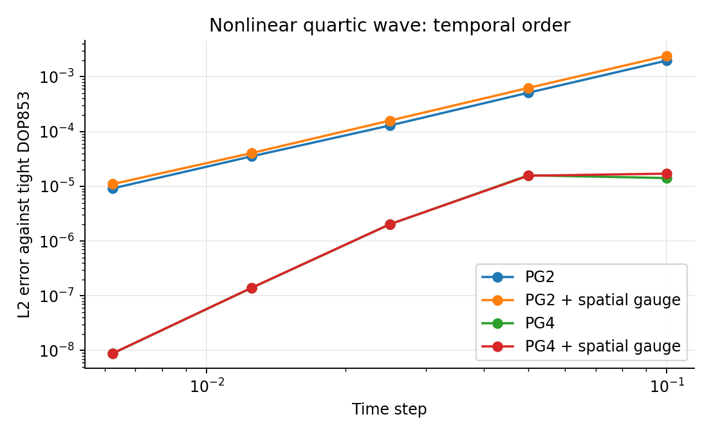
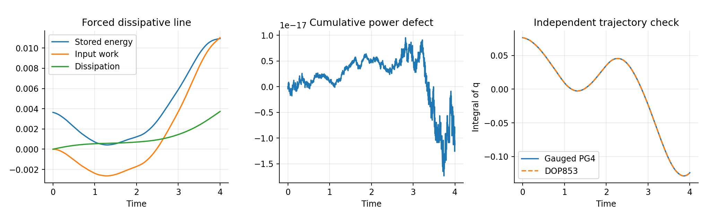

# Active temporal gauges for nonlinear and dissipative port-Hamiltonian systems

Research extension to *Space-Time Stokes-Dirac Discretization*, version 12.  
10 October 2026. Theory, implementation and numerical evidence are collected in this single document.

## 1. Purpose and precise scope

The version-12 manuscript classifies Stokes-compatible pairings and constructs quadratic conservative cap maps by eliminating active temporal stages. Its energy identity also accommodates dissipation, but the high-order conservative cap correction cannot simply be inserted into a dissipative one-effort step without losing order.

This extension retains the active stages. It adds an alternating correction to their projected efforts, proves the resulting port power law, and identifies the common-stage subclass that reduces **exactly** to the mixed cap family of version 12 in its quadratic conservative setting. Thus the new formulation extends that family while retaining the stage information needed for nonlinear energy and physical dissipation.

The zero-gauge time integrator is an established projected-gradient/energy-preserving collocation method [2–4]. Skew modifications of discrete-gradient operators are also established [5–7]. No priority claim is made for high-order energy-consistent integration itself. The contributions investigated here are the stage-gauge classification, its exact connection to the repository's cap family, and the obstruction caused by compressing dissipative effort variation into one effort.

Families of high-order energy-preserving continuous-stage Runge–Kutta methods [9] and discontinuous Galerkin methods with interior effort variables [10] are further relevant antecedents. A different gauge parametrization alone does not prove that the resulting integrator is different after elimination. The exact cap bridge below is a result within this repository's framework, not a claim that retaining interior efforts was previously unknown.

All convergence statements concern a fixed finite-dimensional spatial discretization and the regular local solution branch. The experiments use the repository's 2012 polynomial transmission-line reduction, including its physical boundary ports and skew feedthrough. They do not establish uniform convergence as space and time are refined simultaneously, shock resolution, descriptor consistency, general positivity, or universal symplecticity.

## 2. Active time cell and constitutive effort

Consider the finite-dimensional PH realization

$$
\dot x=(J(x)-R(x))\nabla H(x)+B(x)u(t),
\qquad y=B(x)^\top\nabla H(x)+N(x)u(t),
$$

where $J^\top=-J$, $R^\top=R\succeq0$ and $N^\top=-N$. The matrices may depend smoothly on the state. A resistive feedthrough can be treated separately by adding its symmetric part to the boundary dissipation.

On a time interval of length $h>0$, let $c_i,b_i$ be the $s$ Gauss nodes and positive weights on $[0,1]$, with $\sum_i b_i=1$. Let $\ell_i$ be their cardinal polynomials and set

$$
a_i(\tau)=\int_0^\tau\ell_i(\sigma)\,d\sigma,
\qquad
X(\tau)=x_0+h\sum_{i=1}^s a_i(\tau)F_i.
$$

Here $F_i$ are physical time derivatives, not increments. Define the projected gradient

$$
G_i=\frac1{b_i}\int_0^1\ell_i(\tau)\nabla H(X(\tau))\,d\tau.
$$

Write $F,G,E$ for the stage-stacked vectors and $W=\operatorname{diag}(b_1,\ldots,b_s)\otimes I_n$. The exact chain rule is

$$
H(X(1))-H(x_0)=hF^\top WG.
$$

The independent temporal quadrature must integrate this constitutive projection accurately. For a polynomial Hamiltonian of degree $\nu$, the integrand defining $G_i$ has degree at most $\nu s-1$; $q$-point Gauss quadrature is exact if $2q\geq\nu s$. This requirement is distinct from the number $s$ of active stages. In particular, $s=2,q=4$ handles quartic energy exactly in exact arithmetic. Finite quadrature generally leaves a nonzero chain defect for nonpolynomial energy.

### Proposition 1 — Complete linear stage-gauge family

For a correction linear in $F$ and required to preserve the chain pairing for **every** stage vector, the admissible efforts are exactly

$$
E=G-W^{-1}K_hF,\qquad K_h^\top=-K_h.
$$

For fixed cell data the family has dimension $sn(sn-1)/2$.

**Proof.** Write $E-G=CF$. The required identity is $F^\top WCF=0$ for all $F$. Polarization gives $WC+C^\top W=0$. Thus $K_h=-WC$ is alternating, and the converse follows immediately. This classifies linear corrections on the full stage space; it does not assert that every nonlinear correction has one fixed matrix representation. At a nonzero particular $F$, nonlinear corrections instead belong to the annihilator of $F$ under the weighted pairing. ∎

A state-dependent matrix $K_h(F,X)$ still gives exact power pointwise if it is alternating at every evaluation. Its regularity, step-size scaling and reversal properties must be checked separately.

## 3. Closure, ports and exact energy balance

The stage equations are

$$
F_i=(J(X_i)-R(X_i))E_i+B(X_i)U_i,
\qquad
Y_i=B(X_i)^\top E_i+N(X_i)U_i,
$$

where $X_i=X(c_i)$ and $U_i=u(t_0+c_i h)$. The updated state is $x_1=x_0+h\sum_i b_iF_i$.

### Theorem 2 — Gauged PH power law

With exact constitutive integration and an exact stage solve, every alternating stage gauge satisfies

$$
H(x_1)-H(x_0)
=h\sum_i b_iU_i^\top Y_i-h\sum_i b_iE_i^\top R(X_i)E_i.
$$

**Proof.** Alternation gives $F^\top WG=F^\top WE+F^\top K_hF=F^\top WE$. Substitute the stage equations; the terms with $J$ and $N$ vanish. ∎

Consequently closed conservative systems preserve $H$, and unforced dissipative systems have nonincreasing $H$. This is an identity for the computed stage efforts. Substituting $\nabla H(X_i)$ for $E_i$ in the output generally destroys it.

### Computable certificate

Let $r_i=F_i-[(J_i-R_i)E_i+B_iU_i]$ and

$$
\delta_{\rm chain}=H(x_1)-H(x_0)-hF^\top WG.
$$

For symmetric $R$ and skew feedthrough, direct algebra gives

$$
\Delta H-\mathcal W+\mathcal D
=\delta_{\rm chain}+hF^\top K_hF
+h\sum_i b_iE_i^\top J_iE_i
+h\sum_i b_iE_i^\top r_i,
$$

with $\mathcal W=h\sum_i b_iU_i^\top Y_i$ and $\mathcal D=h\sum_i b_iE_i^\top R_iE_i$. The implementation records these contributions separately, including their floating-point closure. It rejects a supplied nonalternating gauge rather than silently replacing it by its skew part. Newton failure raises an exception.

## 4. Exact recovery of the version-12 mixed cap family

The common-stage gauge is

$$
K_h=h^{2s}(bb^\top\otimes\Theta),
\qquad \Theta^\top=-\Theta,
\qquad b=(b_1,\ldots,b_s)^\top.
$$

It produces the same correction at each stage:

$$
E_i=G_i-h^{2s}\Theta v,
\qquad v=\sum_jb_jF_j=\frac{x_1-x_0}{h}.
$$

### Theorem 3 — Active-stage extension of the mixed Gauss cap map

Suppose $H(x)=x^\top Qx/2$, $J,Q$ are constant and nonsingular, and $R=0$, $u=0$. Wherever the cap chart is regular, eliminating the active stages gives exactly the version-12 cap gauge

$$
S_{s,h}=S^{\rm G}_{s,h}+h^{2s-1}\Theta.
$$

The equality holds for arbitrary alternating $\Theta$, including coefficients that do not commute with the conservative generator.

**Proof.** Gaussian exactness gives $G_i=QX_i$: the projection integrand has degree at most $2s-1$. Put $A=JQ$ and let $R_s(z)$ be the diagonal Padé stability function of Gauss–$s$. Define

$$
\varphi_s(z)=\frac{R_s(z)-1}{z},
\qquad \varphi_s(0)=1.
$$

For the constant stage source $-h^{2s}J\Theta v$, elimination of the Gauss stage equations gives

$$
\Delta x=(R_s(hA)-I)x_0-h^{2s}\varphi_s(hA)J\Theta\Delta x.
$$

Let $B_-^{\rm G}=I+hJS^{\rm G}_{s,h}-hA/2$ and $B_+^{\rm G}=B_-^{\rm G}+hA$. The original cap identity implies

$$
B_-^{\rm G}(R_s(hA)-I)=hA,
\qquad B_-^{\rm G}\varphi_s(hA)=I.
$$

Multiplication therefore yields

$$
(B_-^{\rm G}+h^{2s}J\Theta)\Delta x=hAx_0,
$$

and hence the cap propagator

$$
M_h=(B_-^{\rm G}+h^{2s}J\Theta)^{-1}
     (B_+^{\rm G}+h^{2s}J\Theta),
$$

which is precisely the version-12 mixed deformation. No commutation of $\Theta$ with $A$ was used. ∎

The theorem supplies the exact bridge to the original family. For general nonlinear energy or nonzero dissipation, the active-stage equations remain the definition of the extension. Replacing all stage efforts by a single effective effort would lose information, as the next section proves.

## 5. The dissipative obstruction to one-effort compression

### Theorem 4 — Temporal effort variance obstructs order above two

Consider a closed smooth PH system $\dot x=L\nabla H(x)$, with constant invertible $L=J-R$, $J^\top=-J$ and $R^\top=R\succeq0$. A method constrained to satisfy simultaneously

$$
\Delta x=hLE,\qquad
H(x_1)-H(x_0)=-hE^\top RE
$$

with one effort $E$ cannot have order at least three at a state for which

$$
\dot e(0)^\top R\dot e(0)>0,\qquad e(t)=\nabla H(x(t)).
$$

The statement assumes the usual smooth local error expansion and does not cover methods that change the physical resistance, introduce additional dissipative channels, or use more than one effort.

**Proof.** On the exact endpoints, the first equation forces

$$
E=\bar e=\frac1h\int_0^h e(t)\,dt.
$$

But the exact energy loss is

$$
H(x(h))-H(x(0))
=-h\bar e^\top R\bar e
-\int_0^h(e(t)-\bar e)^\top R(e(t)-\bar e)\,dt.
$$

For $e\in C^2$, the last integral equals

$$
\frac{h^3}{12}\dot e(0)^\top R\dot e(0)+O(h^4).
$$

An order-$p$ method with $p\geq3$ changes the exact endpoint by $O(h^{p+1})$ and its forced effort by $O(h^p)$. Both corresponding changes to the energy balance are $O(h^{p+1})=O(h^4)$, which cannot cancel the nonzero cubic variance term. ∎

This is a restriction on an unmodified physical one-effort closure, not an impossibility theorem for high-order dissipative discrete-gradient methods. Such methods exist, including approaches that modify and complete the dissipative operator [7].

### Quadratic coefficient check

For $H=\|x\|^2/2$, $L=J-R$, and a cap effort $E=\bar x-S_h\Delta x$ with $S_h=hS_1+O(h^3)$, expansion gives

$$
M_h-e^{hL}
=h^3\left(\frac{L^3}{12}-LS_1L\right)+O(h^4).
$$

If $L$ is invertible, cancellation requires $S_1=L/12$, whose symmetric part is $-R/12$. It cannot be alternating when $R\ne0$. This reproduces the obstruction without a trajectory argument.

### Proposition 5 — Minimal information in stage dissipation

For constant $R$, the stage mean $\bar E=\sum_i b_iE_i$ satisfies

$$
\sum_i b_i E_i^\top RE_i
=\bar E^\top R\bar E
+\sum_i b_i(E_i-\bar E)^\top R(E_i-\bar E).
$$

The discarded variance has matrix

$$
V=(\operatorname{diag}(b)-bb^\top)\otimes R,
\qquad \operatorname{rank}V=(s-1)\operatorname{rank}R.
$$

**Proof.** Expand the right-hand side and use $\sum_i b_i=1$. The temporal matrix is congruent to $I-\sqrt b\,\sqrt b^\top$, a rank-$(s-1)$ orthogonal projector. The rank formula follows from the Kronecker product. ∎

Any exact representation of this variance by a sum of squares of linear scalar channels needs at least $\operatorname{rank}V$ channels, since a factorization $V=C^\top C$ has $\operatorname{rank}C\leq$ number of rows. An alternating gauge cannot restore this missing symmetric quadratic form.

## 6. Elimination preserves passivity, including the ports

Normalize the weighted variables by $\widehat F=W^{1/2}F$, $\widehat E=W^{1/2}E$, $\widehat G=W^{1/2}G$ and $\widehat K=W^{-1/2}K_hW^{-1/2}$. Port variables use the corresponding weights with the port dimension. Let the block-diagonal stage matrices be denoted by $\mathcal J,\mathcal R,\mathcal B,\mathcal N$.

Define the full flow and effort vectors and their structure matrices by

$$
f=\begin{bmatrix}\widehat F\\-\widehat Y\end{bmatrix},
\quad
g=\begin{bmatrix}\widehat G\\\widehat U\end{bmatrix},
\quad
Z=\begin{bmatrix}\mathcal J-\mathcal R&\mathcal B\\-\mathcal B^\top&-\mathcal N\end{bmatrix},
\quad
D=\begin{bmatrix}\widehat K&0\\0&0\end{bmatrix}.
$$

The gauged closure is $f=Z(g-Df)$. Whenever $T=I+ZD$ is invertible,

$$
f=Z_{\rm eff}g,\qquad Z_{\rm eff}=T^{-1}Z.
$$

### Proposition 6 — Dissipative congruence

$$
\operatorname{sym}Z_{\rm eff}
=T^{-1}\operatorname{sym}Z\,T^{-\top}
=-T^{-1}
\begin{bmatrix}\mathcal R&0\\0&0\end{bmatrix}
T^{-\top}\preceq0.
$$

**Proof.** Multiply $Z_{\rm eff}+Z_{\rm eff}^\top$ by $T$ and $T^\top$. The additional terms cancel because $D^\top=-D$. ∎

For $\mathcal R=0$ the eliminated structure is skew. Its graph is isotropic for the split power pairing and has half the ambient dimension, so it is maximally isotropic. Thus the conservative algebraic reduction gives an open Dirac structure; the nonlinear Hamiltonian enters through a separate constitutive closure.

The elimination generally changes input, output and feedthrough blocks together. Keeping only a modified state matrix and retaining the old output is not the same PH system.

For fixed matrices, strictly positive $\mathcal R$ ensures invertibility of the state block for every alternating $\widehat K$. Indeed, a nonzero null vector would give $\widehat E=-\widehat K\widehat F$, $\widehat F=(\mathcal J-\mathcal R)\widehat E$, hence $0=\widehat E^\top\widehat F=-\widehat E^\top\mathcal R\widehat E$. Semidefinite resistance does not give this guarantee: with no resistance and $\mathcal J=\widehat K$ equal to the canonical $2\times2$ skew matrix, $I+\mathcal J\widehat K=0$. This algebraic fact is not a global existence or uniqueness theorem for the nonlinear stage solve.

## 7. Order, reversal and coordinate covariance

### Proposition 7 — Order inherited by a sufficiently small stage gauge

Assume the zero-gauge scheme has local error $O(h^{p+1})$. Assume the stage residual, coefficients and gauge are sufficiently smooth jointly in $(h,x_0,F)$ near $h=0$, with uniform derivative bounds on the neighborhood considered, and the zero-gauge stage Jacobian has a uniformly bounded inverse near the consistent branch. If $K_h=O(h^p)$ uniformly there, the gauged scheme has local error $O(h^{p+1})$ and global order at least $p$ on a fixed smooth finite-time problem.

**Proof.** Substituting the zero-gauge stages into the gauged equations leaves residual $O(h^p)$. The local implicit-function estimate gives a stage change $O(h^p)$. The endpoint multiplies this change by $h$. Standard local Lipschitz stability and discrete Gronwall then give the global estimate. For a smooth vanishing gauge, local solvability follows directly at $h=0$: the residual Jacobian with respect to the derivative stages is the identity. ∎

For the known Gauss projected-gradient base of order $2s$ under its smoothness and quadrature assumptions, the sufficient choice is $K_h=O(h^{2s})$. The common-stage gauge uses exactly this scaling. This proposition inherits an order; it does not prove automatic order elevation for dissipative or nonlinear systems from the conservative coefficients of version 12.

Antisymmetry alone is insufficient. For example, Gauss–2 with $H=\|x\|^2/2$, $J^2=-I$, and $K_h=h^2(\operatorname{diag}(b)\otimes J)$ yields the map $R_2(hJ/(1-h^2))$. It preserves energy and is reversible, but is only second order.

### Reversal

Let $P$ reverse the order of Gauss stages and leave state coordinates unchanged. For an autonomous model, a state-independent gauge gives a self-adjoint method if

$$
K_{-h}=PK_hP^\top.
$$

The stage derivatives are physical derivatives; they are permuted, not negated, when the interval is traversed with negative $h$. The common-stage gauge satisfies the condition because $Pb=b$ and $h^{2s}$ is even. For state-dependent gauges, the equality must hold with the full reversed path and exchanged endpoints. Dissipation does not prevent algebraic self-adjointness; the backward step is not a forward dissipative evolution.

For even powers of $h$, admissible alternating matrices preserve the two eigenspaces of $P$. Their dimension is $n_+(n_+-1)/2+n_-(n_--1)/2$, where $n_+=n\lceil s/2\rceil$ and $n_-=n\lfloor s/2\rfloor$. Odd powers exchange those eigenspaces and have dimension $n_+n_-$.

### Linear coordinates

For $z=Tx$, $T$ nonsingular, use

$$
\widetilde H(z)=H(T^{-1}z),\quad
\widetilde J=TJT^\top,\quad
\widetilde R=TRT^\top,\quad
\widetilde B=TB.
$$

The gauge must transform as a covariant two-form:

$$
\widetilde K_h=(I_s\otimes T^{-\top})K_h(I_s\otimes T^{-1}).
$$

Substitution shows that every exact stage solution transforms accordingly. The method therefore commutes with the nodal/modal changes of spatial coordinates used by the 2012 discretization. Recomputing a Euclidean normalization after a nonorthogonal coordinate change would instead define a different gauge.

## 8. The spatial reduction and a geometrically specified test gauge

The experiments import the unchanged version-12 rectangular transmission-line construction. Efforts lie in $\mathcal P_N$, flow/state coefficients in $\mathcal P_{N-1}$, and the reconstruction fixes the same two physical boundary inputs. The rectangular identity implies the reduced skew $J_N$, dual input/output matrices and skew feedthrough $N_N$. No antisymmetrization is applied to repair these raw spatial blocks.

In the orthonormal Legendre state coordinates, write $D_{\rm a}=DM$, the derivative restricted to the active polynomial coefficients. The test gauge is a normalized version of

$$
\Theta_0=\begin{bmatrix}0&D_{\rm a}\\-D_{\rm a}^\top&0\end{bmatrix}.
$$

Thus the correction depends on a specified spatial derivative and on temporal stage flows. It is nonzero and is not fitted to a target cap propagator or to the convergence reference. The normalization and amplitude are recorded in the executable experiment.

This is a concrete geometric choice within the admissible family. It is not a proof that the original PDE uniquely selects this gauge, nor that an independent physical bubble dynamics selects it. The version-12 distinction between compatible design, algebraic realization and independent field selection remains in force.

## 9. Interconnection

On a common time grid, impose opposing stage port interconnections. The two terms $h\sum_i b_iU_i^\top Y_i$ then cancel exactly when adding the cell balances, regardless of their internal alternating gauges.

For different grids, let $W_A,W_B$ be the time-weight matrices including local step lengths, and let $C$ contain the common-refinement integrals of the two temporal port bases. The adjoint transfers

$$
U_A=-W_A^{-1}CY_B,\qquad
U_B=W_B^{-1}C^\top Y_A
$$

give $U_A^\top W_AY_A+U_B^\top W_BY_B=0$. The stage-gauge power law is therefore compatible with this interface construction. This is an algebraic extension; the current validation campaign does not claim a new multirate convergence theorem or a computational speedup.

## 10. Numerical evidence and reproduction

The numerical tables below are generated from the committed result files. The complete protocol, failures raised by the nonlinear solver, reference tolerances and model parameters are retained with the code.

Run from the repository root, using the dependencies in `requirements.txt`:

```bash
make verify-extension
```

The three programs respectively check the implementation, the independent algebraic identities and counterexamples, and the nonlinear transmission-line dynamics. `make verify` additionally runs the unchanged 28 version-12 assertion groups. The reported extension run used Python 3.9.13, NumPy 1.26.4, SciPy 1.13.1 and float64 arithmetic; environment details are included in the result files.

### Nonlinear transmission line

The Hamiltonian is the spatial integral of $(q^2+p^2)/2+\alpha q^4/4$ on the unit interval, with $\alpha=2$. The constitutive spatial Gauss rule has at least $2N+2$ points, sufficient for exact integration of this polynomial energy. All trajectory errors below are against an independently integrated, fixed-$N$ DOP853 solution (`rtol=2.5e-13`, `atol=2.5e-15`). A second reference with looser tolerances checks reference sensitivity. These are temporal, not spatial-refinement, measurements.

For the closed nonlinear case, $N=6$, $T=1$, the initial field is the projection of $q(z)=0.35\sin(\pi z/2)$ with $p=0$. The last refinement is $h=0.0125$ to $0.00625$.

| Scheme | Active stages / constitutive quadrature | Last observed order | Final spatial $L^2$ error |
|---|---:|---:|---:|
| Projected-gradient base | 1 / 2 | 1.9395 | $9.1594\times10^{-6}$ |
| Same base with spatial gauge | 1 / 2 | 1.8759 | $1.0986\times10^{-5}$ |
| Projected-gradient base | 2 / 4 | 3.9684 | $8.8556\times10^{-9}$ |
| Same base with spatial gauge | 2 / 4 | 3.9685 | $8.8944\times10^{-9}$ |

The gauge has unit Frobenius norm in the specified orthonormal spatial chart and the prescribed $h^{2s}$ scaling. It is not tuned to lower the trajectory error; indeed, these results do not show an accuracy improvement over the base scheme. Both gauged and ungauged runs retain the energy to floating-point accuracy with sufficiently accurate constitutive quadrature.



For the open dissipative case, $N=8$, $R=0.12I$, $T=4$, the initial amplitude is $0.12$, and the physical boundary inputs are $(0.06\sin(1.7t),0.04\sin(2.3t))$. The tested steps are $0.04,0.02,0.01,0.005,0.0025$.

| Scheme | Last observed order | Final spatial $L^2$ error at $h=0.0025$ |
|---|---:|---:|
| Two-stage projected-gradient base | 3.98584 | $1.57420\times10^{-7}$ |
| Same base with spatial gauge | 3.98584 | $1.57437\times10^{-7}$ |

The two reference solutions differ by $7.97\times10^{-12}$ at the endpoint. Over all forced runs, the maximum cumulative power defect is $1.29\times10^{-16}$, the maximum one-step balance defect is $2.85\times10^{-17}$, and reconstruction of the physical boundary outputs differs by at most $2.23\times10^{-16}$. The integrated density equations have maximum residual $6.66\times10^{-14}$. The unforced dissipative run has no positive energy increment and loses $0.0179689$ units of energy, equal to the accumulated discrete dissipation to roundoff.

The coarse forced steps initially show rates below two; refinement resolves the expected fourth-order regime. Their small power defects alone would not have revealed this trajectory error.



### Independent geometry checks and expected counterexamples

All 14 engine self-checks pass. Direct comparison with the unchanged version-12 cap implementation at one, two and three active stages gives map errors below $4.03\times10^{-16}$ for a noncommuting gauge. Nonlinear reversal has error $1.08\times10^{-15}$; covariance under a nonorthogonal coordinate change, including state-dependent structure and physical outputs, has errors below $5.4\times10^{-16}$.

All 18 checks in `verify_stage_geometry.py` pass. The full state/port elimination satisfies the dissipative congruence to $4.68\times10^{-15}$; keeping the old output after elimination instead produces a power error of $1.73$ in the same test. The variance form has the predicted rank four for three stages and rank-two resistance.

For the damped oscillator with $J^2=-I$, $Q=I$ and $R=0.2I$, the conservative fourth-order cap correction drops to observed order $1.99999$ under single-effort physical dissipation. The active two-stage scheme with a nonzero common gauge gives $3.99995$. Both still have one-step power defects below $2\times10^{-16}$: energy balance does not distinguish their orders.

Two further negative controls prevent overinterpreting preservation:

- Using one instead of two constitutive quadrature points on a quartic one-stage trajectory produces a maximum relative energy drift $2.98\times10^{-3}$; sufficient quadrature reduces it to $2.64\times10^{-15}$.
- An unresolved linear spatial mode with $\omega h=2.301$ has a final phase lag $1.274$ radians despite relative energy drift below $3\times10^{-15}$.

The deliberately underscaled alternating gauge from Section 7 has observed order $2.00068$, while the $h^4$ gauge gives $4.00000$. The noncommuting spatial gauges preserve the quadratic energy but have nonzero symplectic defects, consistent with the distinction already made in version 12.

### Machine-readable evidence

- [Engine self-checks](../experiments/results/ph_gauges_selfcheck.json).
- [Independent geometry and compression checks](../experiments/results/stage_geometry_validation.json).
- [Complete nonlinear/open-system results](../experiments/results/ph_extension_validation.json) and [tabular export](../experiments/results/ph_extension_validation.csv).

All numerical claims here concern the specified examples. Exact power identities and the stated algebraic results follow from their proofs; numerical agreement is an implementation check, not their proof.

## 11. What remains open

The results establish an active-stage extension with exact discrete power and a proved bridge to the conservative quadratic cap family. They leave several substantive questions:

- A useful gauge-selection principle independent of a prescribed target propagator, with demonstrated benefits beyond an individual test.
- Nonlinear order elevation by nonzero gauges, rather than only retention of the base order.
- Uniform approximation and stability estimates in both spatial degree and time step.
- General descriptor systems, state-dependent mass operators, shocks and positivity constraints.
- An additional tangent analysis for local multisymplectic conservation; scalar energy balance is not such a law.
- Efficient sparse or matrix-free implementations of the implicit stage equations.

Energy accuracy and trajectory accuracy are reported separately. Neither a zero power residual nor a passed algebraic test establishes phase accuracy, PDE convergence or bibliographic novelty.

## References

1. R. Moulla, L. Lefèvre and B. Maschke, *Pseudo-spectral methods for the spatial symplectic reduction of open systems of conservation laws*, Journal of Computational Physics 231 (2012), 1272–1292. [DOI](https://doi.org/10.1016/j.jcp.2011.10.008).
2. D. Cohen and E. Hairer, *Linear energy-preserving integrators for Poisson systems*, BIT 51 (2011), 91–101. [Author manuscript](https://www.unige.ch/~hairer/preprints/ch-poisson.pdf).
3. E. Celledoni and E. H. Høiseth, *Energy-Preserving and Passivity-Consistent Numerical Discretization of Port-Hamiltonian Systems* (2017). [arXiv:1706.08621](https://arxiv.org/abs/1706.08621).
4. J. Giesselmann, A. Karsai and T. Tscherpel, *Energy-consistent Petrov–Galerkin time discretization of port-Hamiltonian systems*, SMAI Journal of Computational Mathematics (2025). [DOI](https://doi.org/10.5802/smai-jcm.127).
5. J. L. Cieśliński, *Locally exact modifications of discrete gradient schemes* (2013). [arXiv:1304.6533](https://arxiv.org/abs/1304.6533).
6. S. Eidnes, *Order theory for discrete gradient methods*, BIT 62 (2022), 1207–1255. [DOI](https://doi.org/10.1007/s10543-022-00909-z).
7. L. Lautwein, N. Marheineke, H. N. Myhr and K. Schäfers, *Fourth-Order Energy-Consistent Average Vector Field Discrete Gradient Methods for Dissipative Hamiltonian Systems* (2026). [arXiv:2609.24692](https://arxiv.org/abs/2609.24692).
8. R. Moulla, *Space-Time Stokes-Dirac Discretization: Affine Pairing Gauges, Constitutive Cayley Coordinates, and Active Interior Reduction*, version 12 (2026). [Repository manuscript](moulla_2026_space_time_stokes_dirac.tex).
9. Y. Miyatake and J. C. Butcher, *A characterization of energy-preserving methods and the construction of parallel integrators for Hamiltonian systems*, SIAM Journal on Numerical Analysis 54 (2016), 1993–2013. [DOI](https://doi.org/10.1137/15M1020861), [author manuscript](https://arxiv.org/abs/1505.02537).
10. T. Kemmochi, *Higher order discrete gradient method by the discontinuous Galerkin time-stepping method* (2023). [arXiv:2308.02334](https://arxiv.org/abs/2308.02334).

For comparison with [5], the exact-flow cap gauge of version 12 rewrites the closed quadratic step as $\Delta x/h=J_hQ\bar x$, where $J_h=(J^{-1}+hS_h)^{-1}=\operatorname{tanhc}(hJQ/2)J$. In canonical coordinates this is the specialization of [5, equation (5.1)]. The present result concerns the placement of such gauges in the active-stage and space-time construction; it does not claim a new exact linear propagator.
